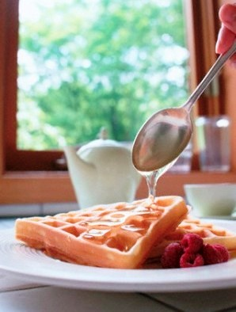

+++
title = "أخذت ملعقة العسل اليوم؟!"
date = 2009-03-23
authors = ["ناصر القحطاني"]

[taxonomies]
authors = ["nasr-elkhtani"]
sections = ["health"]

[extra]
section_name = "صحة"
share_image = "/media/currentarticleassets/01140000230.jpg"
summary = "ملعقة عسل يومياً يمكنها أن تصنع المعجزات، كما يقول الأطباء.."
section_slug = "health"
section_colour = "#2A9D8F"
thumb = "/media/currentarticleassets/01140000230.jpg"
n_comments = 0
original_url = "http://20at.com/20at/health/11678.html"
archived = "20100105210319"
date_source = "byline/meta"
aliases_20at = ["/20at/health/11678.html"]

[extra.provenance]
original_url = "http://20at.com/20at/health/11678.html"
capture_url = "https://web.archive.org/web/20100105210319/http://20at.com/20at/health/11678.html"
capture_label = "٥ يناير ٢٠١٠، ٢١:٠٣ UTC"
date_note = "من سطر التوقيع في المقال"
other_urls = []
comments = ""
missing_images = ""
+++

<figure></figure>

ملعقة عسل يومياً يمكنها أن تصنع المعجزات، كما يقول الأطباء..

فهذه الكمية اليومية لن تقيك شر الأمراض المستعصية فقط، ولكن ملعقة عسل يمكنها أن تجعلك شباب "على طول".

وللعسل أهمية خاصة في المملكة العربية السعودية، إذ يشار إلى أن عدد النحالين والمهتمين بصناعة العسل هناك يصل الى قرابة خمسة آلاف نحال يملكون ما يقارب من المليون خلية، حسبما أكد الدكتور أحمد خازم الغامدي رئيس المؤتمر الدولي السادس للنحالين العرب الذي انطلق في مدينة (أبها) جنوب السعودية الثلاثاء الماضي بمشاركة قرابة 500 مشارك من 15 دولة عربية.

<h3>العسل.. عشق سعودي</h3>

وتشير الإحصاءات المبدئية إلى أن النحالين في المملكة ينتجون حوالي 9 آلاف طن عسل سنوياً، ورغم هذا، لاتزال السعودية تستورد ما يقرب من 10 آلاف طن، وما يقارب من مائة ألف طرد نحل سنوياً، بالإضافة إلى استيراد معظم أدوات ومواد ومستلزمات تربية النحل الحديثة.

وعلى الرغم من معرفتنا جميعاً بأنواع وفوائد عسل النحل، إلا أن د.حسن العسيري، أحد خبراء صناعة العسل بجنوب السعودية يذكرنا بأشهر أنواع العسل التي يتم تداولها بكثرة في المملكة، ومنها الجبلي الذي يستخدم في علاج أمراض الكبد والجهاز الهضمي وفقر الدم والضعف العام والبول السكري، والجراحة والحروق وهو مضاد للالتهابات الفيروسية، ويفيد أيضاً في علاج الإدمان، وهو بمثابة مقوي للحوامل والرضع.

ومن أنواعه أيضاً، عسل الزهور البرية ويستخدم في إنقاص الوزن، ويعوض الجسم لما يفقده من بروتينات وأملاح، كما يفيد في علاج جفاف الحلق والكحة وتحسين القدرة على الإبصار وعلاج الصداع النصفي ويمنع الإصابة بأمراض الأكزيما والقلب والكبد والحويصلة المرارية، وهناك أيضاً عسل الزيتون وحبة البركة وعسل الزعتر والسدر والقرنفل وعسل السمسم والقرنفل والكردية والليمون وغيرها.

<h3>حتى السم مفيد!</h3>

ويشير الباحثان اليمنيان د.محمد خنبش ود.هند عبدالرحمن لـ(عشرينات) إلى أن العسل اليمني يستخدم في علاج خراجات الثدي والأرداف، وفي علاج بعض الأمراض الجلدية والروماتزمية، أما عسل السلم أو الشوكة، فيستخدم في علاج أمراض الكبد واليرقان والضعف العام، علماً بأنه الغذاء المفضل والمأمون لمرضى السكر.

ويشرح د.جابر سالم القحطاني، أستاذ العقاقير بجامعة الملك سعود، أن سم النحل سجل نجاحاً كبيراً في علاج مرض التصلب العصبي المتعدد، حيث يتم إعطاء السم عن طريق الحقن، ويعمل السم كمضاد للالتهاب ومنشط لجهاز المناعة، ويمكن أن يخفف من الشعور بالتعب وتقلصات العضلات والضعف التي تحدث مع المرض.

وبالطبع يتمتع العسل بشعبية جارفة وسط الشباب والفتيات في السعودية، علياء الشمري مثلاً – 23 عاماً- دائما ما تمزج العسل مع خليط من عصير الجزر، وتقوم بدهن بشرتها بهذه المادة باستخدام قطعة من القطن أسبوعيا، ولاحظت أنه يقضى على (حب الشباب) الذي عادة ما يظهر في فترة المراهقة.

<h3>ومنشط جنسي أيضاً!</h3>

أما نوفة علي، الطالبة في المرحلة الجامعية في جدة، فقد برعت في صنع أقنعة لتجميل البشرة، وتشرح طريقة عملها بقولها: "أقوم بوضع العسل مع دقيق القمح والبيض، ثم يتم نشر الخليط على الوجه داخل قناع من الشاش المعقم والمفصل لحجم الوجه وبه فتحات للفم والعينين وتترك لمدة عشرين دقيقة، وبعد ذلك يتم وضع كمادات من الماء الدافئ على الوجه لعدة مرات باستخدام قطع من القطن النظيف حتى يصبح الوجه ذا بشرة نضرة وأصبح وجهي كذلك بسبب العسل".

أما أحمد عبد الهادي - 27 عاماً- الذي تزوج قبل نحو عامين، فقال لنا أنه درج على شراء ما يسمى بـ(معجون العسل الغذائي)؛ لانه مفيد صحياً وطبياً، كما أنه يعمل كمنشط جنسي قوي، لذلك فهو يستخدمه باستمرار!

"دائما أتناول جرعتين من العسل قبل التدريبات يومياً"، هكذا أكد الكابتن سيف فالح الشهراني، من نادي (ضمك) بخميس مشيط جنوب السعودية، وهو متخصص في ألعاب القوى، ويضيف أن العسل مفيد جداً للرياضيين قبيل ممارسة أي نشاط رياضي.

وأنت.. هل أخذت ملعقة عسل اليوم؟!

