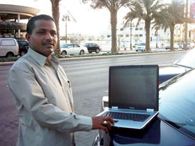

+++
title = "مرحبا بكم في الشارع (الذكي)"
date = 2007-02-13
authors = ["عبد الله الغامدي"]
aliases = ["/articles/harb-n4884/"]

[taxonomies]
authors = ["abdallah-elghamdi"]
sections = ["harb"]

[extra]
section_name = "الحرب الآن"
share_image = "/media/templates/ja_teline_ii/images/printbutton.png"
summary = "\"مرحبا بكم في الشارع الذكي\"..ستواجهك هذه العبارة على أكثر من لافتة عند وصولك لشارع الأمير محمد بن عبدالعزيز بالرياض، والمعروف أيضا باسم (شارع التحلية)، ولكن هذا"
section_slug = "harb"
section_colour = "#7A1E1E"
thumb = "/media/templates/ja_teline_ii/images/printbutton.png"
n_comments = 0
original_url = "http://20at.com/20at/health/3240.html?tmpl=component&print=1&layout=default&page="
archived = "20100105212951"
date_source = "byline/meta"
aliases_20at = ["//harb.20at.com/newarticle.php?sid=4884", "/20at/health/3240.html?layout=default&page=&print=1&tmpl=component"]

[extra.provenance]
original_url = "http://20at.com/20at/health/3240.html?tmpl=component&print=1&layout=default&page="
capture_url = "https://web.archive.org/web/20100105212951/http://20at.com/20at/health/3240.html?tmpl=component&print=1&layout=default&page="
capture_label = "٥ يناير ٢٠١٠، ٢١:٢٩ UTC"
date_note = "من سطر التوقيع في المقال"
other_urls = ["//harb.20at.com/newarticle.php?sid=4884"]
comments = ""
missing_images = ""
+++

<figure></figure>

<figure></figure>

"مرحبا بكم في الشارع الذكي"..ستواجهك هذه العبارة على أكثر من لافتة عند وصولك لشارع الأمير محمد بن عبدالعزيز بالرياض، والمعروف أيضا باسم (شارع التحلية)، ولكن هذا لايعني أن المقيمين به أذكياء، أو أنه يضم في جنباته مساكن العباقرة!

ولكن ذكاء هذا الشارع يعود إلى أنه اللبنة الأولى لتطبيق مشروع المدن الذكية الذي تشرع الممكلة في تطبيقه، وفي هذا الصدد قامت هيئة الاتصالات وتقنية المعلومات بالتنسيق مع الهيئة العليا لتطوير مدينة الرياض بتطبيق تجربة المدن الذكية في شارع التحلية.

<h3>المدن الذكية</h3>

"المدينة الذكية"، عامة المدينة الذكية لا تختلف كثيرا عن مدننا التقليدية، يعني بها أغبياء أيضا، فهي المدينة التقليدية بمبانيها وشوارعها ومحلاتها، إلا أن التقنيات الحديثة تشملها وخدمة الإنترنت تكون متوفرة أينما ذهبت.

فليس شرطاً عندما تحتاج الدخول على شبكة الإنترنت أن تذهب لمنزلك أو مقر عملك أو تبحث عن مقهى انترنت، بل عليك فقط أن تقف في أي مكان داخل محيط المدينة أو التغطية اللاسلكية وأن تبحر بعالم الإنترنت، أيضا أن تكون الإجراءات في كافة القطاعات الحكومية والأهلية عن طريق الانترنت.

فالمدينة الذكية تعتمد على تقنية الشبكة العنكبوتية لتنفيذ الوظائف الاعتيادية لقاطني المدن بطريقة إليكترونية، ويستخدم هذه الوظائف أشخاص عاديون في مدينة عادية.

<h3>الشارع الذكي</h3>

وعودة إلى شارع التحلية والذي أصبح متاح في محيطه الاتصال اللاسلكي بشبكة الإنترنت بالمجان على مدار الساعة عبر ميزة "واي فاي"، فإن ضاقت بك الأحوال ولم تجد مقهى إنترنت، فعليك فقط حمل جهاز "اللاب توب" الخاص بك على أكتافك، وتوجه لشارع التحلية، ودون أن تهبط من سيارتك يمكنك الاتصال بشبكة الإنترنت بالمجان على مدار الساعة.

ويحرص الكثير من سكان الرياض، على زيارة شارع التحلية، بعد أن أصبح "شارعا ذكيا"، ويشهد الشارع الشهير ازدحاما وخاصة في المساء، ويحرص الذين يمتلكون أجهزة كمبيوتر محمولة "لاب توب" على التواجد باستمرار في محيط الشارع للاتصال بالشبكة العنكبوتية وتصفح مواقع الإنترنت.

<h3>ما رأيهم؟</h3>

عشرينات استطلعت رأي عدد من رواد الشارع حول التجربة..

(محمد عبد الله) أعرب عن سعادته بالفكرة، مشيرا إلى أن وجود شوارع ذكية أو مدن ذكية بالمملكة أكبر دليل على الجهد الذي تبذله الهيئة العليا لتطوير مدينة الرياض وهيئة الاتصالات، وهذا الأمر يعكس مدى تطور المملكة العربية السعوديا تقنيا، واقترح محمد أن يتم تنفيذ هذه التجربة خلال مهرجان الجنادريه لكي يمتزج عبق الماضي وتقنيه الحاضر.

وفي السياق نفسه طالب (خالد العويس) بسرعة تعميم الفكرة على كافة شوارع الرياض في أسرع وقت، مبينا أن ذلك سيساهم في زيادة الوعي والثقافة، ويجبر الكثيرين على التعامل مع الكمبيوتر والإنترنت.

(محمد فلاتة) بين أن عمله في شارع التحلية، جعله الأكثر الاستفادة من الشارع الذكي، مبينا أنه قام بشراء لاب توب بعد بدء تنفيذ هذه التجربة، حيث يسرت له التقنية الكثير من الأمور وأصبح بإمكانه إنجاز الكثير من الأمور الإلكترونية، سواء البحث عن معلومات او التواصل الإلكتروني مع الآخرين دون جهد يذكر.

وعن مدى الاستفادة من الخدمة أشار (محمد المزروع) إن سرعة الشبكة داخل الشارع عالية، ولكن الاتصال ينقطع في مواقع أخرى من الشارع، وخاصة عندما يكون هناك ضغط كبير على الشبكة، ولكنه أشاد بالفكرة.

(محمد عبد الكريم) أحد العاملين في مقهى بشارع التحلية أوضح أن المقاهي التي كانت تقوم ببيع بطاقات الاتصال اللاسلكي هي التي ستضرر من إطلاق خدمة الاتصال اللاسلكي، مشيرا إلى أن الطلب على هذه البطاقات توقف تماما منذ بدء الخدمة.

واعتبر محمد أن الأمر عادي ولا يستحق هذه الضجة فهناك مدن في دول أفقر من السعودية ومغطاة بالواي فاي.

<h3>زيادة التسكع والمعاكسات</h3>

ولكن(مصطفى حسن) يرى أن هذه الميزة ستفتح المجال لتوافد المزيد من المراهقين والشباب بالشارع، وبالتالي ستنتشر المعاكسات ويزداد التسكع، وهو ما يجعل الكثير من العائلات تحرم من استغلال هذه الميزة.

بينما يرى (صديق محمد) أن تعميم تجربة المدن الذكية في مجتمع مازال يعاني من ارتفاع نسبة الأمية ستكون بلا جدوى، فنحن بحاجة أولا لإزالة أمية الكتابة والقراءة، ثم إزالة أمية الكمبيوتر، ومن ثم التوجه لتعميم مفهوم المدن الذكية حتى تكون هناك استفادة حقيقية منه.

ومن جهته يرى (سليمان الفرحان) أن تعميم هذه التجربة ستؤثر على التواصل الإنساني بين أبناء الأسرة والمجتمع، ستصبح جميع العلاقات إلكترونية، وهو ما يؤدي إلى تفكك في نسيج الأسرة والمجتمع بشكل عام، قد يترتب عليه زيادة الجرائم الأخلاقية.

<h3>مبادرة المدن الذكية</h3>

تمثل مبادرة المدن الذكية إحدى اللبنات التي يعول عليها للوصول بالمملكة إلى مجتمع عصري يعتمد على تقنية المعلومات والاتصالات الحديثة ويشارك في تكون اقتصاد رقمي متين.

وتطمح هذه المبادرة إلى إيجاد مدن عصرية (تبدأ بالعاصمة الرياض كمرحلة أولى) تتوفر فيها خدمات الاتصال ذات نطاق عريض broadband بحيث تتوفر تلك الخدمات لجميع الأفراد وفي مختلف الأماكن العامة بما فيها (الحدائق والمنتزهات، والمكاتب، والمستشفيات، وأماكن التجمعات عموما)، وإضافة إلى ذلك يتم تسخير كافة الخدمات الحكومية والخاصة بحيث تكون متوفرة بشكل آمن وميسر لهؤلاء المستخدمين عبر مواقع نسيجية وخدمات لا سلكية.

وفي حالة تتويج ذلك بتوفر محتويات وخدمات تجارية متنوعة فإن هذا سيتيح بيئة مناسبة ومناخ ملائم لتعامل سلس مع تطبيقات العمل والتعليم عن بعد دون تقيد بمكان محدد للعمل أو الدراسة.

إضافة إلى ذلك فإن هذه المدن الذكية تعمل بفاعلية أعلى وبتأثير أقل سلبية على البيئة العامة، وبحاجة أقل لوسائل النقل المختلفة، كما أنها تسهم في إيجاد فرص عمل أكبر للمرأة السعودية وتشرك قطاعات جديدة من المجتمع مثل ذوي الاحتياجات الخاصة وغيرهم.

من جانبها أعلنت (شركة الاتصالات السعودية)، أنها تعمل على تغطية المملكة بدءا من المدن الرئيسة بأحدث شبكة واي ماكس لخدمة العملاء في منازلهم وأماكن أعمالهم بسرعات عالية، كذلك ستقوم الشركة بتوفير هذه الخدمة في الأماكن العامة عبر نقاط الواي فاي، من خلال ربطها بهذه الشبكة الواي ماكس.. بما في ذلك شبكة الجيل الثالث المطور.

وأنت..كيف ترى هذه الخطوة الذكية ؟

