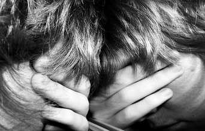

+++
title = "اكتئاب الـFour Seasons"
date = 2007-03-04
authors = ["محمد فاروق عجم", "رانيا الشاعر"]
aliases = ["/articles/harb-n5006/"]

[taxonomies]
authors = ["mohamed-farouk-agam", "rania-elshaar"]
sections = ["harb"]

[extra]
section_name = "الحرب الآن"
share_image = "/media/admins.20at.com/aly/depression.jpg"
summary = "\"حالتي النفسية سيئة في الشتاء.. لا بل تزداد سوءا في الصيف\".."
section_slug = "harb"
section_colour = "#7A1E1E"
thumb = "/media/admins.20at.com/aly/depression.jpg"
n_comments = 2
original_url = "http://20at.com/20at/health/3358.html"
archived = "20100105211307"
date_source = "byline/meta"
aliases_20at = ["//harb.20at.com/newarticle.php?sid=5006", "/20at/health/3358.html"]

[extra.provenance]
original_url = "http://20at.com/20at/health/3358.html"
capture_url = "https://web.archive.org/web/20100105211307/http://20at.com/20at/health/3358.html"
capture_label = "٥ يناير ٢٠١٠، ٢١:١٣ UTC"
date_note = "من سطر التوقيع في المقال"
other_urls = ["//harb.20at.com/newarticle.php?sid=5006"]
comments = "٢"
missing_images = ""
+++

<figure></figure>

"حالتي النفسية سيئة في الشتاء.. لا بل تزداد سوءا في الصيف"..

"لا.. لا.. إنه الربيع الذي أشعر معه بالاكتئاب"..

"أنا أكتئب عندما أشاهد السماء ملبدة بالغيوم".

الحالة النفسية للإنسان أيضا لها "مواسم" تعتدل وتتأثر فيها، فمع تعاقب فصول السنة الأربعة تتبدل حالاتنا المزاجية والنفسية، فنشعر بالاكتئاب أحيانا وبالإقبال على الحياة أحيانا أخرى..

فهل أنت ممن يتأثرون بالشتاء أو الربيع؟ أم ممن يخشون قدوم الصيف أو الخريف ؟

<h3>شتاء = كآبة</h3>

داليا فؤاد، 25 سنة، تحكي لنا قائلة: "أشعر بحالة من الكآبة الشديدة في فصل الشتاء، خاصة عند ازدياد السحاب في السماء وحجبه ضوء الشمس، ولا يفارقني هذا الشعور إلا إذا نزل المطر وذهب الظلام، وأحيانا أحاول التغلب عليه بالابتعاد عن الأماكن المغلقة والذهاب لأماكن غير مزدحمة".

وتوافقها هند محمد، 27 سنة، فتقول: "فصل الشتاء من أسوأ الفصول بالنسبة لي، أواجه فيه حالة اكتئاب لا أعرف سببها، فعندما يأتي الظلام أشعر أنني أختنق وأن النهار لن يأتي أبدا".

يختلف معها محمد رءوف، 28 سنة، الذي يؤكد أن فصل الشتاء من أروع الفصول وأحبها إلى قلبه ففيه يشعر ببهجة شديدة خاصة وقت نزول المطر، إلا أن الشيء الوحيد الذي يؤرقه أنه ينام كثيراً.

<h3>الدنيا ربيع والجو كئيب</h3>

من الواضح أن حالة الاكتئاب لا تظهر فقط في فصل الشتاء، وأغنية الفنانة سعاد حسني "الدنيا ربيع والجو بديع" تغير معناها تماما، هذا ما يؤكده محمد مراد، 26 سنة، فيقول: "خلال بداية فصل الربيع خاصة خلال شهري مارس وإبريل، أشعر بحالة من تعكر المزاج وقلة الرغبة في العمل أو المشاركة في أي نشاط اجتماعي ولا أعرف سبباً واضحاً لذلك، حاولت في الكثير من الأحيان الجلوس مع نفسي لمعرفة السبب لكن دون جدوى"!

أما سلمى عمر، 23 سنة، فترى أن الخريف من أشد الفصول قسوة عليها، فتساقط أوراق الأشجار وسوء الحالة الجوية تشعرها بالقلق والأرق وتحلم بالكثير من الكوابيس ليلا.

أما سماح محروس، 24 سنة، فالمشكلة لديها لا تتعلق بفصل واحد فقط، ولكن الواضح أنها أكبر من ذلك بكثير، تقول: "حالة الاكتئاب عندي تزداد مع بداية كل فصل من فصول السنة وتتمثل في النوم لفترات طويلة أثناء النهار، صداع، توتر وعصبية، وتسوء في بعض الأحيان حالتي ولا أستطيع الخروج من المنزل".

<h3>الاكتئاب أنواع..</h3>

- ترتبط حالات الاكتئاب في بعض الأحيان بتغيير المواسم ويسمى ذلك "بالاكتئاب التفاعلي"، فقد تؤثر التغيرات المحيطة بالإنسان عليه فتجعله في حالة تفاؤل أو تشاؤم أو خوف، وقد يتطور الأمر إلى حالة اكتئاب مرضي وشعور بعدم القدرة على ممارسة الحياة بشكل طبيعي.

وهناك نوعان من هذا الاضطراب الموسمي، تختلف أعراضهما عن بعضهما البعض، النوع الأول يحدث في فصلي الخريف والشتاء، وتكون أعراضه اللجوء للنوم لفترات طويلة وزيادة الشهية للطعام، خاصة النشويات والحلويات وإحساس بثقل في الأيدي والأرجل.

أما النوع الثاني، فيحدث في فصل الربيع ويشبه الاكتئاب العادي في الكثير من أعراضه، مثل نقص النشاط، الاضطراب في الحالة المزاجية. نقص في الوزن وفقدان للشهية، حالة أرق شديدة.

<h3>للمرأة النصيب الأكبر</h3>

تشير الدراسات إلى ظهور أعراض "الاكتئاب الشتوي" بدرجة أكبر عند النساء منها عند الرجال، وذلك بسبب بعض الاضطرابات الهرمونية عند المرأة.

ولذلك تحتاج المرأة في هذه الفترة إلى الشعور بالأمان النفسي والاجتماعي حتى لا تكون تحت تأثير الظروف البيئية المحيطة التي تحدثها تغيرات الفصول وتتخطى هذه المرحلة دون خسائر.

<h3>ولتتجنب الاكتئاب التفاعلي الموسمي عليك أن تقوم بما يلي:</h3>

- فتح النوافذ والستائر التي تحجب ضوء الشمس، لتزيد من كمية الضوء بالمنزل.

- التعرض للضوء لمدة 10 إلى 20 دقيقة في ضوء الشمس في الصباح الباكر ويمكن أن تصل إلى 45 دقيقة يوميا.

- مارس الرياضة بانتظام فهي تحسن من قدراتك البدنية والنفسية.

- حاول أن تمارس رياضة الجري أو المشي خاصة في الأيام المشمسة.

- أوجد لنفسك وقتاً محدداً في اليوم تخصصه للاسترخاء دون التعرض للقلق.

- حاول أن تجد لنفسك وقت للاجتماع الأسري والالتقاء مع أصدقائك، حيث يدور الحديث بينكم مما يساعد على إزالة الهموم والآلام النفسية التي قد تتعرض لها في حياتك اليومية، فهي تساعدك على الاستقرار النفسي والاجتماعي.

* تمت الاستعانة بالآراء العلمية للأستاذ الدكتور أحمد البحيري، استشاري الطب النفسي ومدير مستشفي العباسية للطب النفسي داخل الموضوع.

