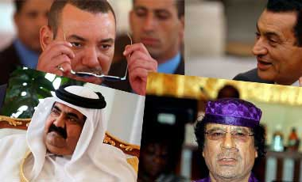

+++
title = "سيادة الرئيس .. Online"
date = 2007-03-12
authors = ["شريف الدواخلى"]
aliases = ["/articles/harb-n5060/"]

[taxonomies]
authors = ["sherif-eldoakhla"]
sections = ["harb"]

[extra]
section_name = "الحرب الآن"
share_image = "/media/admins.20at.com/aly/aga2is.jpg"
summary = "هل فكرت يوماً في زيارة الموقع الإليكتروني لرئيس دولتك لمعرفة محتواه ؟"
section_slug = "harb"
section_colour = "#7A1E1E"
thumb = "/media/admins.20at.com/aly/aga2is.jpg"
n_comments = 30
original_url = "http://20at.com/20at/health/3409.html"
archived = "20100105211422"
date_source = "byline/meta"
aliases_20at = ["//harb.20at.com/newarticle.php?sid=5060", "/20at/health/3409.html"]

[extra.provenance]
original_url = "http://20at.com/20at/health/3409.html"
capture_url = "https://web.archive.org/web/20100105211422/http://20at.com/20at/health/3409.html"
capture_label = "٥ يناير ٢٠١٠، ٢١:١٤ UTC"
date_note = "من سطر التوقيع في المقال"
other_urls = ["//harb.20at.com/newarticle.php?sid=5060"]
comments = "٣٠"
missing_images = ""
+++

<figure></figure>

هل فكرت يوماً في زيارة الموقع الإليكتروني لرئيس دولتك لمعرفة محتواه ؟

أو لكي ترسل له رسالة ؟ أو حتى تقوم بـ chat معه؟

إذا أردت أن تعرف أن ذلك متاحا أم لا، شاركنا في جولتنا التي حاولنا أن نتفقد فيها مواقع الرؤساء العرب وبعض مواقع رؤساء العالم..

<h3>مصر وتونس..دعائية</h3>

عند تصفح المواقع العربية نكتشف أن اللغة الرسمية سمة تميزها، ولا نرى فيه سوى نشرة علاقات عامة مملة واستطراد لا حصر له في محاسنهم وبطولاتهم!

فالرئيس التونسي "علي زين العابدين" أطلق موقعه www.benali2004.tn ضمن حملته الانتخابية 2004 لتحفيز الجماهير على إعادة ترشيحه مرة أخرى، ومنذ هذا الوقت لم يتم تحديثه بأي معلومات إضافية.

يبدو أن مواقع الرؤساء العرب يرتبط تأسيسها بظرف سياسي معين، فالرئيس حسني مبارك انطلق موقعه http://www.mubarak2005.com ليكون وسيلة دعائية لحملته الانتخابية عام 2005، وهو متاح بالعربية والانجليزية، والموقع لم يتم تحديثه منذ هذا التاريخ.

ويأتي هذا الموقع إضافة إلى موقع الرئاسة www.presidency.gov.eg والذي يتميز عن سائر مواقع الرئاسة لسائر الحكام العرب بأنه باللغة الانجليزية فقط وكأنها اللغة الرسمية للبلاد!

<h3>تحدث..تكلم</h3>

أما موقع الأخ العقيد معمر القذافى http://www.algathafi.org فيبث بالعربية والانجليزية والفرنسية، والموقع بالكامل عبارة عن تصريحات تحت عنوان "القذافى يتحدث" واغلبها أحاديث مثيرة للجدل، فضلا عن إبراز كلمته في المؤتمر الوزاري الإفريقي – الأوروبي حول الهجرة والتنمية، وبشكل عام الموقع لا يتسم بالتحديث السريع لمحتوياته كسائر مواقع رؤساء الدول العربية.

ونأتي لموقع الملك عبد الله الثاني ملك الأردن www.kingabdullah.jo الذي يركز بشكل مبالغ فيه على السيرة الذاتية للملك الشاب، فنجدها منشورة في صدر الموقع مع صورة كبيرة له، بالإضافة إلى وجودها في رابط على اليسار ورابط آخر أعلى الصفحة، وفيها يبسط القول عن إمكانيات الملك الشاب وقدراته الخارقة كطيار، وعلى الموقع تقرأ تأكيدات بأن الملك يعد من الجيل الثالث والأربعين لأحفاد النبي صلى الله عليه وسلم ! !

<h3>شيّت مع الرئيس</h3>

أما أكثر المواقع إثارة للسخرية فهو موقع الرئيس السوري بشار الأسد www.basharalassad.com والذي تم اختراقه تماماً ووضعت بعض الأغنيات والفلاشات عليه، إلى جانب وصلات للدردشة بين الشباب، ليظهر الموقع وكـأنه موقعاً ترفيها !

<h3>أشهر مدونة</h3>

أما إذا انتقلنا للمواقع العالمية، فنجد أن مدونة الرئيس الايرانى أحمدي نجاد www.ahmadinejad.ir الأفضل على الإطلاق، حيث يعد أول موقع رئاسي تفاعلي مع الجمهور بشكل حي ومباشر وبأربع لغات "فارسي - انجليزي - فرنسي – عربي".

ويظهر التفاعل واضحاً في مشاركات القراء التي تنضح بحب كبير للرئيس الايرانى، ويؤكد الرئيس نجادى بنفسه هذا المعنى في صدر مدونته لدرجة أنه يخصص 15 دقيقة أسبوعيًّا للرد على الزوار وتحديث المدونة بنفسه !

<h3>إسرائيل..أون لاين</h3>

وعلى الجانب المقابل ونقصد الكيان الصهيوني وبرغم أن رئيس دولته يملك ولا يحكم، إلا أن موقع الرئيس "كستاب" http://www.president.gov.il يعد أفضل من مواقع الرؤساء العرب مجتمعة، فالموقع تم إعداده بشكل تقنى وحرفي كبير لمراعاة الاتصال المتكافئ بين الرئيس وزوار الموقع، حتى العوامل النفسية لم يغفلها الموقع، فنجد الصورة التي توجد في صدر الموقع تتحرك مستعرضة بيت الرئيس والحدائق الغناء التي تحيط به، مع ظهور كلمة أهلا وسهلا للزائرين تتحرك مع تحرك الكاميرا، والموقع متاح بثلاث لغات"العبرية والعربية والانجليزية".

كذلك فالموقع يتيح الفرصة حتى للأطفال ليدلو بدلوهم في الموقع، وإن لم يستطيعوا التعبير بكلماتهم فعن طريق الرسومات الصغيرة، والتي يعرضها الموقع بأسماء هؤلاء الأطفال بما يعزز انتمائهم لإسرائيل و يقوى عاطفتهم تجاهها.

<h3>اسأل البيت الأبيض</h3>

ولم يختلف الحال كثيراً في موقع البيت البيض الأمريكي http://www.whitehouse.gov والذي يتم تحديث مواده بشكل يومي فضلا عن شمول الموقع لمختلف القضايا التي تهم المواطن الأمريكي مثل إدارة الموازنة وشئون التعليم و الطاقة الرّعاية الصحية الأمن الداخلي بالإضافة إلى الاهتمام بشكل خاص بكل ما يتعلق بالهجرة وأوضاع الشرق الأوسط .

وليس هذا فحسب بل يحتوى الموقع على عدد كبير من الروابط الهامة مثل الخطب الرئيسية لبوش الابن و التفاعل المباشر مع الجمهور في رابط اسأل البيت الأبيض والبيت الأبيض التفاعلي، ولكن لعل أكثر ما يميز الموقع هو عرض روابط للإدارة الأمريكية كلها تحت عنوان "حكومتك"، بالإضافة إلى رابط خاص للأطفال يركز على اهتمام بوش بهم، و يمكن عرض الموقع باللغة الانجليزية أو الاسبانية .

ونختتم بزيارة موقع الكرملين الروسي http://www.kremlin.ru يهتم الموقع بإبراز نشاطات الرئيس "فلاديمير بوتين" وعرض أرائه في القضايا الخارجية خاصة استعداد روسيا لتوسيع التعاون مع الهند في الطّاقة النّوويّة، والموقع متاح بالروسية والانجليزية فقط.

<h3>لا شفافية</h3>

من جانبه يؤكد الدكتور "حسن عماد مكاوي"، رئيس قسم الإذاعة والتليفزيون بإعلام القاهرة، "أن عدم تحديث المواد الموجودة بمواقع الرؤساء العرب يعكس عدم إيمانه بالأخذ بالتكنولوجيا الحديثة وضرورة استخدامها بشكل كبير باعتبارها عنصر أساسي في حياه البشر، ويدلل على عدم وجود شفافية كاملة من جانب مؤسسات الرئاسة لأنها تنتقى ما تود بثه، فهناك معلومات بعينها تريد إخفائها عن الجمهور في وقت لم يعد هناك طائلا من إخفاء أي معلومات في وجود الأقمار الصناعية وشبكة المعلومات الدولية".

يضيف: "وهذا الأمر يلقى بظلال كبيرة على ضعف الإقبال الجماهيري على المواقع لعدم وجود أي تفاعليه تذكر فيه، حيث أن الجمهور في تلك الأدوار يقتصر دوره على أن يكون متلقي سلبي للمحتوى الموجود على الموقع دون أدنى قدره على تبادل الأدوار بواسطة إرسال بعض التعليقات أو مراسلة الموقع، وذلك أبرز سمات الإعلام الشمولي الذي نحياه، حيث الترويج لكل سياسة الحاكم -صحيحة كانت أو خاطئة- وكأن الحاكم شخصية مثاليه لا يوجد لديه أي سلبيات!".

