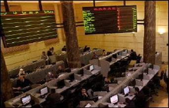

+++
title = "(البورصة) صديقتي!"
date = 2007-03-17
authors = ["محمد فاروق عجم"]
aliases = ["/articles/harb-n5091/"]

[taxonomies]
authors = ["mohamed-farouk-agam"]
sections = ["harb"]

[extra]
section_name = "الحرب الآن"
share_image = "/media/admins.20at.com/do3a2/egypt_stock_1_.jpg"
summary = "حلم الثراء يراودهم ويداعب خيالهم بجنون.. ولكن كيف يمكن تحقيقه ؟"
section_slug = "harb"
section_colour = "#7A1E1E"
thumb = "/media/admins.20at.com/do3a2/egypt_stock_1_.jpg"
n_comments = 5
original_url = "http://20at.com/20at/health/3440.html"
archived = "20100105211633"
date_source = "byline/meta"
aliases_20at = ["//harb.20at.com/newarticle.php?sid=5091", "/20at/health/3440.html"]

[extra.provenance]
original_url = "http://20at.com/20at/health/3440.html"
capture_url = "https://web.archive.org/web/20100105211633/http://20at.com/20at/health/3440.html"
capture_label = "٥ يناير ٢٠١٠، ٢١:١٦ UTC"
date_note = "من سطر التوقيع في المقال"
other_urls = ["//harb.20at.com/newarticle.php?sid=5091"]
comments = "٥"
missing_images = ""
+++

<figure></figure>

حلم الثراء يراودهم ويداعب خيالهم بجنون.. ولكن كيف يمكن تحقيقه ؟

الحل بسيط .. خطوات قليلة تجاه عالم "البورصة" لتكون بعدها من أصحاب الأسهم، لتضارب وتبيع وتشتري في هذا السوق الكبير الذي أصبح يجذب عددا كبيرا من الشباب العربي، لهم تفكير مختلف ولغة مختلفة في مفرداتها.. (تداول الأوراق، مضاربات، سندات، أرباح، سيولة، اكتتاب، عمولة، مؤشر داو جونز..).

لكن إياك أن تصاب بـ"جنون" البورصة، التي دفعت شاباً سعودياً إلى التجرد من ملابسه أمام الجميع نتيجة انخفاض سعر أسهمه !

مع أصدقاء البورصة تحاورنا، لنكتشف عالمها من خلالهم..

<h3>خطوات محسوبة</h3>

هشام صلاح الدين، 28 سنة، يخبرنا: "اصطدمت فكرة دخولي عالم البورصة مع معارضة أهلي وأصدقائي، ولكني صممت على أن أخوض التجربة، خاصة أن مجال دراستي هو التجارة، وبالفعل أتقدم في مجال الاستثمار يوما وراء يوم، ولكن بخطوات محسوبة مفضلا عدم الاندفاع حتى لا أتعرض لخسارة كبيرة، فمجال البورصة يعطيك الشعور بعدم الأمان لتقلب أحوال السوق بين ساعة وأخرى، فهذه الخسارة تعرض لها كثير ممن حولي في يوم "الثلاثاء الأسود" العام الماضي الذي انهارت فيه أسعار السوق.

عماد محمد، 27 سنة، يقول: "البورصة بالنسبة لي تمثل فرصة عمل تدر دخلا إضافيا بجوار عملي الأساسي، لأستطيع مواجهة غلاء المعيشة والالتزامات الكبيرة علّى كشاب يستعد للزواج".

وينصح "عماد" من يتجه إلى الاستثمار في الأسهم أن يحاول جيدا معرفة تاريخ الأسهم، أي متى طرحت في الاكتتاب، وأقل نقطة وصل إليها، وسعرها في السوق.

<h3>اكتشف البورصة</h3>

أما شيماء علي، 25 سنة، فتقول: "الاستثمار في البورصة سهل ولا يحتاج إلى تفرغ، وهو مجال جديد على الشباب المصري، في كليتي (اقتصاد وعلوم سياسية) تعلمت الكثير من نموذج محاكاة البورصة، وهو ما شجعني على دخول هذا المجال بعد التخرج، وهو مجال وجدت فيه إثبات ذاتي فقد حققت من خلاله مكاسب مادية مناسبة".

مجدي عباس،26 سنة، فيقول: "ما شجعني على دخول البورصة أنها تأتي بربح سريع ومباح وليس به أي شبهة ربوية، ولكن الأسهم التي قمت بشرائها وهي أسهم "المصرية للاتصالات" انخفضت قيمتها، لكني ما زلت محتفظا بها أملا في صعودها، ولكن بالرغم من ذلك فهي تجربة اكتشفت من خلالها عالم البورصة، الذي كنت أسمع به فقط من بعيد".

<h3>يا.. خسارة</h3>

حسام أحمد، 25 سنة، كانت له بعض الأسهم المحفوظة في أحدى الشركات، وحتى يسترد هذه الأسهم عانى طويلا من التردد على شركات السمسرة والبنوك، وفي النهاية باع أسهمه بالخسارة، ولم يحاول طرق هذا الباب ثانية عاملا بالمثل الشعبي "خسارة قريبة خير من مكسب بعيد"!.

أما محمد عبد الخالق، 28 سنة، وهو مصري مقيم بالسعودية، فيقول: "الحكايات التي سمعتها عن المكاسب الخيالية التي يحصل عليها البعض من المضاربة في أسهم البورصة هي التي دفعتني إلى دخول هذا المجال ووضعت فيه مبلغا كبيرا، ولكن ما حدث من انهيار للبورصة السعودية جعلني أفقد كل أموالي، ومن وقتها فضلت الانسحاب وعدم المخاطرة ثانية".

<h3>* هذه بعض نصائح خبراء الأسواق المالية التي قمنا بتجميعها لتفيدك عند دخولك البورصة لأول مرة:</h3>

- للاستثمار بالبورصة عليك أولا اختيار شركة الوساطة، التي عن طريقها ستقوم بعملية التداول وهي بمثابة وسيط يطلق عليه "السمسار" أو "شركات السمسرة"، والتي تعد وكيل العميل الراغب في إجراء تداول في البورصة سواء بيعا أو شراء‏.

- تقوم شركة الوساطة بتنفيذ الأوامر التي تتلقاها منك كمستثمر عن طريق نظام التداول الخاص بالبورصة.

- عليك أن تتابع عن قرب وبصورة يومية أداء الأسواق المالية في الدول العربية، حتى تستطيع أن تتنبأ بما سيكون عليه الوضع في سوق الأوراق المالية الخاص بدولتك.

- عليك بعدم المجازفة بكل ما تملك في هذا المجال، لكي لا تعرض نفسك لنتائج سلبية، فالبورصات شديدة الحساسية والتأثر لأي أزمة اقتصادية.

- تداول الأوراق المالية ما هي إلا تجارة تخضع للربح والخسارة، لذا عليك بضبط النفس وعليك بالابتعاد عن العصبية والثورة.

- عند نزولك سوق البورصة عليك تقبل الخسارة بشكل طبيعي وعدم التأثر واليأس من أول مرة.

- عليك أن تحدد في أي أسهم سوف تستثمر، فكلما استثمرت في أسهم ترتبط بشركة قوية كلما زاد العائد وقلت المخاطر، فعليك أن تبدأ بالتعلم والمعرفة قبل أن تتخذ القرار.

- كمستثمر يجب أن تكون على وعي بالمؤشرات التي تسبق انهيار أي بورصة، وفهم أسباب تكرار الأزمات المالية التي تحدث في أسواق العالم، وهذا يأتي من خبرة التعامل.

- عدم الاندفاع وراء المضاربات أو الاندفاع خلف كلام الناس والإشاعات المنتشرة، ولكن يجب أن يكون الاستثمار مبنيا على أسلوب علمي.

- دراسة تاريخ السهم من خلال اتجاه حركته وعدة مؤشرات إحصائية أخرى، وهو ما يمكن من استقراء الحركة المستقبلية لتلك الأسهم من خلال الصعود والهبوط.

وأنت.. هل جربت يوما أن تكون من أصدقاء البورصة ؟

