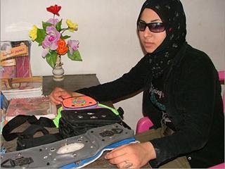

+++
title = "(شروق).. شمس المكفوفين"
date = 2008-01-15
authors = ["نجلاء عبد ربه"]
aliases = ["/articles/harb-n13845/"]

[taxonomies]
authors = ["naglaa-abdel-rabh"]
sections = ["harb"]

[extra]
section_name = "الحرب الآن"
share_image = "/media/currentarticleassets/images/shms.jpg"
summary = "هبة جاد الله سليمان فياض، طالبة فلسطينية، عمرها 16 عاماً، وهي أول فتاة في مثل هذا العمر في قطاع غزة تسجل براءة اختراع في فلسطين.."
section_slug = "harb"
section_colour = "#7A1E1E"
thumb = "/media/currentarticleassets/images/shms.jpg"
n_comments = 0
original_url = "http://20at.com/20at/health/8037.html"
archived = "20100105211511"
date_source = "byline/meta"
aliases_20at = ["//harb.20at.com/newarticle.php?sid=13845", "/20at/health/8037.html"]

[extra.provenance]
original_url = "http://20at.com/20at/health/8037.html"
capture_url = "https://web.archive.org/web/20100105211511/http://20at.com/20at/health/8037.html"
capture_label = "٥ يناير ٢٠١٠، ٢١:١٥ UTC"
date_note = "من سطر التوقيع في المقال"
other_urls = ["//harb.20at.com/newarticle.php?sid=13845"]
comments = ""
missing_images = ""
+++

<figure></figure>

هبة جاد الله سليمان فياض، طالبة فلسطينية، عمرها 16 عاماً، وهي أول فتاة في مثل هذا العمر في قطاع غزة تسجل براءة اختراع في فلسطين..

لم تستسلم لليأس وأنين أوجاعها بعد أن فقدت عينها اليمنى، وهي طفلة صغيرة في الثانية من عمرها عقب سقوطها على الأرض، وفشل الأطباء في علاجها.. بل أن هذا الوضع جعلها تشعر بمدى معاناة فاقدي البصر، لتفكر كثيرا في مساعدتهم، وأخيرا صممت لهم دليل المكفوفين لمساعدتهم على السير والحركة.

<h3>مرشد الكفيف</h3>

تقول هبة: "أشعر بمدى معاناة الكفيف في حياته، ورغم أن عيني الثانية نظرها سليم، إلا أنني أواجه بعض المشاكل، فكيف بالمكفوفين الذين يفتقدون العينين".

أما جهازها ففكرته "إرشاد الكفيف إلى العوائق التي تعترض تحركاته، ويصف له الأشياء من حوله، وهو مزود ببوصلة وهاتف خلوي، متصل بوحدة تغذية تكون في البيت وعداد أمتار، وعصا حساسة تعينه على السير في الطرقات".

فكرة الجهاز كانت تراود هبة وهي في عمر الرابعة عشر من عمرها، ومنذ ذلك الوقت لم تتوقف عن البحث عمن يساعدها في تحقيق الفكرة، لكن كل من أطلعتهم على الفكرة من الفنيين والمهتمين في مجال الكمبيوتر والإلكترونيات، أجمعوا على استحالة تحقيق الفكرة؛ لانعدام الإمكانيات التي يحتاجها جهاز من هذا القبيل في غزة، إلا أن إيمانها بالله تعالى جعلها تنجزه.

<h3>شروق.. كيف يعمل؟</h3>

اختارت هبة لاختراعها اسم "شروق"، ليكون بمثابة شروق شيء جديد في حياة المكفوفين ليبصروا طريقهم من خلاله.

والجهاز عبارة عن حقيبة صغيرة، تلف حول خصر الكفيف، وبداخلها جهاز صغير يصدر موجات فوق صوتية، من قطعة إلكترونية صغيرة تسمى "آلترا سونيك ترانس ميتر"، بحيث تقوم هذه القطعة بإرسال موجات فوق صوتية، وحين اصطدامها بأي جسم أو عائق، ترتد وتنعكس وتستقبلها قطعة إلكترونية أخرى "آلترا سونيك ريسيفر"، التي تعالج الموجات المرتدة، وتحولها إلى إشارة كهربائية ضعيفة، تمر عبر دائرة تكبير ثم على دائرة تحكم، تعمل على توصيل الإشارة الكهربائية المكبرة بجهاز التنبيه، الذي يصدر صوتا ينبه الكفيف للابتعاد عن العائق وأخذ الحذر منه.

والجهاز أيضا مزود بسماعة أذن، بإمكان الكفيف تركيبها إذا كان لا يرغب أن يسمع غيره صوت التنبيه، إضافة إلى أن التحكم ببعد المسافة التي يريد الكفيف أن ينبهه الجهاز بشأنها متروكة له ليحددها، علما بأن أقصى مسافة للتنبيه هي ثلاثة أمتار.

وتشير هبة إلى أن "شروق" يمكن استخدامه أيضا للصم والبكم بإضافة جهاز آخر إليه.

<h3>معاناة النجاح</h3>

استغرق إنجاز الجهاز نحو سنتين، تعرضت خلالها هبة لصنوف متعددة من الإحباط، لعدم قناعة المؤسسات ومسئوليها بجدوى الفكرة، بحيث أصبح هذا الشعور أصعب المشاكل التي اعترضت طريق تحقيق جزء من حلمها.

وكانت المشكلة الأكبر في تنفيذ الاختراع، حيث يحتاج إلى طاقم عمل كامل من مبرمجين ومصممين وفنيين تقنيين لعمل الاختراع كاملا، وزاد من المشكلة الحصار الذي يتعرض له القطاع، تقول: "نتيجة إغلاق المعبر أدى ذلك لعدم توفر القطع والمعدات الخاصة للجهاز ولم تتوفر إمكانية الحصول عليها، كما أنني لم أجد الدعم المالي والمعنوي لإتمام الجهاز".

وكان الحل لدى شباب ملتقى خريجي مدينة خان يونس، لمساعدتها في البحث عمن يمكن أن يمد يد العون؛ لتوفير الإمكانات اللازمة لإجراء تجاربها، ونجحوا في الوصول إلى منتدى "شارك" الشبابي الذي اقتنع بتمويل المشروع.

توجه هبة من خلال (عشرينات) رسالة إلى كافة المسئولين والمهتمين بالمشاريع والاختراعات، بأن يهتموا بالمبدعين والعمل على تطويرهم وتنمية قدراتهم، مشيرة إلى أن الشباب الفلسطيني بحاجة إلى من يتبنى تطبيق أفكارهم داخل وطنهم دون أن يذهبوا إلى أي دولة أخرى لتنفيذها.

