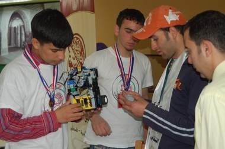

+++
title = "ROBOT.. صناعة فلسطينية 100%"
date = 2008-04-22
authors = ["رنا خموس"]
aliases = ["/articles/harb-n15373/"]

[taxonomies]
authors = ["rana-khmos"]
sections = ["harb"]

[extra]
section_name = "الحرب الآن"
share_image = "/media/currentarticleassets/images/robort123.jpg"
summary = "من منا لا يعشق الإبداع والعلم، ولكن في فلسطين تصبح الأمور مضاعفة، تجد نفسك أمام تحدي اكبر هنا، يتحول فيها الإبداع إلى حق تنتزعه وتتباهى بانجازه."
section_slug = "harb"
section_colour = "#7A1E1E"
thumb = "/media/currentarticleassets/images/robort123.jpg"
n_comments = 7
original_url = "http://20at.com/20at/health/8857.html"
archived = "20100105211443"
date_source = "byline/meta"
aliases_20at = ["//harb.20at.com/newarticle.php?sid=15373", "/20at/health/8857.html"]

[extra.provenance]
original_url = "http://20at.com/20at/health/8857.html"
capture_url = "https://web.archive.org/web/20100105211443/http://20at.com/20at/health/8857.html"
capture_label = "٥ يناير ٢٠١٠، ٢١:١٤ UTC"
date_note = "من سطر التوقيع في المقال"
other_urls = ["//harb.20at.com/newarticle.php?sid=15373"]
comments = "٧"
missing_images = ""
+++

<figure></figure>

من منا لا يعشق الإبداع والعلم، ولكن في فلسطين تصبح الأمور مضاعفة، تجد نفسك أمام تحدي اكبر هنا، يتحول فيها الإبداع إلى حق تنتزعه وتتباهى بانجازه.

فريق (فلسطين الإبداعي) تردد اسمه مؤخرا إثر فوزه بالمرتبة الأولى لصنع وأداء الروبوت PRC، فهم شباب حلقت أفكارهم في سماء الإبداع والاختراع ليتجاوزوا بها عراقيل الاحتلال التي طالما كانت عثرة أمام طموحاتهم وأحلامهم.

<h3>أحلام كبيرة</h3>

يوضح ليث عودة (15 عاما) احد أعضاء الفريق، أن صناعة الروبوت تحتاج إلى تقنية عالية وقد قمنا به بشكل متقن بوجود كافة أجزاءه من محركات ومسننات ومجسات ويتم ربطها مع عقل الكتروني ونقل الأوامر إلى الروبوت وبرمجته للقيام بها، والمشروع الآخر الذي نقوم به هو البحث عن مصادر طاقة بديلة، وقد حققنا فوزا كبيرا من خلال حصولنا على المرتبة الأولى على مستوى 55 دولة وفريق مشارك، فكان انجاز لنا ونحن الآن في صدد المشاركة بالمسابقة العالمية لهذا العام.

ويضيف عودة، منذ الصغر وأنا احلم بان أكون مبدع وأقوم بالاختراع، أسعى من خلال هذه الفرصة أن ارفع اسم وعلم فلسطين عاليا، حتى نبرهن للعالم أننا كشباب نحب الحياة ونتشبث بحقوقنا، وحقنا بالحياة والإبداع والتفكير، ونتمنى أن نشارك ونتطور بكل الاتجاهات.

أما محمد سرحان (16 عاما) يتحدث وكله ثقة بما صنعه، أن المشروع جاء كمنفذ لنا واحتواء لنشاطاتنا، فالفشل هنا موجود وسهل ولكننا نجد أنفسنا أمام تحدي للنجاح وهذا يحتاج إلى إرادة، وعن طريقه أتيح لنا كشباب فرصة لاستغلالها ولتفريغ الضغوطات التي نعيشها كإبداع ومشاريع ناجحة، فما نعيشه ينعكس سلبا علينا وعلى أحلامنا وما نقوم به دليل على جدية أهدافنا وسعي للوصول إلى العالم عن طريقه.

<h3>حاجة ماسة</h3>

ومن جانبه، يشير المهندس مهند عمرية منسق ومدرب لفريق فلسطين الإبداعي للروبوت، إن الشباب المبدعين في فلسطين كثر، ولكنهم لا يجدون المكان الذين يتوجهون إليه، وجمعية السبق للإبداع الفكري التي أنشأت في عام 2006 في مدينة البيرة، كانت منفذا لهم في احتضانهم وتنمية مهاراتهم التي ترجمت فعليا بفوز الفريق بالمرتبة الأولى في تصميم الروبوت، ويشارك بالفريق فتية وفتيات تتراوح أعمارهم ما بين (14-17).

ويضيف عمرية، أن فوزهم هو دليل وجود ثمرة الإبداع عند الشباب الفلسطيني وما يحد منها هي الظروف السياسية والاقتصادية الصعبة التي يعيشها الشعب الفلسطيني، وعدم وجود الإمكانيات المادية لتفعيل تلك العقول والاستفادة منها في تنمية وتطوير المجتمع، والتحدي اليوم هو تامين رحلتهم للمشاركة ببطولة العالم التي ستعقد في الصين.

<h3>نافذة إلى العالم</h3>

ويشير منسق ومدرب الفريق، أن المشروع جاء كحاجة ضرورية لإظهار انجاز الطلاب خاصة انه يحتوي على أكثر من جانب، ومنها الجانب التقني التعليمي والجانب التربوي القائم على ثقة النفس والصبر والمثابرة فالطلاب يدرسون أفكار جديدة يتم استخدامها بالحياة العلمية، وجاء المشروع كحاجة في ظل التطور التكنولوجي الذي يشهده العالم ولمواكبة العصر وكعامل مساعد ومميز لمساعدتهم في فهم التعليم، وهدف المسابقة هو إدخال الجانب العلمي إلى التعليم الفلسطيني الذي طالما اخذ الجانب التلقيني للطالب.

وقال أن أهم انجازات الفريق هو المساهمة في الوعي ونشره على جميع المستويات ولفت نظر المسؤولين إلى موضوع ترشيد الطاقة والاهتمام بمصادر الطاقة البديلة، وقد قام الفريق بتصميم رجل إلي ليقوم بعدة مهام حول الطاقة، وتم إعداد بحث حول مصادر الطاقة البديلة بشكل عام وحول الوعي وترشيد استهلاك الطاقة بشكل خاص.

ويؤكد عمرية أن وجود مثل هذه المشاريع هي التي تبرهن للعالم بأسره على وجود عقول مبدعة في فلسطين تحتاج إلى نافذة تطل منها إلى العالم، و رغم الظروف التي يمر بها الشعب والشباب الفلسطيني فالإرادة موجودة للتطلع إلى مستقبل زاهر لفلسطين على جميع القطاعات وبمختلف الفئات، فالجمعية تسعى لولادة جيل واعي ومثقف ومنتج يفيد وطنه بعلمه.

