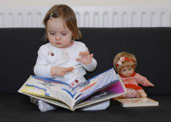

+++
title = "على بابا .. راجل طيب!"
date = 2008-11-01
authors = ["فؤاد فليح حسن"]
aliases = ["/articles/20at-arts-10375/"]

[taxonomies]
authors = ["fouad-falih-hassan"]
sections = ["klam-rosas"]

[extra]
section_name = "قلم رصاص"
share_image = "/media/currentarticleassets/42-19294803.jpg"
summary = "رغم أن قصة (على بابا والـ40 حرامي) يعرفها أغلب أطفال العرب، إلا أن شباب العراق مصممون أن هذه القصة ملكهم فقد ارتبطوا بها كثيرا في فترة الطفولة، وعلمتهم كيف يعاق"
section_slug = "klam-rosas"
section_colour = "#333333"
thumb = "/media/currentarticleassets/42-19294803.jpg"
n_comments = 0
original_url = "http://20at.com/20at/arts/10375.html"
archived = "20100106004536"
date_source = "byline/meta"
aliases_20at = ["/20at/klam-rosas/10375.html", "/20at/arts/10375.html"]

[extra.provenance]
original_url = "http://20at.com/20at/arts/10375.html"
capture_url = "https://web.archive.org/web/20100106004536/http://20at.com/20at/arts/10375.html"
capture_label = "٦ يناير ٢٠١٠، ٠٠:٤٥ UTC"
date_note = "من سطر التوقيع في المقال"
other_urls = ["/20at/arts/10375.html"]
comments = ""
missing_images = ""
+++

<figure></figure>

رغم أن قصة (على بابا والـ40 حرامي) يعرفها أغلب أطفال العرب، إلا أن شباب العراق مصممون أن هذه القصة ملكهم فقد ارتبطوا بها كثيرا في فترة الطفولة، وعلمتهم كيف يعاقب الله الطماع وكيف نحب عمل الخير.

ففي ليالي الشتاء الباردة كانت جدتي تجمع أحفادها وتقص علينا حكايات واقعية وأخرى خرافية لنتعلم منها، ومن أشهرها حكاية السلعوة والأميرة , وحكاية الفانوس السحري , وحكاية السندباد لكن على بابا والأربعين حرامي كان لها وقع مختلف على النفوس.

ولا يغيب عن بالي عندما كنا صغار نلعب ونجري في البيت تعلوا أصواتنا ولا يسكتُنا إلا صوت جدتي وهي تنادينا "تعالوا احكي لكم قصة"، فنركض مسرعين ويعم الهدوء المكان.

وتبقى عيوننا تنظر إلى وجه الجدة ونحن نترقب ما ستقصه علينا هذه المرة، ويبقى صوت جدتي هو الحد الفاصل بين الضوضاء التي نتعمدها في بعض الأحيان حين نشتاق إلى حكاية من حكاياتها.. ومن أكثر ما كنا نتمنى سماعه حكاية (علي بابا والأربعين حرامي) فلا زلت أذكر أول مرة سمعتها فقد كانت جدتي تتكئ على وسادتها وتبدأ بسرد الحكاية قائلة:(كان يا ما كان في قديم الزمان) كان هناك أخوين شقيقان احدهما يدعى علي بابا والآخر(قاسم) وقد ورثا ثروة هائلة عن والدهما ولكن طمع (قاسم )جعله يستولي على كل الثروة ويترك اخاه علي بابا فقيرا معدما).

<h3>افتح يا سمسم</h3>

وتتابع الجدة (كان علي بابا يعمل حطابا في الغابة ويحمل الحطب على حماره ويبيعُه ويشتري بثمنه طعاما لزوجته وأولاده وذات يوم وهو بالغابة سمع صوت خيل كثيرة فخاف وصعد على شجرة عالية يراقب فشاهد 40 فارسا على خيولهم يقتربون من مكانه.فوقفوا أمام صخرة كبيرة وتقدم قائدهم وصاح ( افتح ياسمسم) فمُلى المكان بالغبار الذي تطاير بسبب تحرك الصخرة من مكانها وظهر كهف خلف الصخرة ودخل الفرسان الى الكهف وبعد فترة خرجوا وذهبوا بعيدا... عندها نزل علي بابا من أعلى الشجرة وهو مندهش لما فعلته جملة ( افتح ياسمسم ) فأحب أن يجرب ما حدث أمامه فأقترب من الصخرة وأخذ حماره معه وصاح باعلى صوته (افتح ياسمسم).

وفي هذه الأثناء كانت الدهشة تسيطر علينا وتبحلق عيوننا نترقب ما سيحدث حين قال علي بابا هذه الجملة، فصمتت جدتي قليلا وكأنها تريد تشويقنا أو ربما تعبت من سرد القصة.

وكانت عيوننا تبين لهفتنا لأن نقول لجدتنا أكملي لولا الدهشة التي عقدت السنتنا لأننا لا نريد أن نخرج من أجواء الحكاية، وأخيرا أكملت جدتي بعد أن شربت قدح من الماء، وقالت : وبعد أن قال علي بابا هذه الجملة تحركت الصخرة ودخل علي بابا هو وحماره إلى الكهف ورجعت الصخرة إلى مكانها وأندهش لما وجده من جواهر ذهب وفضة وأشياء ثمينة. فعرف أن هؤلاء الفرسان الأربعين هم لصوص يسرقون من الناس فحمًل حماره ما يستطيع حمله من الجواهر وقال افتح يا سمسم فخرج مسرعا إلى بيته وقص على زوجته ما حدث معه وفرحت كثيرا.

<h3>افتح يا حمص</h3>

وتكمل الجدة " ثم أخبر أخاه قاسم ولشدة طمع قاسم ذهب إلى مكان الصخرة وقال افتح ياسمسم ودخل إلى الكهف ومعه عشرة بغال فأندهش لما وجده من كنوز وجواهر وأخذ يحمل منها ما يستطيع تحميله ولكن لشدة جشعه وطمعه نسى كلمة السر عندما أراد الخروج، وأخذ يصيح افتح يا حُمص افتح يا شعير لكن دون جدوى فظل محبوسا إلى أن جاء اللصوص ووجدوه داخل الكهف فغضبوا وقبضوا عليه".

وتتنهد الجدة قائلة:"حين تأخر قاسم ذهب ورائه علي بابا ليرى ماسبب تأخره وحين وصل إلى المكان شاهد اللصوص يشدون وثاق قاسم ويسحبونه معهم فصاح علي بابا انتظروا انتظروا وحين وصل إليهم قال لهم : إنه أخي أين تذهبون به فقالوا له لقد أراد سرقتنا وسنعاقبه رد عليهم علي بابا قائلا اتركوه وسأعطيكم وزنه من الجواهر والذهب فقبلوا بالمقايضة ورجع قاسم بعد أن أعطاهم علي بابا ما أخذه من الكهف".

"ندم قاسم على ما فعله مع أخيه حين استولى على نصيبه من الميراث وتعانقا وأرجع له ما أخذ منه وعاشوا عيشة سعيدة".

ودائما كان الأطفال يتساءلون هل على بابا رجل طيب أم كان يجب عليه أن يسلم المجوهرات إلي الشرطة؟ وهي القضية التي ناقشها الفيلم المصري "محاكمة على بابا".

