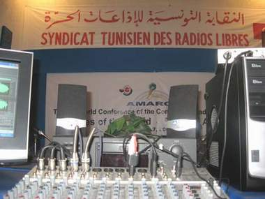

+++
title = "راديو 6 .. شباب يتحدّى التعتيم"
date = 2008-11-24
authors = ["إسماعيل دبارة"]
aliases = ["/articles/20at-arts-10592/"]

[taxonomies]
authors = ["ismail-dabara"]
sections = ["klam-rosas"]

[extra]
section_name = "قلم رصاص"
share_image = "/media/masr.20at.com/currentarticleassets/marwah/samir_2_.jpg"
summary = "بعد أيام قليلة يحتفل مؤسسي وجمهور إذاعة \"راديو 6\" الالكترونيّة التونسية بمرور عام على بث الإذاعة، حيث أطلقت في العاشر من ديسمبر 2007، وخلال عام فائت استطاعت الإ"
section_slug = "klam-rosas"
section_colour = "#333333"
thumb = "/media/masr.20at.com/currentarticleassets/marwah/samir_2_.jpg"
n_comments = 0
original_url = "http://20at.com/20at/arts/10592.html"
archived = "20100106004317"
date_source = "byline/meta"
aliases_20at = ["/20at/klam-rosas/10592.html", "/20at/arts/10592.html"]

[extra.provenance]
original_url = "http://20at.com/20at/arts/10592.html"
capture_url = "https://web.archive.org/web/20100106004317/http://20at.com/20at/arts/10592.html"
capture_label = "٦ يناير ٢٠١٠، ٠٠:٤٣ UTC"
date_note = "من سطر التوقيع في المقال"
other_urls = ["/20at/arts/10592.html"]
comments = ""
missing_images = ""
+++

<figure></figure>

بعد أيام قليلة يحتفل مؤسسي وجمهور إذاعة "راديو 6" الالكترونيّة التونسية بمرور عام على بث الإذاعة، حيث أطلقت في العاشر من ديسمبر 2007، وخلال عام فائت استطاعت الإذاعة الشبابية استقطاب شريحة هامة من شباب ألنت من خلال  موقعها  .

تتميز برامج الإذاعة الالكترونية بتناول مواضيع حساسة ومسكوت عنها، وأخرى تتسم بالتنوع والطرافة، على الرغم من أن بثها لا يتجاوز 3 ساعات ونصف، كما تتخللها أغاني متنوعة يغلب عليها الطابع الملتزم.

(عشرينات) التقت مع شباب "راديو 6" في مقرّ الإذاعة يقع بشارع انكلترا بالعاصمة تونس..

<h3>إتحاد 6 إذاعات</h3>

سمير الجرّاي، 23 سنة، طالب بمعهد الصحافة وعلوم الإخبار وأحد كوادر الراديو الالكتروني، يقول: "اختار القائمون على الإذاعة إطلاق اسم راديو 6 عليها لأنها تأتي للتدليل على ستّ إذاعات مازال أصحابها ينتظرون الترخيص مند سنوات للبث عبر الأثير ولكنهم لم يحصلوا على ذلك الترخيص بعدُ".

مقرّ راديو 6 ليس فخما، فهو يتكون من حجرتين فحسب، الأولى للاستقبال والبحوث وتضمّ جهازي حاسوب والأخرى غرفة التسجيل وتضمّ بعضا من الأجهزة الضرورية المتواضعة.

ملكية راديو 6 تعود للإعلامي التونسي "صالح الفورتي" الذي أسس النقابة التونسية للإذاعات الحرة، تقدم الفورتي منذ 10 ديسمبر عام 1987 بمطلب بعث إذاعة حرّة خاصة، لكنه عانى من "مماطلة وتسويف لا نظير لهما "، وبعد أن تأكد من رفض مطلبه اتصل بعدد من الجهات الوطنية والأجنبية لكسب الدعم والتأييد لحقه في بعث إذاعة خاصة، وبعد الرفض جاءته فكرة تكوين نقابة للإذاعات الحرة تدافع عن حق الأفراد في إنشاء الإذاعات التي يريدونها بعيدا عن أية وصاية وقد كانت القمة العالمية لمجتمع المعلومات التي انعقدت بتونس في العام 2005 فرصة للإعلان عن ميلاد نقابة الإذاعات الحرة.

<h3>من وإلى الشباب</h3>

يعتمد راديو 6 على فريق شبابي، منهم نزهة بن محمد، 25 سنة، وهي مذيعة برنامج "خارج الصفّ"، تقول: "الاعتماد على فريق شبابي في تسيير راديو 6 يمكن اعتباره خيارا من خياراتنا نحو إعلام بديل غير مألوف في بلادنا، فالمواضيع الشبابية تطغى على برمجة إذاعتنا بالتأكيد، لكن ذلك لا يعني أننا لا نهتم بكافة المجالات الأخرى سياسية واجتماعية وحقوقية وثقافية".

أما الصحفي الشاب سمير الجرّاي مذيع برنامج "حوارات" الأسبوعي، فيقول: "منطقي للغاية أنني كشاب أختار تسليط الضوء على المواضيع التي تهمّ هذه الفئة العمرية كمشاكل الطلبة والدراسة والهجرة السرية وغيرها من المواضيع الحساسة في إطار مهني يلتزم بشرف الصحافة وحرية التعبير كما درسنا ذلك في اختصاص الإعلام الذي اخترناه، ووفق شعار الرأي الحرّ الذي نرفعه والذي سنجابه من خلاله التعتيم المفروض على أخبار الشباب التونسي".

لا يتقاضى الصحافيون والتقنيين في راديو 6 أية مستحقات ذات قيمة مقابل خدماتهم الإعلامية وجهودهم الكبيرة في الحفاظ على دورية البرامج الإذاعية التي ينتجونها، لكنهم في ذات الوقت غير ممتعضين مما يعملون لأجله.

يضيف سمير: "نحن ملتزمون بتقديم صورة جديدة للإعلام التونسي والقطع مع النمطية التي تسيطر عليه منذ سنوات، قناعتنا تلك ليست مرتبطة بالأموال والمستحقات، ثم إننا نشتغل في إطار نحبّه وننتمي إليه فلم التذمرّ والتبرّم؟".

<h3>مشاكل تقنية</h3>

لا يخفي القائمون على راديو 6 الالكتروني تعاظم المشاكل التقنية والمادية التي قد تساهم في تعطيل العمل غالب الأحيان.. تقول سمية حملاوي، 22 سنة، تقنيّة بالإذاعة: "الظروف التي نشتغل فيها تبدو قاسية نوعا ما من الزاوية التقنية، قد نضطرّ في عدّة مناسبات إلى إلغاء التسجيل أو بث البرامج بسبب مشاكل فنية تعود إلى قدم التجهيزات أو لعدم تمكن الفريق التقني من الاضطلاع بمهامه بالشكل الكافي فأغلبنا مبتدئون لكننا مصممون على تجاوز تلك العوائق التي لن تثنينا على إيصال أصواتنا للتونسيين في الداخل والخارج".

تتغير البرمجة مرة واحدة في الأسبوع وهو ما يعكس تأثير ظروف العمل الصعبة التي ترافق عادة العمل التطوعي بالإضافة إلى غياب التجهيزات والمعدّات الحديثة.

<h3>أخبار الحريات</h3>

وترى المذيعة نزهة بن محمد إن مواضيع إذاعتهم الالكترونية غير مقيدة بسقف ما أو تابوهات أو حواجز، "فقط أخلاقيات المهنة هي حدودنا وموجهنا في عملنا، انحيازنا التام للمستمع وما يطلبه، نحن الجهة الإعلامية الوحيدة التي تتناول مواضيع حساسة ومسكوت عنها في تونس كالمثلية الجنسية".

كما سلطت الإذاعة الضوء في عديد المناسبات على مواضيع هامة كالإعدام وأخبار الحريات وحقوق الإنسان وخصوصا ما يمكن أن يطول حرية التعبير والكلمة في تونس، وهي موضوعات تهتم بها الإذاعة التي تزامن إطلاقها مع الذكرى التاسعة والخمسين للإعلان العالمي لحقوق الإنسان.

<h3>"مواضيع حساسة"</h3>

يتنوع الجمهور المتابع لإذاعة راديو، من بينهم تقول نهى بن سدرين، 25 سنة: "ما شدّني لهذه المحطة تجرئها على المواضيع الحساسة وغياب السقف لدى صحافييها، المشرفون عليها تطرقوا لمواضيع ما كنا لنستمع إليها عبر الإعلام الرسمي المتخلف".

أما صفوان النجار، 21 سنة، طالب، فيقول: "نريد لراديو 6 أن يهتمّ ببعض المواضيع التي لها علاقة بالثقافة الرقمية، كأخبار المدونات والفيس بووك وغيرها، مقابل الابتعاد قليلا على المواضيع السياسية وأخبار الاعتقالات.. أعتقد أن المواضيع الخفيفة تجلب اهتمام الشباب أكثر".

