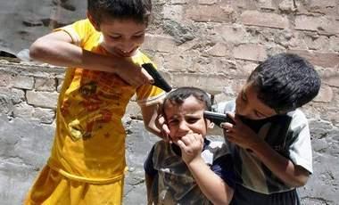

+++
title = "(حرب الشوارع).. لعبة مفضلة للأطفال"
date = 2009-01-03
authors = ["فؤاد فليح حسن"]
aliases = ["/articles/20at-arts-10861/"]

[taxonomies]
authors = ["fouad-falih-hassan"]
sections = ["klam-rosas"]

[extra]
section_name = "قلم رصاص"
share_image = "/media/currentarticleassets/al3ab.jpg"
summary = "أصبحت محلات العاب الأطفال والمحلات التجارية في بغداد تغص بالأسلحة القتالية والرشاشات والقنابل بالاضافة إلى أقنعة القتال و رغم أنها مجرد ألعاب إلا أنها تشبه الأس"
section_slug = "klam-rosas"
section_colour = "#333333"
thumb = "/media/currentarticleassets/al3ab.jpg"
n_comments = 0
original_url = "http://20at.com/20at/arts/10861.html"
archived = "20100106004959"
date_source = "byline/meta"
aliases_20at = ["/20at/klam-rosas/10861.html", "/20at/arts/10861.html"]

[extra.provenance]
original_url = "http://20at.com/20at/arts/10861.html"
capture_url = "https://web.archive.org/web/20100106004959/http://20at.com/20at/arts/10861.html"
capture_label = "٦ يناير ٢٠١٠، ٠٠:٤٩ UTC"
date_note = "من سطر التوقيع في المقال"
other_urls = ["/20at/arts/10861.html"]
comments = ""
missing_images = ""
+++

<figure></figure>

أصبحت محلات العاب الأطفال والمحلات التجارية في بغداد تغص بالأسلحة القتالية والرشاشات والقنابل بالاضافة إلى أقنعة القتال و رغم أنها مجرد ألعاب إلا أنها تشبه الأسلحة الحقيقية بجميع أجزائها، ثقافة الألعاب القتالية التي خلفتها الحرب الأمريكية على العراق أثارت تذمر أولياء الأمور لأنها تؤثر على تصرفات أطفالهم وسلوكهم اليومي.

ويقول أبو مهند (35 عاما) وهو أب لثلاثة أولاد:" أنا لم استطع الصمود أمام إلحاح أطفالي لشراء العاب لهم شبيهة بالأسلحة النارية . أنهم الآن ينامون وفي أحضانهم أسلحتهم اقصد ألعابهم التي هي على شكل مسدسات ورشاشات".

<h3>حرب شوارع..يوميا!</h3>

ويضيف أبو مهند قائلا:" عند استيقاظهم في الصباح الباكر يتوجهون إلى الشارع ليلعبوا مع أصدقائهم لعبة حرب الشوارع ) وهي عبارة عن أداء ادوار تمثيلية لمشاهد مواجهات مسلحة أو مشاهد مداهمات أو انتشار كالتي يقوم بها أفراد الجيش العراقي والأمريكي يوميا في الشوارع. وباتت هذه اللعبة منتشرة في أغلب أزقة وشوارع بغداد.

رحيم أحمد ( 37 عاما) صاحب محل لبيع لعب الأطفال في منطقة بغداد الجديدة (شرق بغداد) يعلق على هذه الظاهرة قائلا:" ألعاب الأسلحة والقتال تلقى رواجا كبيرا بين الأطفال . وهم يعشقونها إلى حد الجنون ومن الصعب منعها عنهم بالقوة. لكن يمكن التعامل معها بهدوء حتى تضمحل وتنتهي".

وأكد رحيم أنهم لديهم مخزون هائل من هذه الألعاب فقد اشتروا الكثير منها بعدما زاد الإقبال عليها في جميع الأحياء، لكنه أوضح أنها تنشط في الأحياء الشعبية.

<h3>مصائب قوم عند قوم</h3>

أبو علي صاحب محل متخصص في بيع لعب الأطفال يقول يرى أن الأسر التي تأتي للمحل لشراء لعب لأطفالها تنقسم إلى فريقين:الأول يستمتع باختيار أسلحة لهم. والثاني يحاول إقناع أطفاله بعدم شراء تلك اللعب لكن دون نتيجة، فالأطفال متمسكون بتلك الألعاب ويبدأ أغلبهم في البكاء إن رفض آبائهم شرائها.

أم حسن واحدة من الأمهات التي تحاول اقناع أبنائها بخطر هذه الألعاب دون فائدة، وتقول:" أنا منعت أطفالي من اللعب في الشارع بسبب هذه الظاهرة وظواهر أخرى أراها سلبية واشتريت لهم لعبة الكترونية لكي يجلسوا في البيت. لكن تفاجئت بان الألعاب الإلكترونية فيها أيضا الكثير من الألعاب التي تشجع على العنف".

<h3>جماعات مسلحة بالمستقبل</h3>

أما الأستاذ توفيق محسن مدير مدرسة ابتدائية فيطالب، المسؤولين بإصدار قانون لمنع استيراد هذه الألعاب الضارة لأطفال العراق.

ويضيف :"هناك توجها عالميا لمكافحة الإرهاب وثقافة العنف التي يحاول الأطفال تقليدها عبر امتلاك ألعاب شبيهة بالعاب الإرهابيين والمتقاتلين . مما يمهد الطريق لانضمامهم للجماعات المسلحة مستقبلا. بسبب حبهم للقوة التي يظهرها أتباع تلك الجماعات المسلحة.

ويؤكد أخصائيوا علم النفس و الاجتماع على التأثير السلبي لهذه الألعاب على حياة الأطفال وحياة الآخرين ، وتقول رقية البهادلي أستاذة علم النفس:" إقبال الأطفال على اقتناء اللعب النارية ظاهرة خطيرة على الأطفال كونها تخلق نوعا من الاضطراب لديهم، فالطفل لا يستطيع أن يعي ما تؤدي إليه هذه اللعبة فهو قد يتصورها لعبة يتسلى بها ولكن نتائجها وخيمة".

وأشارت إلى وجود أسبابا عديدة لهذه الظاهرة منها "تأثر الطفل بما يشاهده سواء في الوسط الذي يعيشه أو عن طريق وسائل الأعلام كالفضائيات أو ما يشاهده في الشارع من خلال مرور الارتال العسكرية سواء كانت أمريكية أم عراقية والطفل بطبيعته يحب التقليد".

وطالبت الأسر بالوعي التام لتصرفات أطفالها وما يستعملونه في ألعابهم وان يكونوا على حذر من اقتناء لعب الأسلحة لأن لها نتائج وخيمة على حياة الأبرياء.. فالوقاية من البداية خيرا من العلاج.

