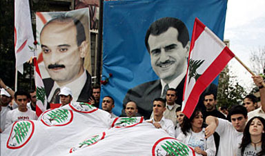

+++
title = "اغتيالات .. لحظة بلحظة!"
date = 2005-12-12
authors = ["رويترز"]

[taxonomies]
authors = ["reuters"]
sections = ["latest-news"]

[extra]
section_name = "آخر الأخبار"
share_image = "/media/admins.20at.com/aly/gobran.jpg"
summary = "لقي جبران تويني المدير العام لصحيفة النهار المعروف بمعارضته سوريا وعضو البرلمان اللبناني مصرعه في انفجار سيارة ملغومة ببيروت اليوم الإثنين."
section_slug = "latest-news"
section_colour = "#1D3557"
thumb = "/media/admins.20at.com/aly/gobran.jpg"
n_comments = 0
original_url = "http://20at.com/20at/latest-news/1392.html"
archived = "20100106021333"
date_source = "byline/meta"
aliases_20at = ["/20at/latest-news/1392.html"]

[extra.provenance]
original_url = "http://20at.com/20at/latest-news/1392.html"
capture_url = "https://web.archive.org/web/20100106021333/http://20at.com/20at/latest-news/1392.html"
capture_label = "٦ يناير ٢٠١٠، ٠٢:١٣ UTC"
date_note = "من سطر التوقيع في المقال"
other_urls = []
comments = ""
missing_images = ""
+++

<figure></figure>

لقي جبران تويني المدير العام لصحيفة النهار المعروف بمعارضته سوريا وعضو البرلمان اللبناني مصرعه في انفجار سيارة ملغومة ببيروت اليوم الإثنين.

وفيما يلي تسلسل زمني مختصر لأبرز الاغتيالات السياسية التي شهدها لبنان على مدى ثلاثة عقود..

فبراير شباط 1975 - مقتل السياسي اليساري السني معروف سعد بالرصاص خلال مظاهرة في صيدا. وكان مقتله أحد العوامل التي أطلقت شرارة الحرب الأهلية التي اندلعت في أبريل نيسان من ذلك العام.

مارس اذار 1977 - مقتل الزعيم الدرزي كمال جنبلاط في كمين في ضيعته الجبلية بمنطقة الشوف بوسط لبنان. واتهم ابنه وليد سوريا بالمسؤولية.

يونيو حزيران 1978 - اغتيال طوني فرنجية نجل الرئيس السابق سليمان فرنجية في هجوم شنته ميليشيا مسيحية منافسة عند بيته في اهدن بشمال لبنان.

سبتمبر ايلول 1982 - مقتل بشير الجميل الذي انتخب رئيسا للبنان في انفجار قنبلة زرعها مسيحي مؤيد لسوريا وذلك قبل توليه منصب الرئاسة الذي شغله شقيقه امين الجميل.

يونيو حزيران 1987 - مقتل رئيس الوزراء اللبناني المخضرم رشيد كرامي اثر انفجار قنبلة في طائرة هليكوبتر عسكرية في طرابلس. وكان كرامي في ولايته التاسعة كرئيس للوزراء على مدى تاريخه السياسي الذي امتد 37 عاما.

مايو ايار 1989 - مقتل مفتي لبنان الشيخ حسن خالد وهو زعيم الطائفة السنية في لبنان في انفجار سيارة ملغومة ببيروت.

نوفمبر تشرين الثاني 1989 - مقتل الرئيس رينيه معوض في انفجار ضخم في بيروت. وكان معوض وهو من الطائفة المسيحية المارونية ومدعوم من سوريا قد انتخب رئيسا لبنان قبل أقل من ثلاثة أسابيع.

اكتوبر تشرين الاول 1990 - مسلحون يغتالون داني شمعون رئيس الحزب الليبرالي القومي والزعيم السابق لميليشيا مسيحية في ضاحية مسيحية ببيروت.

فبراير شباط 1992 - مقتل عباس الموسوي احد زعماء حزب الله في هجوم شنته طائرة هليكوبتر اسرائيلية على موكبه في جنوب لبنان.

يناير كانون الثاني 2002 - مقتل ايلي حبيقة الوزير السابق وزعيم ميليشيا القوات اللبنانية المسيحية التي كانت ضالعة في قتل لاجئين فلسطينيين في مذبحة صبرا وشاتيلا عام 1982. ووقع الهجوم على حبيقة في بيروت.

مايو ايار 2002 - مقتل محمد جهاد أحمد جبريل ابن أحمد جبريل زعيم الجبهة الشعبية لتحرير فلسطين - القيادة العامة في انفجار سيارة ملغومة في بيروت.

فبراير شباط 2005 - اغتيال رفيق الحريري رئيس الوزراء السابق في انفجار سيارة ملغومة على الطريق الساحلي ببيروت.

ديسمبر كانون الأول 2005 - مقتل جبران تويني عضو البرلمان اللبناني والمعروف بمعارضته القوية لسوريا في انفجار سيارة ملغومة ببيروت. وقتل في الانفجار ثلاثة آخرون وأصيب نحو 32 .

