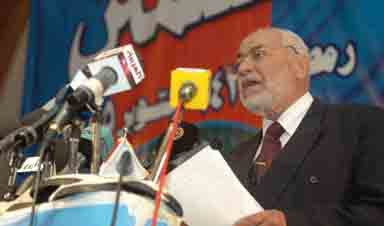

+++
title = "إخوان الأردن.. على خطى مصر!"
date = 2005-12-12
authors = ["ماجد توبة"]

[taxonomies]
authors = ["maged-toba"]
sections = ["latest-news"]

[extra]
section_name = "آخر الأخبار"
share_image = "/media/admins.20at.com/aly/8.jpg"
summary = "أبحاث ودراسات وجهود رصد، كلها تؤكد أن الشعوب العربية أصبحت تفضل الإسلام السياسي كبديل عن الأوضاع المزمنة التي تعيش فيها منذ سنوات، وهو ما ظهر جليا في عديد من ال"
section_slug = "latest-news"
section_colour = "#1D3557"
thumb = "/media/admins.20at.com/aly/8.jpg"
n_comments = 1
original_url = "http://20at.com/20at/latest-news/1395.html"
archived = "20100106021155"
date_source = "byline/meta"
aliases_20at = ["/20at/latest-news/1395.html"]

[extra.provenance]
original_url = "http://20at.com/20at/latest-news/1395.html"
capture_url = "https://web.archive.org/web/20100106021155/http://20at.com/20at/latest-news/1395.html"
capture_label = "٦ يناير ٢٠١٠، ٠٢:١١ UTC"
date_note = "من سطر التوقيع في المقال"
other_urls = []
comments = "١"
missing_images = ""
+++

<figure></figure>

أبحاث ودراسات وجهود رصد، كلها تؤكد أن الشعوب العربية أصبحت تفضل الإسلام السياسي كبديل عن الأوضاع المزمنة التي تعيش فيها منذ سنوات، وهو ما ظهر جليا في عديد من البلدان العربية في الفترة الأخيرة وخصوصا ما سبق 11 سبتمبر 2000، وهو الحدث الذي ربطه الباحثون بظاهرة تفضيل الإسلاميين.

نجاح الإخوان المسلمين (رغم حظرها قانونيا) في الانتخابات البرلمانية المصرية بعدد كبير هو ما جعل البعض يؤكد أن الجماعة ستنتشر على المستوى الدولي أيضا، خاصة أنها تحظى بوضع أفضل في دول أخرى لا تتعمد التضييق عليهم كما يحدث في مصر.

الأردن ربما تكون هي الدولة التالية في مسلسل صعود الأخوان، فمع إقتراب موعد الانتخابات صرح حمزة منصور أمين عام حزب جبهة العمل الإسلامي في تصريح خاص بعشرينات أمس أنه "إذا ما كان هنالك في المستقبل قوائم نسبية وثقة بالعملية الانتخابية، من حيث نزاهتها وشفافيتها، فسيقدم الإسلاميون قائمة مرشحين انتخابيين ستكون الأصدق تمثيلا لشرائح المجتمع الأردني فكريا وجغرافيا وسكانيا".

ولفت إلى إن القائمة الوطنية للإسلاميين "ستشمل مرشحين مسيحيين، نثق بتوجهاتهم الوطنية وانتمائهم للأمة ثقافة وحضارة". وأشار إلى إن ذلك "لن تمنعه قلة عدد المنتسبين للحزب من المسيحيين".

واستغرب منصور ما سماه بـ"التخوف من الإسلاميين". ووصفه بـ "غير المبرر". وقال إن "الإسلاميين وصلوا للبرلمان بقوة العام 1989".

وكان رئيس الوزراء معروف البخيت تعهد في رده على كتاب التكليف السامي بتقديم قانون انتخاب جديد ضمن حزمة قوانين أخرى للبلديات والأحزاب. وأشار إلى أن حكومته، التي شكلت في 27 تشرين الثاني (نوفمبر) الماضي "ستعتمد توصيات الأجندة الوطنية مرشدا وهاديا لعملها".

وقال منصور إن الإسلاميين "ليسوا طارئين على البلد، ومشاركتهم ليست جديدة، وقد أكدوا للسلطة وللأحزاب الأخرى أنهم ليسوا إقصائيين أو متزمتين"، وزاد أنهم "دعموا خلال انتخابات 1989 الكثير من المرشحين من مختلف الاتجاهات، وبعضهم مسيحيون، كما لم يعهد عليهم أنهم من مقتنصي الفرص".

إلى ذلك، وحول الحوار بين الغرب والإسلاميين قال منصور إن "الإسلاميين المعتدلين دعاة حوار، لكن الحوار له ظروفه". وشدد على أن أي حوار لإسلاميي الأردن مع الإدارة الأميركية "سابق لأوانه". وزاد انه "يلزم لإجراء أي حوار أن تقوم الإدارة الأميركية بوقف العدوان بأشكاله عن الأمة".

