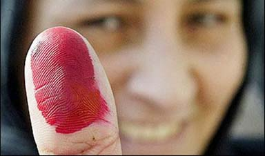

+++
title = "وبدأ موسم التشكيك!"
date = 2005-12-12
authors = ["محمد أبو زيد"]
aliases = ["/articles/b70/"]

[taxonomies]
authors = ["mohamed-abu-zid"]
sections = ["latest-news"]

[extra]
section_name = "آخر الأخبار"
share_image = "/media/admins.20at.com/aly/entekhabat.jpg"
summary = "كما توقع الجميع، فإن المعركة الحالية بين الوطني والإخوان ستدور بشكل قانوني ودستوري وقضائي أيضا، فرهان الجبهتين الآن يركز على مدى قدرة المجلس الحالي على الاستمرا"
section_slug = "latest-news"
section_colour = "#1D3557"
thumb = "/media/admins.20at.com/aly/entekhabat.jpg"
n_comments = 1
original_url = "http://20at.com/20at/latest-news/1396.html"
archived = "20100106021257"
date_source = "byline/meta"
aliases_20at = ["/article2.php?sid=70", "/20at/latest-news/1396.html"]

[extra.provenance]
original_url = "http://20at.com/20at/latest-news/1396.html"
capture_url = "https://web.archive.org/web/20100106021257/http://20at.com/20at/latest-news/1396.html"
capture_label = "٦ يناير ٢٠١٠، ٠٢:١٢ UTC"
date_note = "من سطر التوقيع في المقال"
other_urls = ["/article2.php?sid=70"]
comments = "١"
missing_images = ""
+++

<figure></figure>

كما توقع الجميع، فإن المعركة الحالية بين الوطني والإخوان ستدور بشكل قانوني ودستوري وقضائي أيضا، فرهان الجبهتين الآن يركز على مدى قدرة المجلس الحالي على الاستمرار خاصة بعد طعون كثيرة قدمت فيه، وبعد وقائع تزوير أكيدة مسجلة صوت وصورة، و..بإشراف قضائي كامل!

اليوم، وفي فصل جديد من فصول التشكيك في المجلس القادم بأغلبية وطني (نسبة للوطني) وكمية اخوانية غير مسبوقة، وبموت إكلينيكي لأحزاب المعارضة، تحرك رؤساء الأحزاب التي لم يعرفها المصريين إلا مؤخرا في انتخابات الرئاسة ليقولوا كلمتهم في ما حدث في انتخابات المجلس في معركة لم يكن لهم فيها ناقة ولا جمل ...

<h3>قضاء...وقدر!</h3>

قضت محكمة القضاء الإداري بجنوب القاهرة بقبول الدعوى القضائية التي أقامها رؤساء سبعة أحزاب المشاركين في لجنة التشاور الحزبي.

وأكد أحمد الفضالي رئيس حزب السلام الدولي ووكيل رافعي الدعوة أن المحكمة حجزت القضية للحكم يوم السبت القادم وأنها قبلتها كدعوى مستعجلة لتوافر عناصر الدعوى المستعجلة ومنها ثبوت وجود الخطر الداهم والذي يتمثل في أن عدم وقف قرار رئيس الجمهورية رقم 347 لستة 2005 من شأنه أن يؤدي إلى تشكيل مجلس شعب باطل مخالف للدستور.

وأضاف الفضالي أن رؤساء الأحزاب استندوا في دعواهم على عدم دستورية فرار رئيس الجمهورية الخاص بدعوة الناخبين لانتخاب أعضاء مجلس الشعب، إلى غياب اللائحة التنفيذية لقانون مباشرة الحقوق السياسية الذي تم تعديله العام الحالي، وأن دعوة الناخبين جاءت وفقا للائحة عام 1956 وكأن مصر ماتت نصف قرن.

وأشار الفضالي خلال المؤتمر الصحفي الذي عقد أمس بمقر حزب السلام والذي حضره حلمي سالم رئيس حزب الأحرار، ووحيد الأقصري رئيس حزب مصر الاشتراكي، وأحمد عبد الهادي رئيس حزب شباب مصر، إلى أن رؤساء الأحزاب طالبوا في دعواهم بضرورة إجراء الانتخابات بالقائمة النسبية لأنها الأقرب لروح الدستور الذي نص على التعددية الحزبية.

وفد تبارى رؤساء أحزاب (لجنة التشاور) في مهاجمة الحكومة وحملوها المسئولية عن صعود الإخوان بهذه الصورة وذلك بحصارها للأحزاب الشرعية وتركها الإخوان يتحركون في كل مكان، وكأن الأمر عقاب لهذه الأحزاب (الضعيفة أصلا) على وجودها في معركة الرئاسة الأخيرة.

وقال وحيد الأقصري، رئيس حزب مصر الاشتراكي، أن الإخوان يتقابلون 5 مرات يوميا من صلاة الفجر وحتى صلاة العشاء في النقابات والجامعات ثم تقول الحكومة أنها جماعة محظورة؟، وهو ما دفعه للتأكيد (ضمنيا) في كلمته أن الأحزاب هي التي أصبحت محظورة أمام سطوة الحزب الوطني وإمكانياته المادية والأمنية، وأمام قدرة الإخوان على الحشد وتفوقهم التنظيمي والعددي والذي ظهر جليا في معركة الانتخابات المنتهية منذ أيام!

وتساءل حلمي سالم رئيس حزب الأحرار لماذا لم تحاسب الحكومة الإخوان على جرائم الرشوة والبلطجة التي ارتكبوها طالما هي متأكدة من ذلك؟

ولو لم يكن الأخوان هم الفاعلين، فأين المسئولين عما حدث، وأين الأمن المصري وسيطرته "المزعومة" التي يباهي بها الرئيس أقرانه في كل محافله!

