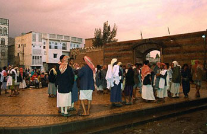

+++
title = "قات اليمن.. محروق"
date = 2005-12-13
authors = ["رويترز"]
aliases = ["/articles/b80/"]

[taxonomies]
authors = ["reuters"]
sections = ["latest-news"]

[extra]
section_name = "آخر الأخبار"
share_image = "/media/admins.20at.com/aly/yp001110.jpg"
summary = "تسببت موجة صقيع تخيم على معظم المناطق الجبلية الزراعية في اليمن منذ نهاية الأسبوع الماضي بحدوث أضرار كبيرة في زراعة منتج القات الذي ينتشر تعاطيه بكثرة لدى غالبي"
section_slug = "latest-news"
section_colour = "#1D3557"
thumb = "/media/admins.20at.com/aly/yp001110.jpg"
n_comments = 1
original_url = "http://20at.com/20at/latest-news/1406.html"
archived = "20100106021420"
date_source = "byline/meta"
aliases_20at = ["/article2.php?sid=80", "/20at/latest-news/1406.html"]

[extra.provenance]
original_url = "http://20at.com/20at/latest-news/1406.html"
capture_url = "https://web.archive.org/web/20100106021420/http://20at.com/20at/latest-news/1406.html"
capture_label = "٦ يناير ٢٠١٠، ٠٢:١٤ UTC"
date_note = "من سطر التوقيع في المقال"
other_urls = ["/article2.php?sid=80"]
comments = "١"
missing_images = ""
+++

<figure></figure>

تسببت موجة صقيع تخيم على معظم المناطق الجبلية الزراعية في اليمن منذ نهاية الأسبوع الماضي بحدوث أضرار كبيرة في زراعة منتج القات الذي ينتشر تعاطيه بكثرة لدى غالبية اليمنيين ما أدى إلى ارتفاع أسعاره بشكل لم يسبق له مثيل هذه الأيام.

وقال باعة قات ومتعاملون ان موجة الصقيع الحالية اثرت سلبياً على سائر المنتجات الزراعية والخضروات والفواكة عموماً وزراعة نبات القات بشكل خاص مما قد يزيد الأعباء الإضافية على المزارعين الذين كانوا تضرروا من تطبيق إصلاحات سعرية جديدة رفعت أسعار المشتقات النفطية ومنها الديزل الذي يعتمد عليه في الإنتاج الزراعي منذ يوليو الماضي بنسبة مئة في المائة.

وأشاروا إلى ان موجة الصقيع هذه أثارت مشاعر الخوف والقلق لدى مزارعي الخضار والفواكة والقات الذين سارع قطاع واسع منهم إلى قطف ثمار المحاصيل مبكراً خشية من ان تتلف بسبب البرد القارس الذي رافقه ارتفاع قياسي في أسعار القات بنسبة تجاوزت 300 في المئة في الحزمة الواحدة.

كما ارتفعت أسعار الخضروات والفواكة بنسبة أكثر من مئة في المئة.

والقات منتج نباتي يستهلك يوميا. وهو أول وأهم محصول زراعي رائج استهلاكياً ورابح تجارياً في اليمن نتيجة الأموال التي يحركها في الأسواق يومياً والتي تقدر بحوالي ستة ملايين دولار. ويتعاطى معظم اليمنيين البالغ تعدادهم 20 مليون نسمة القات بالمضغ عن طريق الفم من بعد ظهر كل يوم في جلسات جماعية وفردية تمتد إلى الساعات الأولى من الليل.

وأظهرت دراسة علمية حديثة ان الوقت الذي يهدره اليمنيون في جلسات تعاطي القات اليومية التي تسمى شعبياً "المقيل" تقدر بحوالي 20 مليون ساعة في اليوم الواحد في حين يتراوح متوسط تكلفة حاجة الشخص الواحد منه بين 5 و10 دولارات.

وأشارت إلى ان ما يزيد على نصف مليون أسرة يمنية تعتمد بدرجة أساسية على زراعة القات. كما ان نسبة مماثلة تعمل في الأعمال المساعدة مثل النقل والتجارة والبيع بالجملة في مناطق التصدير والتجزئة في أسواق مدن ومناطق الاستهلاك.

أي ان هناك نسبة كبيرة من السكان تقدر بحوالي 20 إلى 30 بالمئة يرتبط نشاطهم الاقتصادي ومصدر حياتهم المعيشية اليومية بالقات زراعة وإنتاجا ونقلاً وتوزيعاً وتسويقاً.

ويرى محللون محليون ان هذا الوضع يعني ان تعرض قطع زراعة وتجارة القات لأي طاريء أو ظرف من الظروف سيلقي بتبعاته السلبية على المشتغلين في هذا المحصول

الذي يقدر حجم نشاطه اليومي بمئات الملايين من الريالات.

وكان تقرير رسمي قد ذكر ان القات احتل المرتبة الأولى في قيمة المنتجات الزراعية في اليمن اذ بلغت قيمة إنتاجه العام الماضي نحو 127 مليار ريال بزيادة 14 مليار ريال عن العام 2003 وجاءت الفواكة في المرتبة الثانية بنحو 77 مليار ريال.

