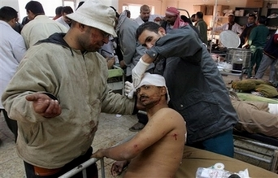

+++
title = "50 عراقياً شهداء الطيران"
date = 2006-12-12

[taxonomies]
authors = []
sections = ["nashrat-9"]

[extra]
section_name = "نشرة 9"
share_image = "/media/admins.20at.com/marwa05/iraq_tafgir.jpg"
summary = "لقي أكثر من خمسين شخصا حتفهم وأصيب قرابة مئة آخرين عندما انفجرت سيارتان مفخختان أحداهما بقيادة انتحاري بشكل متزامن صباح اليوم في أحد ميادين العاصمة بغداد."
section_slug = "nashrat-9"
section_colour = "#004B80"
thumb = "/media/admins.20at.com/marwa05/iraq_tafgir.jpg"
n_comments = 1
original_url = "http://www.20at.com:80/20at/latest-news/2910.html"
archived = "20100214022853"
date_source = "byline/meta"
aliases_20at = ["/20at/latest-news/2910.html"]

[extra.provenance]
original_url = "http://www.20at.com:80/20at/latest-news/2910.html"
capture_url = "https://web.archive.org/web/20100214022853/http://www.20at.com:80/20at/latest-news/2910.html"
capture_label = "١٤ فبراير ٢٠١٠، ٠٢:٢٨ UTC"
date_note = "من سطر التوقيع في المقال"
other_urls = []
comments = "١"
missing_images = ""
+++

<figure></figure>

لقي أكثر من خمسين شخصا حتفهم وأصيب قرابة مئة آخرين عندما انفجرت سيارتان مفخختان أحداهما بقيادة انتحاري بشكل متزامن صباح اليوم في أحد ميادين العاصمة بغداد.

ووقع الانفجاران في ميدان الطيران واستهدف على ما يبدو دورية للشرطة وتجمع لعمال عراقيين كان يسعون للحصول على عمل في أحد المواقع تحت البناء.

وأعقب التفجيران سماع أصوات إطلاق رصاص بينما غطى الدخان الكثيف المنطقة.

ويقع ميدان الطيران في قلب العاصمة العراقية ويجاوره العديد من الوزارات.

