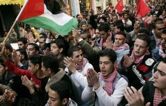

+++
title = "خيمة عزاء لأطفال فلسطين"
date = 2006-12-12

[taxonomies]
authors = []
sections = ["nashrat-9"]

[extra]
section_name = "نشرة 9"
share_image = "/media/admins.20at.com/marwa05/r2914200255.jpg"
summary = "أمر الرئيس الفلسطيني محمود عباس قوات الأمن التابعة له بالانتشار في أنحاء غزة اليوم الثلاثاء بعد مقتل ثلاثة أبناء لأحد مؤيديه وهو حادث أثار صدمة الفلسطينيين وعزز"
section_slug = "nashrat-9"
section_colour = "#004B80"
thumb = "/media/admins.20at.com/marwa05/r2914200255.jpg"
n_comments = 1
original_url = "http://www.20at.com:80/20at/latest-news/2911.html"
archived = "20100215070444"
date_source = "byline/meta"
aliases_20at = ["/20at/latest-news/2911.html"]

[extra.provenance]
original_url = "http://www.20at.com:80/20at/latest-news/2911.html"
capture_url = "https://web.archive.org/web/20100215070444/http://www.20at.com:80/20at/latest-news/2911.html"
capture_label = "١٥ فبراير ٢٠١٠، ٠٧:٠٤ UTC"
date_note = "من سطر التوقيع في المقال"
other_urls = []
comments = "١"
missing_images = ""
+++

<figure></figure>

أمر الرئيس الفلسطيني محمود عباس قوات الأمن التابعة له بالانتشار في أنحاء غزة اليوم الثلاثاء بعد مقتل ثلاثة أبناء لأحد مؤيديه وهو حادث أثار صدمة الفلسطينيين وعزز المخاوف من اندلاع صراع داخلي.

وتصاعد التوتر بين عباس وحركة المقاومة الإسلامية (حماس) بعد الهجوم الذي شنه مسلحون مجهولون أمس، وقتل الصبية الثلاثة وهم أبناء قيادي رفيع في المخابرات الفلسطينية لدى وصولهم إلى مدرستهم.

وفي وقت مبكر اليوم اتخذ أفراد مدججون بالسلاح ينتمون لقوات أمن تابعة لعباس وبأمر من الرئيس الفلسطيني مواقع حول المنشات وتقاطعات الطرق في مدينة غزة.

وقال مصدر أمني فلسطيني "انتشرت قوات الأمن الفلسطينية في كل شوارع مدينة غزة من أجل منع الجريمة، ويأتي هذا تنفيذا لأوامر عباس".

كما عززت قوة مؤيدة لحكومة حماس مواقعها، ولم تكن هناك أي مؤشرات على وقوع احتكاك بين الموالين لعباس والموالين لحماس ولكن تصاعدت بحدة المخاوف من تجدد الاشتباكات أمس.

ومر عشرات الأطفال في طريقهم إلى مدارسهم بخيمة عزاء أقيمت للضحايا الثلاثة في مدينة غزة، ثم أشعلوا بعدها النار في إطارات السيارات احتجاجا على حادث القتل وتصاعد الدخان الأسود في الجو.

وهذه أول مرة يستهدف فيها أطفال في مثل هذا الهجوم، وهاجم مشيعون غاضبون مجمع البرلمان خلال جنازة الصبية مطلقين أعيرة نارية، وتتراوح أعمار الصبية بين ستة أعوام وتسعة أعوام.

وقال مسؤول رفيع في المخابرات الفلسطينية في الضفة الغربية أنه لم يتضح من يقف وراء الهجوم على أبناء العقيد بهاء بعلوشة.

وأعلن عباس وإسماعيل هنية رئيس الوزراء الفلسطيني أنهما طلبا من السلطات ملاحقة القتلة.

