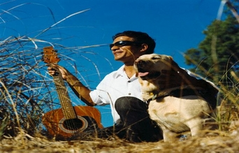

+++
title = "المكفوفين في رحلة صيد"
date = 2006-12-12

[taxonomies]
authors = []
sections = ["nashrat-9"]

[extra]
section_name = "نشرة 9"
share_image = "/media/admins.20at.com/marwa05/blind.jpg"
summary = "قدم العضو ادموند كيمبل البرلماني بولاية تكساس اقتراحا من شأنه أن يسمح للمكفوفين بصيد كل الطرائد التي يمكن للمبصرين تعقبها حاليا."
section_slug = "nashrat-9"
section_colour = "#004B80"
thumb = "/media/admins.20at.com/marwa05/blind.jpg"
n_comments = 0
original_url = "http://www.20at.com:80/20at/latest-news/2912.html"
archived = "20100215070450"
date_source = "byline/meta"
aliases_20at = ["/20at/latest-news/2912.html"]

[extra.provenance]
original_url = "http://www.20at.com:80/20at/latest-news/2912.html"
capture_url = "https://web.archive.org/web/20100215070450/http://www.20at.com:80/20at/latest-news/2912.html"
capture_label = "١٥ فبراير ٢٠١٠، ٠٧:٠٤ UTC"
date_note = "من سطر التوقيع في المقال"
other_urls = []
comments = ""
missing_images = ""
+++

<figure></figure>

قدم العضو ادموند كيمبل البرلماني بولاية تكساس اقتراحا من شأنه أن يسمح للمكفوفين بصيد كل الطرائد التي يمكن للمبصرين تعقبها حاليا.

ويأمل كيمبل في إقرار هذا الاقتراح عندما يجتمع المجلس التشريعي في يناير/ كانون الثاني المقبل بالرغم من أنه لا يتوقع سريانه قبل عام 2008.

وقال كيمبل لرويترز "هذا يتيح متعة الصيد لأناس آخرين وأعتقد أن هذا أمر عظيم".

وربما لا يلقى مشروع القانون هذا معارضة تذكر في تكساس حيث أن السياسيين من مختلف الأطياف في الولاية يقرون الصيد الذي يحظى بشعبية كبيرة هناك.

وبموجب مشروع القانون سيتطلب أن يرافق صياد مبصر الصيادين المكفوفين كما سيسمح باستخدام أجهزة تصويب بالليزر وأدوات أخرى يحظر استخدامها حاليا.

وقال تيري اروين منسق تعليم الصيد بإدارة حدائق تكساس والحياة البرية ومقره اوستين "يمكن لشخص كفيف أن يطلق النيران من بندقية مزودة بمجهر التصويب من الجانب بدلا من الجزء الفوقي".

وأضاف "هذا يسمح للمرافق بالنظر من ورائهم ومساعدتهم على التصويب لكن يمكن للشخص الكفيف سحب زند البندقية".

