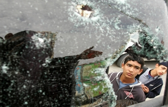

+++
title = "إغتيال قاضي فلسطين .. مين السبب؟"
date = 2006-12-13

[taxonomies]
authors = []
sections = ["nashrat-9"]

[extra]
section_name = "نشرة 9"
share_image = "/media/admins.20at.com/marwa05/palestinian_egteal.jpg"
summary = "قتل مسلحون مجهولون قاضيا في حكومة حركة المقاومة الإسلامية الفلسطينية (حماس) قرب المحكمة التي يعمل بها في قطاع غزة اليوم الأربعاء في حادث من شبه المؤكد أن يؤجج ا"
section_slug = "nashrat-9"
section_colour = "#004B80"
thumb = "/media/admins.20at.com/marwa05/palestinian_egteal.jpg"
n_comments = 0
original_url = "http://www.20at.com:80/20at/latest-news/2921.html"
archived = "20100215070455"
date_source = "byline/meta"
aliases_20at = ["/20at/latest-news/2921.html"]

[extra.provenance]
original_url = "http://www.20at.com:80/20at/latest-news/2921.html"
capture_url = "https://web.archive.org/web/20100215070455/http://www.20at.com:80/20at/latest-news/2921.html"
capture_label = "١٥ فبراير ٢٠١٠، ٠٧:٠٤ UTC"
date_note = "من سطر التوقيع في المقال"
other_urls = []
comments = ""
missing_images = ""
+++

<figure></figure>

قتل مسلحون مجهولون قاضيا في حكومة حركة المقاومة الإسلامية الفلسطينية (حماس) قرب المحكمة التي يعمل بها في قطاع غزة اليوم الأربعاء في حادث من شبه المؤكد أن يؤجج الصراعات الداخلية ويزيد المخاوف من اندلاع حرب أهلية.

وقال مسؤولون من حماس وسكان آن بسام الفرا (28 عاما) قاض في محكمة مدنية وهو أيضا قائد بارز في الجناح العسكري للحركة الإسلامية، وذكروا أن أربعة مسلحين فتحوا النار عليه في بلدة خان يونس بجنوب غزة بينما كان الفرا في طريقه إلى العمل.

وجاء الحادث وسط تصاعد للتوتر في قطاع غزة والضفة الغربية المحتلة بين حركة حماس الحاكمة وحركة فتح المنافسة التي يقودها الرئيس الفلسطيني محمود عباس.

ولم تعلن أي جهة المسؤولية عن قتل القاضي الذي وصفته حماس بأنه "اغتيال" وأصدرت حماس التي تتهم فتح بمحاولة إسقاط حكومتها بياناً ألقت فيه اللوم على فرق الموت التابعة لفتح.

وقال مشير المصري - نائب حماس في المجلس التشريعي الفلسطيني- لرويترز أن الساعين لانقلاب في فتح يتحملون مسؤولية كل أعمال الفوضى الجارية في الشوارع الفلسطينية.

وانتقد توفيق أبو خوصة - المتحدث باسم فتح -حماس لإلقائها اللوم على الحركة الحاكمة السابقة وطالب "الإخوة في حماس" بالدقة وعدم إلقاء التهم جزافا قبل أن تبدأ التحقيقات.

وفي جنين بالضفة الغربية قال سكان أن ناشطا لا يعرف إلى أي فصيل ينتمي قتل، ولم يكن لديهم المزيد من التفاصيل، وقال الجيش الإسرائيلي الذي شن غارات كثيرة على البلدة أنه يستوثق من صحة التقرير.

<h3>تبادل الجانبان</h3>

وتبادلت قوات أمن فلسطينية تابعة لعباس ورجال الشرطة التابعة لحماس أمس إطلاق النار في جنوب غزة مع تصاعد التوتر في القطاع بعد مقتل ثلاثة أبناء لمسؤول كبير بالمخابرات من مؤيدي الرئيس الفلسطيني.

وتبادل الجانبان الاتهام ببدء الاشتباك الذي وقع في مدينة خان يونس، وقال المتحدث باسم حماس أن أفرادا من قوة عباس كانوا يقومون باحتجاج ويهاجمون المباني العامة.

وفي وقت سابق أمر عباس قوات أمنه بالانتشار في أنحاء غزة بعد مقتل الصبية الثلاثة الذين تتراوح أعمارهم بين ستة أعوام وتسعة أعوام.

وحمل حسين الشيخ وهو مسؤول كبير في حركة فتح حكومة حماس المسؤولية، وقال الشيخ إن أناسا مقربين من حماس على اقل تقدير هم بالطبع مسؤولون عن القتل.

وأضاف "نحمل الحكومة ووزارة الداخلية المسؤولية المباشرة"، وأضاف أنهم مافيا

وعصابات إجرام في إشارة إلى القتلة الذين شنوا هجومهم من سيارة مسرعة.

وسارع المصري إلى نفي الاتهام في غضب ونفى أي صلة لحركته بالهجوم، وقال "يبدو أن بعض قادة فتح" يحاولون استغلال دماء الأطفال الأبرياء لتحقيق مكاسب سياسية وقال أن حركة حماس تحمل هؤلاء القادة المسؤولية عن العواقب الخطيرة التي قد تسفر عن الأكاذيب والاختلافات التي يرددونها.

وإلى جانب الاضطرابات السياسية الداخلية تفجر اقتتال عشائري وتصاعدت الجريمة في غزة بعد الحظر الاقتصادي الغربي الذي فرض على حكومة حماس مما زاد من مستويات الفقر.

<h3>علي أيدي مسلحين</h3>

وفي مدينة رام الله بالضفة الغربية قال مسؤول في حماس أن نشطا من الحركة أصيب في وقت متأخر يوم الثلاثاء بجراح على أيدي مسلحين من كتائب شهداء الأقصى وهي جزء من حركة فتح، وقال المسؤولون أن نشطاء كانوا يحاولوا تعليق رايات لحماس حينما تعرضوا لإطلاق النار، واتهم مسؤول المسلحين بخطف عضو من حماس.

ونفت كتائب شهداء الأقصى أنها خطفت أحد أشخاص حماس، وقالت الجماعة أنها أطلقت النار على النشطاء بعد ما حاولوا تعليق رايات وملصقات فوق صور للزعيم الراحل ياسر عرفات الذي كان أيضا زعيما لفتح قبل وفاته عام 2004 .

وانتقد أمس وزير الداخلية سعيد صيام عباس قائلا انه لم ينسق معه نشر القوات في غزة يوم الثلاثاء، ورفض صيام وهو قيادي بارز في حماس كذلك اتهامات بأنه يتحمل مسؤولية مقتل الأطفال، وابلغ صيام قناة الجزيرة الإخبارية أن مثل هذه التصريحات والاتهامات لا تخدم الاستقرار.

واتهمت حماس عباس بمحاولة الإطاحة بالحكومة التي وصلت للسلطة بعد فوزها في الانتخابات، وانهارت محادثات تشكيل حكومة وحدة وطنية فلسطينية لرفض حماس الاستجابة للمطالب الغربية بالاعتراف بإسرائيل.

