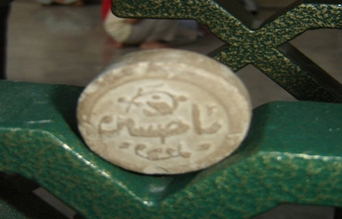

+++
title = "إعلان تأسيس دولة الشيعة بالعراق"
date = 2006-12-18

[taxonomies]
authors = []
sections = ["nashrat-9"]

[extra]
section_name = "نشرة 9"
share_image = "/media/admins.20at.com/marwa05/ya_hussine.jpg"
summary = "قالت صحيفة واشنطن بوست الأمريكية اليوم الاثنين نقلاً عن تقرير أمني أمرت بإعداده الحكومة السعودية إن إيران أنشأت بشكل فعلي \"دولة (شيعية) داخل الدولة\" في العراق م"
section_slug = "nashrat-9"
section_colour = "#004B80"
thumb = "/media/admins.20at.com/marwa05/ya_hussine.jpg"
n_comments = 0
original_url = "http://www.20at.com:80/20at/latest-news/2942.html"
archived = "20100215070039"
date_source = "byline/meta"
aliases_20at = ["/20at/latest-news/2942.html"]

[extra.provenance]
original_url = "http://www.20at.com:80/20at/latest-news/2942.html"
capture_url = "https://web.archive.org/web/20100215070039/http://www.20at.com:80/20at/latest-news/2942.html"
capture_label = "١٥ فبراير ٢٠١٠، ٠٧:٠٠ UTC"
date_note = "من سطر التوقيع في المقال"
other_urls = []
comments = ""
missing_images = ""
+++

<figure></figure>

قالت صحيفة واشنطن بوست الأمريكية اليوم الاثنين نقلاً عن تقرير أمني أمرت بإعداده الحكومة السعودية إن إيران أنشأت بشكل فعلي "دولة (شيعية) داخل الدولة" في العراق موفرة كل من الإمداد للجماعات المسلحة والتمويل للبرامج الاجتماعية.

ونقلت الصحيفة عن التقرير الذي يقع في 40 صفحة قوله إن القوات المسلحة الإيرانية تزود الميليشيات الشيعية بالسلاح والتدريب وإن طهران تدعم بشكل نشط الساسة العراقيين المؤيدين لإيران، ونقلت عن التقرير قوله أيضاً "حيث أخفق الأمريكيون يدخل الإيرانيون".

ووصف التقرير منظمة بدر وهي الجناح المسلح للمجلس الأعلى للثورة الإسلامية في العراق وهو أكبر حزب في الحكومة العراقية بوصفها "الأداة الرئيسية التي تستخدمها إيران لتحقيق أمنها العسكري وأهداف المخابرات".

وفي تفاصيل عن نشاط المسلحين السنة ينقل التقرير عن زعماء عشائر عراقيين قولهم إن من يقودون هذه الأعمال أساسا هم قادة سابقون وضباط عسكريون برتب عالية من حكومة حزب البعث العراقية التي جرى تفكيكها.

وذكرت الصحيفة أن التقرير يتوصل إلى أنه مع وضع الروابط التاريخية في الاعتبار فان "السعودية تتحمل مسؤولية خاصة بضمان استمرار رفاهية وأمن السنة في العراق".

ومضت الصحيفة تقول إن التقرير يوصي بأن تعد الحكومة السعودية إستراتيجية للتعامل مع أسوأ سيناريو ممكن باندلاع حرب أهلية شاملة واطلاع الولايات المتحدة على التقرير.

وأشار المقال إلى أن نواف عبيد قاد إعداد التقرير، وأقيل عبيد في الآونة الأخيرة بعد أن كتب مقالا في صحيفة واشنطن بوست لمح فيه إلى أن المملكة العربية السعودية ستساند السنة في العراق في حالة اندلاع صراع طائفي أوسع.

وأوضحت الصحيفة أن الدراسة أعدتها مجموعة مشروع تقييم الأمن الوطني السعودي المكلفة بتقديم تقييم أمني واستخباري للحكومة السعودية، وقالت إن هذه النتائج قدمت للحكومة السعودية في مارس آذار ولكنها لم توزع بشكل علني.

