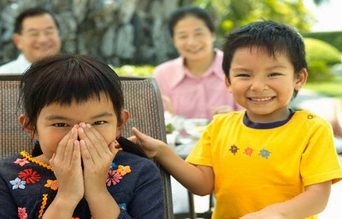

+++
title = "2% من الصينيين يبتسمون"
date = 2006-12-18

[taxonomies]
authors = []
sections = ["nashrat-9"]

[extra]
section_name = "نشرة 9"
share_image = "/media/admins.20at.com/marwa05/smile2.jpg"
summary = "قررت مدينة شنغهاي إطلاق حملة لحث مواطنيها على التبسم قبل المعرض العالمي الذي سيقام 2010 وجندت لهذا الغرض \"متطوعين مبتسمين\" من أجل أن تظهر المدينة في أفضل صورها "
section_slug = "nashrat-9"
section_colour = "#004B80"
thumb = "/media/admins.20at.com/marwa05/smile2.jpg"
n_comments = 1
original_url = "http://www.20at.com:80/20at/latest-news/2943.html"
archived = "20100215070504"
date_source = "byline/meta"
aliases_20at = ["/20at/latest-news/2943.html"]

[extra.provenance]
original_url = "http://www.20at.com:80/20at/latest-news/2943.html"
capture_url = "https://web.archive.org/web/20100215070504/http://www.20at.com:80/20at/latest-news/2943.html"
capture_label = "١٥ فبراير ٢٠١٠، ٠٧:٠٥ UTC"
date_note = "من سطر التوقيع في المقال"
other_urls = []
comments = "١"
missing_images = ""
+++

<figure></figure>

قررت مدينة شنغهاي إطلاق حملة لحث مواطنيها على التبسم قبل المعرض العالمي الذي سيقام 2010 وجندت لهذا الغرض "متطوعين مبتسمين" من أجل أن تظهر المدينة في أفضل صورها أمام ضيوفها الأجانب.

وقالت صحيفة تشاينا ديلي اليوم الاثنين أن 40 طالبا جامعيا تطوعوا للابتسام في وجه الناس في الأماكن العامة بعد ما أوضحت دراسة لإحدى شركات صناعة العلكة أن 2% فقط من الشعب الصيني يبتسمون في وجه الغرباء.

وقال تشو شياوهونج قائد الفريق للصحيفة "نطلب من جميع الأعضاء التدريب على الابتسام في المنزل ... نبتسم أمام المرأة لمعرفة ما إذا كانت ابتسامتنا مقبولة، لا نبتسم فقط بأفواهنا بل بأعيننا أيضا".

وقامت المجموعة بأول "مهمة ابتسام" يوم السبت في مسرح محلي حيث ابتسموا في وجه رواد المسرح وعرضوا تقديم أي مساعدة لهم.

وقال تشو أن فريق المبتسمين سوف يقوم بضم أفراد جدد وستنتشر الفرق أثناء المعرض الذي تعتبره حكومة شنغهاي بمثابة علامة على وصول المدينة التي تحظى برواج اقتصادي كبير إلى درجة عالية من التطور.

وقوبلت محاولات لإضفاء حالة من الدفء على العلاقات بين الغرباء في الصين بردود أفعال متباينة.

ففي شهر أكتوبر/ تشرين الأول احتجزت الشرطة متطوعين كانوا "يحتضنون مجانا" الأشخاص في شارع تسوق مزدحم في بكين.

