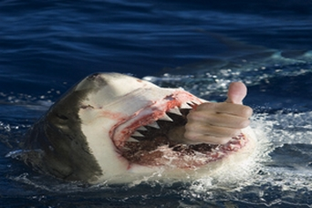

+++
title = "حادثة القرش .. كانت سليمة"
date = 2006-12-19

[taxonomies]
authors = []
sections = ["nashrat-9"]

[extra]
section_name = "نشرة 9"
share_image = "/media/admins.20at.com/marwa05/fish_shark.jpg"
summary = "هاجمت سمكة قرش شابا كان يركب الأمواج قبالة شاطئ بلز بيتش الاسترالي بعد ظهر أمس الاثنين وقبضت على ساقه اليسرى قبل أن يتمكن من الفكاك من أنيابها والوصول إلى الشاط"
section_slug = "nashrat-9"
section_colour = "#004B80"
thumb = "/media/admins.20at.com/marwa05/fish_shark.jpg"
n_comments = 0
original_url = "http://www.20at.com:80/20at/latest-news/2952.html"
archived = "20100215070046"
date_source = "byline/meta"
aliases_20at = ["/20at/latest-news/2952.html"]

[extra.provenance]
original_url = "http://www.20at.com:80/20at/latest-news/2952.html"
capture_url = "https://web.archive.org/web/20100215070046/http://www.20at.com:80/20at/latest-news/2952.html"
capture_label = "١٥ فبراير ٢٠١٠، ٠٧:٠٠ UTC"
date_note = "من سطر التوقيع في المقال"
other_urls = []
comments = ""
missing_images = ""
+++

<figure></figure>

هاجمت سمكة قرش شابا كان يركب الأمواج قبالة شاطئ بلز بيتش الاسترالي بعد ظهر أمس الاثنين وقبضت على ساقه اليسرى قبل أن يتمكن من الفكاك من أنيابها والوصول إلى الشاطئ.

وقالت السلطات اليوم الثلاثاء إن بيتر جالفن (25 عاما) كان يركب الأمواج في منطقة بالقرب من شاطئ بلز بيتش في ساحل استراليا الجنوبي عندما هاجمته سمكة القرش.

وقالت ليزا كيرني المسؤولة في الشرطة الاسترالية لوسائل إعلام محلية "الضحية كان يجلس على لوح ركوب الأمواج وساقاه تتدليان من الجانبين حين جاءته سمكة القرش من أسفل وقبضت على ساقه اليسرى في منطقة الفخذ وربلة الساق".

وأصيب جالفن بجروح أعلى ربلة ساقه وبجرح كبير تحت ركبته وبعد أن تلقى علاجا من زملائه راكبي الأمواج على الشاطئ نقل جوا إلى مستشفى في ملبورن حيث يرقد في حالة خطيرة ولكن مستقرة، ومنذ نحو أسبوعين قضمت سمكه قرش ساق شخص آخر من راكبي الأمواج قبالة شاطئ بعيد في ولاية استراليا الغربية.

وتسجل ولاية فلوريدا الأمريكية سنويا حتى الآن أغلب هجمات أسماك القرش، ويقول السجل الدولي لهجمات أسماك القرش الذي يتخذ من الولايات المتحدة مقرا إن 341 هجوما لأسماك القرش وقعوا قبالة شواطيء فلوريدا بين عامي 1990 و2005.

وفي نفس الفترة سجلت استراليا 74 هجوما وجنوب إفريقيا 72 هجوما والبرازيل 62 هجوما وجزر هاواي 57 هجوما لأسماك القرش.

