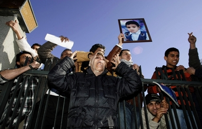

+++
title = "ممرضات ليبيا .. الإعدام انتقام"
date = 2006-12-19

[taxonomies]
authors = []
sections = ["nashrat-9"]

[extra]
section_name = "نشرة 9"
share_image = "/media/admins.20at.com/marwa05/libya.jpg"
summary = "أصدرت محكمة ليبية أحكاما بإعدام خمس ممرضات بلغاريات وطبيب فلسطيني اليوم الثلاثاء بعد إدانتهم بتعمد حقن مئات الأطفال بفيروس (إتش. آي . في) المسبب لمرض الإيدز وهي"
section_slug = "nashrat-9"
section_colour = "#004B80"
thumb = "/media/admins.20at.com/marwa05/libya.jpg"
n_comments = 0
original_url = "http://www.20at.com:80/20at/latest-news/2953.html"
archived = "20100215070052"
date_source = "byline/meta"
aliases_20at = ["/20at/latest-news/2953.html"]

[extra.provenance]
original_url = "http://www.20at.com:80/20at/latest-news/2953.html"
capture_url = "https://web.archive.org/web/20100215070052/http://www.20at.com:80/20at/latest-news/2953.html"
capture_label = "١٥ فبراير ٢٠١٠، ٠٧:٠٠ UTC"
date_note = "من سطر التوقيع في المقال"
other_urls = []
comments = ""
missing_images = ""
+++

<figure></figure>

أصدرت محكمة ليبية أحكاما بإعدام خمس ممرضات بلغاريات وطبيب فلسطيني اليوم الثلاثاء بعد إدانتهم بتعمد حقن مئات الأطفال بفيروس (إتش. آي . في) المسبب لمرض الإيدز وهي أحكام أثارت موجة من الاحتجاجات الغربية.

وأعلن الأحكام القاضي محمود حويصة، والستة متهمون بتعمد إصابة 426 طفلا ليبيا بالفيروس في مستشفى بنغازي أواخر التسعينات، وكان الادعاء طالب بعقوبة الإعدام، وقد تمثل الأحكام انتكاسة لجهود ليبيا لتحسين علاقاتها مع الغرب.

وأشادت عائلات الأطفال بالأحكام وقالت إنها تحد للغرب، وقال صبحي عبد الله الذي توفيت ابنته منى (سبعة أعوام) متأثرة بفيروس (إتش . آي . في) الذي أصيبت به في المستشفى في بنغازي حيث كانت الممرضات والطبيب يعملون "لقد تحققت العدالة، نحن سعداء".

وتابع لرويترز بعد النطق بالأحكام ليسدل الستار على إعادة المحاكمة التي استمرت سبعة شهور "يجب أن يعدموا سريعا"، وفي بلغاريا قالت بولينا ديميتروفا ابنة الممرضة المدانة سينزهانا ديميتروفا "لا أصدق مثل هذا الظلم".

وتوفي 50 طفلا من بين الأطفال الذين أصيبوا بالفيروس، ونفى المتهمون التهم المنسوبة إليهم وقال محامي الدفاع عثمان بيزنطي إنهم يعتزمون استئناف الأحكام الأخيرة، وأضاف لرويترز "سنستأنف الحكم أمام المحكمة العليا"، وتابع "سندرس الحكم وسنرى ما إذا كانت هناك أخطاء أو سوء فهم للحقائق".

وقال وزير العدل الليبي علي عمر الحسناوي إن المتهمين ستتاح لهم فرصة استئناف الأحكام الصادرة عليهم بالإعدام أمام المحكمة العليا الليبية، وكان المتهمون أدينوا في محاكمة جرت عام 2004 وصدرت ضدهم أحكام بالإعدام رميا بالرصاص، ولكن المحكمة العليا الليبية ألغت الأحكام العام الماضي وأمرت بإعادة المحاكمة أمام محكمة أقل درجة.

وأبدى فرانكو فراتيني مفوض الاتحاد الأوروبي لشؤون العدالة والأمن صدمته وخيبة أمله تجاه الأحكام، وأدانت محكمة العفو الدولية الأحكام.

ووصف وزير الخارجية البلغاري ايفاليو كالفين الحكم بأنه "مخيب للآمال بشدة، ولم تأخذ المحكمة الليبية في الاعتبار كل الأدلة على براءة الممرضات".

