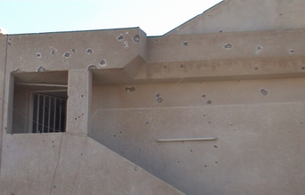
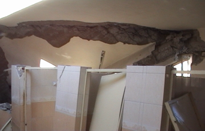
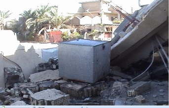

+++
title = "هكذا تهدم بيتي"
date = 2006-12-21
authors = ["نور أحمد"]

[taxonomies]
authors = ["nour-ahmed"]
sections = ["nashrat-9"]

[extra]
section_name = "نشرة 9"
share_image = "/media/admins.20at.com/marwa05/eraq_2.jpg"
summary = "الأمن والهدوء مبتغى كل اسرة في العالم .. هذه الحاجة الانسانية الواضحة هي التي أشار إليها القرآن الكريم في قوله تعالى (فليعبدوا رب هذا البيت الذي اطعمهم من جوع و"
section_slug = "nashrat-9"
section_colour = "#004B80"
thumb = "/media/admins.20at.com/marwa05/eraq_2.jpg"
n_comments = 0
original_url = "http://www.20at.com:80/20at/latest-news/2958.html"
archived = "20100215070100"
date_source = "byline/meta"
aliases_20at = ["/20at/latest-news/2958.html"]

[extra.provenance]
original_url = "http://www.20at.com:80/20at/latest-news/2958.html"
capture_url = "https://web.archive.org/web/20100215070100/http://www.20at.com:80/20at/latest-news/2958.html"
capture_label = "١٥ فبراير ٢٠١٠، ٠٧:٠١ UTC"
date_note = "من سطر التوقيع في المقال"
other_urls = []
comments = ""
missing_images = ""
+++

<figure></figure>

الأمن والهدوء مبتغى كل اسرة في العالم .. هذه الحاجة الانسانية الواضحة هي التي أشار إليها القرآن الكريم في قوله تعالى (فليعبدوا رب هذا البيت الذي اطعمهم من جوع وامنهم من خوف).

وفيما تشن الحروب فان هذا يعني استخدام الأسلحة المتنوعة والأشد فتكا بالأبرياء .. ففي الحرب الأمريكية على العراق استخدمت أسلحة متطورة وفتاكة.

أما بالنسبة لي ففي بيتي المتواضع على الطريق السريع الذي يخترق االعاصمة العراقية بغداد من الشمال إلى الجنوب في حي الجامعة ببغداد، وقعت مأساة حقيقة لا يمكن تصورها الا لمن عاش فيها.

صوت انفجار ضخم هز هذا البيت وكسر النوافد جميعها وبينما نحن هكذا لم نكشف عن وحشية الهجوم بالقذائف إلا عندما صعدت إلى الطابق العلوي من البيت لأجده قد تهشم بأكمله وقد اخترقت أكثر من قذيفة الطابق.

كانت الدماء قد جفت منذ فترة، غير أنه بالإماكن رؤية أماكن داكنة في بيت جارتي التي تلقت عشرين قذيفة أخرى بينما قتل أبناؤها علي 15 عاما، ومحمد 19 عاما، وهما يجلسون في الطابق العلوي من البيت المجاور لنا ....القميص الذي كانت ترتديه الطفلة هدى امتلآ بالدماء أما الابنة الأخرى سبعة أعوام فقد توفيت متأثرة بجراحها التي أصيبت بها لعدم تمكن نقلها للمستشفى بسبب حالة منع التجوال الليلي اليومي في بغداد من العاشرة ليلاً حتي السادسة صباحاً أو بالأحرى في منطقتنا تجد منع التجوال منذ الرابعة عصرا فلا أحد يوجد في الشارع، فهي منطقة أشباح لا محل ولا بشر فيها منذ الصباح بسبب سوء الوضع الأمني فيها.

ولم ينج من المذبحة، التي وقعت، سوى الأم، وابنه أخرى فقط .

وخلال زيارتي للمنزل، ظلت الأم صامتة أغلب الوقت، غير أن ابنتها أعادت رواية الحادث لنا في جلد تحسد عليه، إلا أنها انهارت عندما جاء ذكرت الإصابات التي تعرضت لها ابنتها الصغرى.

الابنة تروي بحقد إن ما حدث لها من كارثة لا تريد بعدها الحياة للأبد.

العراقيون استبشروا خيراً بالتوقيع على وثيقة مكة، وعدّوها مخرجاً مشرفاً للأزمة التي يعيشونها، والتي حظيت بتوقيع رجال الدين سنة وشيعاً عرباً وأكراداً، وأضفت أجواء التفاؤل بعد ما حرمت الوثيقة ببنودها العشرة سفك دماء العراقيين، وألزمت جميع الأطراف بعدم المساس بحرمة المساجد والحسينيات ودور العبادة الأخرى.

لكن ما يجري على الأرض العراقية من تقتيل واحتراب يضع الموقعين عليها أمام تساؤلات عدة، أبرزها: من يتحمّل وزر ما يحدث في العراق؟ وكيف سيسهمون في حقن دماء العراقيين هذا من جهة؟ أما من الجهة الثانية: فكيف تحل الأزمة الأمنية القائمة؟

<h3>شاهد صورتين لأثر قذيفة الهاون علي منزل نور</h3>

<figure></figure>

<figure></figure>
