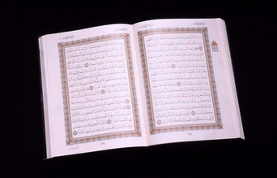

+++
title = "اللهم أعز الاسلام بالمغرب مثلما حدث  بالدن…"
date = 2006-12-21

[taxonomies]
authors = []
sections = ["nashrat-9"]

[extra]
section_name = "نشرة 9"
share_image = "/media/admins.20at.com/marwa05/the_holy_quran.jpg"
summary = "قالت صحيفة كريستيلغ داغلبلادت\" المسيحية أمس أن القرآن أصبح هدية مطلوبة لعيد الميلاد في الدنمارك بسبب اهتمام الدنماركيين المتزايد بالقرآن وبيعت خلال شهر حوالي خم"
section_slug = "nashrat-9"
section_colour = "#004B80"
thumb = "/media/admins.20at.com/marwa05/the_holy_quran.jpg"
n_comments = 1
original_url = "http://www.20at.com:80/20at/latest-news/2960.html"
archived = "20100215070109"
date_source = "byline/meta"
aliases_20at = ["/20at/latest-news/2960.html"]

[extra.provenance]
original_url = "http://www.20at.com:80/20at/latest-news/2960.html"
capture_url = "https://web.archive.org/web/20100215070109/http://www.20at.com:80/20at/latest-news/2960.html"
capture_label = "١٥ فبراير ٢٠١٠، ٠٧:٠١ UTC"
date_note = "من سطر التوقيع في المقال"
other_urls = []
comments = "١"
missing_images = ""
+++

<figure></figure>

قالت صحيفة كريستيلغ داغلبلادت" المسيحية أمس أن القرآن أصبح هدية مطلوبة لعيد الميلاد في الدنمارك بسبب اهتمام الدنماركيين المتزايد بالقرآن وبيعت خلال شهر حوالي خمسة آلاف نسخة من الترجمة الجديدة للقرآن إلى الدنماركية أي نصف أول طبعة من هذا الكتاب المقدس التي أصدرتها دار فاندكونستن.

وأصبح القرآن باللغة الدنماركية يحتل المرتبة الثانية لأفضل مبيعات الكتب ويفسر الخبير في الدين الإسلامي يورغن باك سيمونسن اهتمام القراء بقضية الرسوم الكاريكاتورية المثيرة للجدل التي تناولت النبي محمد ورأى الباحث في صحيفة كريستيلغ داغلبلادت أنه لا يمكن قراءة صحيفة أو الاستماع إلى إذاعة أو مشاهدة التلفزيون إلا وكان هناك ذكر للإسلام والمسلمين وهذا يفسر الرغبة في الاطلاع على ما يتضمنه القرآن.

<h3>نيشان ممنوع بالأسواق</h3>

وكانت مصادر رسمية أوضحت أن الحكومة المغربية منعت اليوم مجلة "نيشان" الأسبوعية من التداول بسبب نشرها نكتا تسخر من الدين الإسلامي وأثارت حفيظة عدد من المغاربة خاصة الإسلاميين.

وقالت وكالة المغرب العربي الرسمية للأنباء أن "الوزير الأول (رئيس الوزراء) باسمه وباسم الحكومة منع عرض "نيشان" في الطريق العمومية وكذا إذاعتها بأي وجه من الوجوه، وذلك

إثر نشر هذه المجلة نكاتا تتضمن مساسا بالدين وبمشاعر المغاربة".

ونشرت مجلة"نيشان" التي تصدر باللغة العربية وبعض العامية المغربية في العدد قبل الأخير نكاتا عن الدين والجنس وعدد من السياسيين المغاربة على رأسهم ملك المغرب تحت عنوان

"كيف يضحك المغاربة من الدين والجنس والسياسة".

وقالت مصادر قضائية إن الصحيفة ستلاحق قضائيا بسبب ارتكاب "جنحة المس بالدين الإسلامي وجنحة نشر وتوزيع مكتوبات منافية للأخلاق والآداب" طبقا لقانون الصحافة

المغربي.

وصرح مدير النشر ادريس كسيكس للصحافة المغربية أنه لم تكن له نية الإساءة للدين الإسلامي ولا لأي شخص آخر وقال أنه يجب محاكمة المجتمع المغربي على تداول هذه النكت وليس المجلة التي نقلتها "فالعمل الذي قمنا به مهني ولا وجود فيه لسوء النية".

واعتبر عدد من الإسلاميين أن هذه النكت أخطر من الرسوم الكاريكاتيرية التي نشرتها جريدة دنمركية العام الماضي وأثارت موجة من الاحتجاجات في العالم الإسلامي، واستنكر عدد من المغاربة خاصة الإسلاميين نشر هذه النكت.

وذكرت صحيفة التجديد المقربة من حزب العدالة والتنمية الإسلامي المعتدل في وقت سابق عزم عدد من المغاربة رفع دعوى قضائية ضد المجلة كما أفرد عدد من الإسلاميين في مواقع الكترونية مساحات للتنديد بالمجلة والدعوة إلى مقاطعتها.

