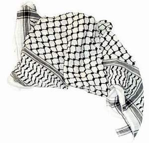

+++
title = "الكوفية الفلسطينية ..  موضة عالمية"
date = 2008-11-03
authors = ["رنا خموس"]

[taxonomies]
authors = ["rana-khmos"]
sections = ["7ayatna"]

[extra]
section_name = "حياتنا"
share_image = "/media/currentarticleassets/kofeya.jpg"
summary = "الكوفية الفلسطينية.. رمز للعزة والكرامة، تغنى بها الشعراء، وعلى مدار 60 عاما اقترنت بالكفاح والنضال، حيث يرتديها شباب يمسك بيده الحجارة أو على كتفه بندقيته.."
section_slug = "7ayatna"
section_colour = "#CA0789"
thumb = "/media/currentarticleassets/kofeya.jpg"
n_comments = 3
original_url = "http://20at.com:80/20at/lifestyle/10412.html"
archived = "20100115064313"
date_source = "byline/meta"
aliases_20at = ["/20at/lifestyle/10412.html"]

[extra.provenance]
original_url = "http://20at.com:80/20at/lifestyle/10412.html"
capture_url = "https://web.archive.org/web/20100115064313/http://20at.com:80/20at/lifestyle/10412.html"
capture_label = "١٥ يناير ٢٠١٠، ٠٦:٤٣ UTC"
date_note = "من سطر التوقيع في المقال"
other_urls = []
comments = "٣"
missing_images = ""
+++

<figure></figure>

الكوفية الفلسطينية.. رمز للعزة والكرامة، تغنى بها الشعراء، وعلى مدار 60 عاما اقترنت بالكفاح والنضال، حيث يرتديها شباب يمسك بيده الحجارة أو على كتفه بندقيته..

أما اليوم فزاد على ذلك أن أصبحت "موضة" غزت الأسواق الغربية والشرقية، يرتديها الفقير المعدم ومن يمشي على البساط الأحمر في هوليوود، لا فرق في ذلك بين شاب وفتاه..

الشارع الفلسطيني اختلف على هذه الموضة، هناك من يرى في انتشارها تأييد للقضية الفلسطينية، وعلى العكس هناك من يبدى استياءه لانتشار الكوفية لأنها تتجرد من معناها وتقل قيمتها..

<h3>رمز القضية</h3>

هدى جمعة، طالبة في كلية الاقتصاد، ترى أن "انتشار موضة الكوفية أمر جميل ومشجع، فرغم محاولات إسرائيل لطمس فلسطين وطمس معالمها وثقافتها وتراثها، إلا أن المتضامنين مع القضية الفلسطينية وأحرار العالم نقلوا قضيتنا عبر الكوفية إلى العالم كله بكل ألوانه وأشكاله وأطيافه، واجتاحت الكوفية خطوط الموضة والأسواق العالمية رغم اختلاف ألوانها، وهذا أمر جيد لأن قضيتنا بذلك تصل إلى أجيال وشباب من مختلف شعوب العالم".

أما مصعب أبو صالح، فيقول: "الكوفية معروفة أنها رمز لفلسطين والمقاومة، فالرئيس الراحل ياسر عرفات لبسها أينما حل، وجعلها ترمز إلى الثورة والنضال والمقاومة، كما لبسها المناضل والشهيد عز الدين القسام ولبسها الشيخ أحمد ياسين".

<h3>الألوان حرية</h3>

سمية وسارة، طالبتان بكلية الآداب، وجدنا عليهما كوفيتان بلون الأزرق والزهري، اقتربنا منهما، تقول سمية: "دائما الكوفية مقتصرة على الشباب أكثر من البنات، ولكن مع وجود ألوان مختلفة كان الأمر أكثر رواجا للفتيات في ارتداءها، في الماضي كان من يرتدي اللون الأبيض والأسود يحسب على حركة فتح، أما من يرتدى الكوفية الحمراء يحسب على الجبهة الشعبية لتحرير فلسطين، فلقد عانينا من تسييس الكوفية لصالح التنظيمات الموجودة، أما اليوم بوجود كل العديد من الألوان أصبح الأمر أكثر حرية، وأتاح فرصة ارتداءها مرة أخرى وبحرية أكبر".

وتوضح سارة: "أنا أحب ارتداء الكوفية، ولكنني لا أشجع حركة فتح أو الجبهة وغيرها، فلم أكن أجرؤ على ارتداءها حتى لا أكون مؤيدة لفصيل دون آخر، خاصة بعد أحداث الانقسام، وبعض انتشار الكوفيات بألوان أخرى تشجعت على ارتدائها".

<h3>سلب للهوية</h3>

من جانبه، يعبر أسامة شحادة عن استياءه الكبير لانتشار الكوفية بهذا الشكل في العالم الغربي خاصة، فالكوفية تجردت من معناها الحقيقي لتصبح موضة يتوشح بها الغربيين والمشردين والسكارى والمثليين وغيرهم.

يضيف: "أمر مؤلم أن نرى كل شيء يتم سلبه من معناه الحقيقي وإنسانيته، ولكنني لن أرضى أن يسلب تراثنا وهويتنا، فالكوفية لها دلالات ومعاني كثيرة للقضية الفلسطينية، والخوف أن نصبح بلا وطن أمام العالم وبلا تراث وبلا علم، مثلما حولوا أكلاتنا ورقصاتنا وأثوابنا إلى تراث إسرائيلي، فسلبوا حضارتنا أمام أعيننا".

ماهر عمر، يقول: "الكوفية بألوانها ورسومها كانت ترمز للمقاومة والحرية والعدالة والنضال الوطني والشعبي من المحتل الغاصب للبلد، ولطالما كانت خيوطها ترمز إلى الأسلاك الشائكة التي طالت كل شيء، أما مع دخولها عالم الموضة واقتناء أثرياء العالم لها قلل ذلك من قيمتها وعروبتها الأصيلة، وهناك من أخذ منها مكسبا، فبدلا من أن نصنع كوفيتنا بأيدينا، أصبحت هناك مصانع إسرائيلية تصنعها وتضع عليها نجمة داوود، وأخرى صينية آخذة في الانتشار".

وأنت.. أي الاتجاهين تؤيد؟

