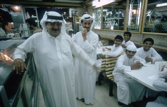

+++
title = "السعودية .. متطوعون رغم الصعاب"
date = 2006-12-01
authors = ["سمر الموسى"]

[taxonomies]
authors = ["samr-elmosa"]
sections = ["7ayatna"]

[extra]
section_name = "حياتنا"
share_image = "/media/admins.20at.com/marwa05/0000258724-019.jpg"
summary = "الاتجاه نحو العمل أمر طبيعي، أما الاتجاه نحو العمل التطوعي فهو منحنى آخر يدل على مستوى الطموح الإنساني الذي يمتلكه الفرد المتوجه إليه.."
section_slug = "7ayatna"
section_colour = "#CA0789"
thumb = "/media/admins.20at.com/marwa05/0000258724-019.jpg"
n_comments = 1
original_url = "http://www.20at.com:80/20at/lifestyle/2837.html"
archived = "20100215070550"
date_source = "byline/meta"
aliases_20at = ["/20at/lifestyle/2837.html?layout=default&page=&print=1&tmpl=component", "/20at/lifestyle/2837.html"]

[extra.provenance]
original_url = "http://www.20at.com:80/20at/lifestyle/2837.html"
capture_url = "https://web.archive.org/web/20100215070550/http://www.20at.com:80/20at/lifestyle/2837.html"
capture_label = "١٥ فبراير ٢٠١٠، ٠٧:٠٥ UTC"
date_note = "من سطر التوقيع في المقال"
other_urls = ["/20at/lifestyle/2837.html?layout=default&page=&print=1&tmpl=component"]
comments = "١"
missing_images = ""
+++

<figure></figure>

الاتجاه نحو العمل أمر طبيعي، أما الاتجاه نحو العمل التطوعي فهو منحنى آخر يدل على مستوى الطموح الإنساني الذي يمتلكه الفرد المتوجه إليه..

شباب السعودية طرقوا أبواب العمل التطوعي الجماعي، طامحين إلى النهوض بالأمة الإسلامية والإسهام في الأعمال الإنسانية والخيرية والتطويرية التي تسهم في الرفع من شان المجتمع وتطويره نحو الأفضل.

وأمام هذه الرغبات والأماني السامية تقف أمامهم مصاعب وعقبات تحد من انطلاقتهم الاجتماعية، ومن هنا يتساءلون لماذا لا تفتح الأبواب وتزال العقبات حتى تؤدى الرسالة التي يحملونها على أكمل وجه؟.

<h3>الفوائد</h3>

تقول هدى، وهي متطوعة بجمعية صناع الحياة بمكة المكرمة، نسعى من خلال العمل التطوعي لتحقيق فوائد لا تعد ولا تحصى معنوية ومادية واجتماعية ودينية وبيئية، منها انتشار روح المحبة والإخاء بين المتطوعين، والتعرف على أشخاص جدد يحملون نفس التصور والأفكار والهدف، مما يسهل على المرء الوصول لأهدافه.

وتضيف: تكمن المتعة في العمل الجماعي لأن به روح التعاون والتفاني والرؤية الواضحة، كما تكمن أيضاً في النتائج الملموسة التي تنعكس إيجاباً على المجتمع ككل، فالنتائج دائماً بمثابة الشهادة للناجحين وبقدر النجاح يكون التقدير.

إلا أننا نواجه الكثير من المصاعب من أبرزها عدم تقبل الأهل لكل هذه المفاهيم، أو بالأصح الخوف مما يعتبرونه مجهول، فالأسلم من وجهة نظرهم أن يعيش المرء يدرس ويحصل على وظيفة ويتزوج وينجب ويموت فحسب.

وحول الدعم والتحفيز تقول: هناك دعم معنوي من بعض الأشخاص الغير مقربين بالتشجيع الشفوي والابتسامة والحضور وكل ذلك له دور فعال في التحفيز على العمل التطوعي، وأنا كفتاة أحتاج لدعم والدي وأخواني خاصة في "المشاوير الخيرية" لكن لا يحدث ذلك إلا نادرا للأسف.

<h3>تعلمت الكثير</h3>

ويحدثنا احد المتطوعين قائلاً: توجهت نحو العمل التطوعي لما له من اثر في إحداث تغيير وتأثير في المجتمع أكبر من العمل المؤسسي الروتيني، بالإضافة لما فيه من الفوائد مثل الأجر من الله، الصحبة الصالحة في عمل الخير، استغلال وقت الفراغ، صقل المواهب، الإحساس بالمسؤولية تجاه الأمة.

يضيف: إلا أن ابرز العوائق التي تقف أمامنا تتمثل في الدعم المادي، وقلة المتطوعين وعدم جدية البعض منهم، إلا أن تشجيع المجتمع يدفعنا على العمل والاستمرار.

أما عبد الرحمن فيقول: من خلال العمل التطوعي تعلمت الكثير من الأشياء ومنها طرق التعامل مع الأشخاص المختلفين في العمر، واشعر بالسعادة عندما اسعد غيري من الناس، رغم عدم دعم المجتمع لنا مع أننا نسعى إلى تقديم المفيد لهم.

<h3>لا يعترف بنا أحد</h3>

وتتحدث هبة، طالبة جامعية ومتطوعة بصناع الحياة بجدة، عن ابرز ما تصادفها من عوائق قائلة: العراقيل موجودة أمامنا ونحن صانعي حياة وحتى الآن لا يعترف بنا أحد ولا نشكل جهة نظامية يحق لها العمل في بناء المجتمع، بل ولا نحظى بمقر معتمد لنقدم فيه أنفسنا ونجتهد من خلاله في تأدية أعمالنا.

وتضيف: ورغم كل الصعوبات نحاول العمل وتحقيق الانجازات ولكن حتى الآن هناك الكثير من الفتيات اللواتي يتمنين اللحاق بنا والمشاركة إلا أن المواصلات باتت هي المعضلة الأكبر.

<h3>الدعم الدعم</h3>

بينما تقول نوف، وهي متطوعة في إحدى الجمعيات، كثيرا ما يحاصرني مجتمعي بالأسئلة التي تتحدث عن الأجر الذي أتقاضاه في العمل، وأنا ارفض أن احصل على مكافأة مادية لأنها وببساطة ستلغي متعة ما أقوم به وستحولني إلى مجرد عاملة عادية بينما طموحي يصل إلى التميز.

تضيف: أطالب كشابة بدعم الشباب المتطوع والرفع من معنوياته، لأنه عمود الأمة الذي يحتاج إلى رعاية وعناية وتقدير.

حاتم، طالب بجامعة أم القرى وعضو بمجموعة صناع الحياة بمكة، يقول: حتى الآن اشعر بالنظرة الدونية من قبل المجتمع الذي يظن أننا مجرد شباب وبنات مختلطين وما إلى ذلك، وهذا الأمر غير صحيح ومن هنا يتوجب علينا إثبات وإشهار أنفسنا لنكسب ثقة الناس بنا، واعتقد أن هذه النظرة موجودة لأننا شيء جديد بالنسبة لهم ولذلك نجد من يؤيدنا ومن يحتقرنا!

<h3>تواجد الجميع</h3>

الأستاذ فواز مكي، منسق مجموعة صناع الحياة، تحدث لـ"عشرينات" قائلا: العمل التطوعي من أهم الوسائل التي تحرك الناس لتحقيق أهدافهم والتي تخدم نهضة الأمة في النهاية، ونحن نلاحظ أن الغرب لم يصلوا إلى ما هم فيه إلا عندما استشعروا أهمية العمل التطوعي وانخرطوا فيه، ومن هنا فضلنا جميعا نحن الشباب التوجه إلى هذا المجال، حيث نطمح إلى الأجر والمثوبة من عند الله، ونطمح إلى القضاء على أوقات الفراغ والعمل على صقل المواهب والمهارات.

ويضيف: تكمن المتعة الحقيقية في عملنا في مواجهة المصاعب التي قد تمر بنا والتي نسعى إلى التغلب عليها، ومنها القيود الكثيرة والدعم المادي .. نحن نشعر بدعم المجتمع لنا بنسبة 90% ولكن الجهود مازالت قليلة، ونحتاج لتفعيل طاقات أكبر وأكثر من المجتمع لننهض بالأمة، والحقيقة أن المجتمع فيه خير كبير ويتفاعل بقوة مع ما نقوم به، لكننا نحتاج تواجدهم معنا وانضمامهم لنا وهذا ما نسعى إليه في كل برامجنا وأنشطتنا لأن نهضة الأمة مسؤولية الجميع.

<h3>عن الأجر .. نبحث</h3>

أما الأستاذ وليد باصمد، نائب مدير مكتب مندوبية الدعوة بالكعكية، فقال: هناك إقبال كبير من قبل الشباب نحو التطوع، لدينا بالمكتب شباب من مختلف الشرائح ونقوم بتكليفهم بالأعمال بحسب قدراتهم وتوجهاتهم، فمنهم من يعملون في التصميم ومنهم من يساهم في توزيع الكتب والأشرطة ويقومون بهذه الأعمال دون اجر مادي لابتغاء الأجر الأكبر من الله، ونحن هنا كذلك متطوعون ونعمل من اجل تحقيق نفس الهدف.

