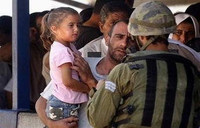

+++
title = "أكشاك نابلس .. متنزه 5 نجوم!"
date = 2006-12-03
authors = ["عاطف دغلس"]

[taxonomies]
authors = ["atef-deghles"]
sections = ["7ayatna"]

[extra]
section_name = "حياتنا"
share_image = "/media/admins.20at.com/masr/2hagaz.jpg"
summary = "إذا قرر أحد الفلسطينيين زيارة أقارب له خارج المدن الفلسطينية، أو الذهاب لعمله أو حتى الخروج للتنزه، فإنه يصطدم بالحواجز الإسرائيلية المقامة على أطراف المدن الفل"
section_slug = "7ayatna"
section_colour = "#CA0789"
thumb = "/media/admins.20at.com/masr/2hagaz.jpg"
n_comments = 0
original_url = "http://www.20at.com:80/20at/lifestyle/2846.html"
archived = "20100215070603"
date_source = "byline/meta"
aliases_20at = ["/20at/lifestyle/2846.html?layout=default&page=&print=1&tmpl=component", "/20at/lifestyle/2846.html"]

[extra.provenance]
original_url = "http://www.20at.com:80/20at/lifestyle/2846.html"
capture_url = "https://web.archive.org/web/20100215070603/http://www.20at.com:80/20at/lifestyle/2846.html"
capture_label = "١٥ فبراير ٢٠١٠، ٠٧:٠٦ UTC"
date_note = "من سطر التوقيع في المقال"
other_urls = ["/20at/lifestyle/2846.html?layout=default&page=&print=1&tmpl=component"]
comments = ""
missing_images = ""
+++

<figure></figure>

إذا قرر أحد الفلسطينيين زيارة أقارب له خارج المدن الفلسطينية، أو الذهاب لعمله أو حتى الخروج للتنزه، فإنه يصطدم بالحواجز الإسرائيلية المقامة على أطراف المدن الفلسطينية، والتي عليها ترى مئات المواطنين محتشدين في انتظار السماح لهم بالمرور..

وبعد عراك طويل ومناورات مع الجنود، ذهابا وعودة، يبحث المواطنين عن شيء يزيل عنهم تعب يومهم الشاق أو المعاناة التي وجدوها على الحاجز..

هناك وعلى قارعات الطرق، وبعد كل حاجز تجد أكشاكا "محلات للبيع"، تقدم لك ما تحتاجه، من الحامض للحلو، وبأسعار رخيصة، والاهم من ذلك كله الراحة التي تجدها هناك، وقد يخيل لك بأنك لا تريد أن تذهب، وتنسى أنك تود الذهاب لمكان آخر.

<h3>متنزه 5 نجوم</h3>

فنجان قهوة الصباح له نكهته الخاصة في تلك الأماكن، حيث تجلس على كرسيك الخاص، وأمامك المارة من الناس، وبالقرب منك جنود الاحتلال، وكأنك في متنزه يرتقي لمستوي خمس نجوم، وتقدم لك الطلبات كما تريد، وهي متنوعة أيضا ما بين قهوة وشاي وعصائر.

وهذه الأكشاك بالطبع تقدم الخدمات السريعة والمستعجلة للمواطنين، وأصحابها يأتون منذ الصباح الباكر، وهم من مناطق قريبة جدا على الحواجز، واللافت بها أيضا أنها متنوعة، وروادها كثيرون، وتحوم حولها المظلات الملونة لتكتمل أركان الجلسة الهادئة.

<h3>كل شئ متاح</h3>

البائع عامر جاد الله، صاحب كشك لبيع المشروبات الساخنة والمواد الغذائية على حاجز بيت ايبا غرب نابلس، يقول: بالنسبة لتضييق الاحتلال علينا يتمثل في إجبارنا على إغلاق محلاتنا في حالة إغلاق الحاجز، فما أكثر المرات التي يغلقون فيها الحاجز وبشكل متكرر، لكن تحدث مرات كثيرة بأن يأتي الجنود ليشتروا بأنفسهم من عندنا بعض الحلويات والمشروبات.

يضيف: يخالط الارتياح الذي ينتاب بعض المارة عند الحاجز بعض الحزن، بسبب إجراءات الاحتلال على هذا الحاجز، لكن يجدون في هذه الأكشاك مكانا مناسبا للاستراحة، خاصة للمواطنين الذين يسافرون من خلال المركبات التي يسمح لها بالمرور عبر الحاجز بعد التفتيش والتدقيق، ويستمتع هؤلاء الناس بالمشروبات والحلويات إضافة إلى علب السجائر التي نقدمها.

وبالنسبة لحجم البيع أشار: البيع متذبذب من يوم لآخر، لكن الوضع جيد، لأن كل ما يلزم الناس في هذه الظروف والأماكن متوفر لدينا، فالناس "عابري السبيل" والذين تبعد بلداتهم عشرا ت الكيلومترات عن الحاجز يجدون المأكل والمشرب المناسب لهم والذي يكفيهم طوال الرحلة إلى أماكن سكنهم، وهذا يدر علينا أرباحا جيدة.

<h3>أكشاك ضد الإرهاق</h3>

المرور صباحا ومساءاً على ذلك الحاجز هو حال الكثير من الشباب، فالشاب أسامة مسعود من مدينة نابلس يعمل في محل لبيع الملابس في مدينة جنين، يقول أسامة: في المساء أقطع الحاجز بهدوء، وقبل أن أغادره اجلس حوالي ساعة لدى أحد الأكشاك لتناول الطعام والشراب، وشرب القهوة على أنغام أغاني أم كلثوم، والتي يفتحها البائع بصوت مرتفع، هذا الإحساس يزيل عني إرهاق اليوم ومعاناة الطرق، وكأني في استراحة فخمة.

وينصح أسامة المواطنين الذين يودون الذهاب لمتنزهات ولا يجدون، بضرورة التوجه لتك الاستراحات، مشيرا إلى أنها تكاد تكون أفضل وسيلة للترويح عن النفس في هذا الضغط والحصار الكبيرين.

<h3>استراحات السائقين</h3>

لا تقتصر خدمات تلك الأكشاك على المواطنين المارين فحسب، فهناك أيضا أصحاب التاكسي، وسيارات النقل العمومية، والذين يؤرقهم طول الانتظار على الحواجز، وتعتبر مثل هذه الأكشاك بمثابة استراحات على حافات الطرق بالنسبة لهم.

فالسائق أبو الهاشم يتنقل ببضاعته يوميا إلى شمال الضفة الغربية، وتعتبر مثل تلك الأماكن فرصة له ليلقي بجسده المنهك أمام تلك الأكشاك، ويجلس لتناول طعام الإفطار والشاي الذي يفضله.

يقول أبو الهاشم: هذا متنزه لي ولغيري من الناس، ولا أخفي سرا، فاني أفكر أحيانا كثيرة باصطحاب أبنائي للتمتع ببعض الوقت هنا، خاصة في ظل هذا التضييق علينا وإغلاق المتنزهات.

<h3>سهرة مع أم كلثوم</h3>

بالعودة للوراء قليلا، نجد أن مثل تلك الأكشاك لم يكن موجودا، وإنما كان الأمر يقتصر على بائع للشاي أو للقهوة فقط، فأخذت الأمور تتطور شيئا فشيئا، لتنتقل من محلات صغيرة تلبي حاجة بعض المواطنين، إلى متنزهات كبيرة، وأصبح لها زبائنها وروادها من كل جانب.

هذه الأكشاك تمتاز بصوت "أم كلثوم"، في ساعات المساء، لتضاف خدمة جديدة لراحة الزبون وتلبية لرغباته، فينتعش المارة أيضا على تلك الألحان والكلمات المتناغمة.

هنا في فلسطين، ربما تكون ما تحتاج إليه من الراحة أكبر من أي شيء آخر، ورغم الهم الفلسطيني..لا مانع أن تنفس كربك ولو قليلا.

