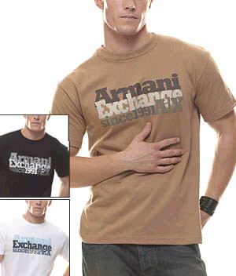

+++
title = "هل انت.. أنيق؟!"
date = 2006-12-26
authors = ["الشرق الأوسط"]

[taxonomies]
authors = ["elshrk-elaost"]
sections = ["7ayatna"]

[extra]
section_name = "حياتنا"
share_image = "/media/templates/ja_teline_ii/images/printbutton.png"
summary = "ظل الرجل طويلا مهمشا، عندما يتعلق الأمر بالمظهر الخارجي، من منطلق ان «الرجل لا يعيبه إلا جيبه»."
section_slug = "7ayatna"
section_colour = "#CA0789"
thumb = "/media/templates/ja_teline_ii/images/printbutton.png"
n_comments = 0
original_url = "http://20at.com/20at/lifestyle/2972.html?tmpl=component&print=1&layout=default&page="
archived = "20100105231540"
date_source = "byline/meta"
aliases_20at = ["/20at/lifestyle/2972.html?layout=default&page=&print=1&tmpl=component"]

[extra.provenance]
original_url = "http://20at.com/20at/lifestyle/2972.html?tmpl=component&print=1&layout=default&page="
capture_url = "https://web.archive.org/web/20100105231540/http://20at.com/20at/lifestyle/2972.html?tmpl=component&print=1&layout=default&page="
capture_label = "٥ يناير ٢٠١٠، ٢٣:١٥ UTC"
date_note = "من سطر التوقيع في المقال"
other_urls = []
comments = ""
missing_images = ""
+++

<figure></figure>

<figure></figure>

ظل الرجل طويلا مهمشا، عندما يتعلق الأمر بالمظهر الخارجي، من منطلق ان «الرجل لا يعيبه إلا جيبه».

لكن هذا الأمر اختلف كثيرا في السنوات الأخيرة، وبدأ المصممون يهتمون به، كما اهتمامهم بالمرأة، وليس أدل على هذا من أنه أيضا أصبح يتمتع بأسابيع موضة خاصة به، لا شك ان البداية كانت حثيثة وخجولة، لكن سرعان ما زادت حرارتها وجرأتها بتشجيع من الرجل الشاب الذي لم يعد يرى أن العناية بالمظهر يتعارض مع مفهوم الرجولة، بل العكس يمكن ان يساعده على الترقي في مجال العمل، على اساس انه اكثر «حساسية» وتفهما بعد ان تغيرت اجواء العمل نفسها وأصبحت تهتم بالجانب الإنساني.

<h3>خيارات بسيطة جدا</h3>

المشكلة التي يعاني منها الرجل حاليا هي قلة الخيارات أمامه، مقارنة بتلك التي يقدمها المصممون للمرأة،. فالبدلة هي ذاتها لا تتغير كثيرا.

فيما عدا عدد الأزرار وشكلها وبطانتها، وكذلك المعاطف والكنزات الصوفية والبنطلونات وغيرها من القطع التي عرفها منذ عقود، ولم تشهد أية إضافات جذرية من حيث إبداعها.

لكن الرجل اللبيب هو الذي يعرف كيف يوظف المتاح امامه بطريقة تجعله يبدو متجددا وأنيقا طوال الوقت، وما علينا إلا النظر إلى نجوم من عيار براد بيت وجورج كلوني وغيرهما. فهذا الأخيرة مثلا يغير في ألوان البدلات، وإن كان يميل إلى الأسود والرمادي الغامق أغلب الأحيان، كما أنه يغير في طرق استعماله للاكسسوارات، فهو تارة يلبس القميص مع ربطة عنق وتارة بدون، بغض النظر عن المناسبة.

وفي كل مرة يجعلنا نشعر بأنه قدوة يمكن الاقتداء بها. صحيح ان وسامته تساعد بعض الشيء، لكن ذوقه الخاص هو الذي يبرز هذه الوسامة. أما عن إمكانياته المادية فهناك العديد ممن تسمح لهم إمكانياتهم بارتداء أغلى الماركات، لكن أسلوبهم في التنسيق لا يساعدهم على التألق، مثل لاعب الكرة البريطاني، واين روني. حتى تكون مثل الأول جمعنا لك من خبراء مجموعة من النصائح والقواعد الذهبية.

فهل انت رجل أنيق

