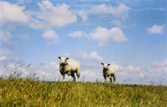

+++
title = "أجمل خروف العيد .. شارك"
date = 2006-12-29
authors = ["مجاهد شرارة"]

[taxonomies]
authors = ["magahd-shrara"]
sections = ["7ayatna"]

[extra]
section_name = "حياتنا"
share_image = "/media/admins.20at.com/aly/sheep_s_front.jpg"
summary = "ساعات قليلة تفصلنا عن عيد الأضحى المبارك ، وقد شرع الله عز وجل الأضحية شعارا لهذا العيد وتنتشر الخراف في شوارع وميادين المدن العربية والإسلامية في هذه الأيام حت"
section_slug = "7ayatna"
section_colour = "#CA0789"
thumb = "/media/admins.20at.com/aly/sheep_s_front.jpg"
n_comments = 12
original_url = "http://www.20at.com:80/20at/lifestyle/2986.html"
archived = "20100115063022"
date_source = "byline/meta"
aliases_20at = ["/20at/lifestyle/2986.html", "/20at/lifestyle/2986.html?layout=default&page=&print=1&tmpl=component"]

[extra.provenance]
original_url = "http://www.20at.com:80/20at/lifestyle/2986.html"
capture_url = "https://web.archive.org/web/20100115063022/http://www.20at.com:80/20at/lifestyle/2986.html"
capture_label = "١٥ يناير ٢٠١٠، ٠٦:٣٠ UTC"
date_note = "من سطر التوقيع في المقال"
other_urls = ["/20at/lifestyle/2986.html?layout=default&page=&print=1&tmpl=component"]
comments = "١٢"
missing_images = ""
+++

<figure></figure>

ساعات قليلة تفصلنا عن عيد الأضحى المبارك ، وقد شرع الله عز وجل الأضحية شعارا لهذا العيد وتنتشر الخراف في شوارع وميادين المدن العربية والإسلامية في هذه الأيام حتى صلاة العيد ثم بعدها يواجه كل خروف مصيره المحتوم، ويجتمع الجميع لحضور مراسم الأضحية وعلامات الفرحة ترتسم على وجوه الجميع.

فهذا الولد الصغير يزاحم الكبار كي يرى الخروف وكيف سيواجه مصيره أما الأم فتسرع كي تحمل لحم الخروف بعد ذبحه وينشغل الأب في دفع حساب القصاب (الجزار) الذي قام بهذه المهمة الشاقة.

<h3>أعزائنا القراء</h3>

جمعنا لكم صورا كثيرة للخراف حول العالم، ونرجو من كل قارئ أن يختار أجمل خروف من بين هؤلاء جميعا، والباب مفتوحا أمام الجميع للمشاركة في هذه المسابقة الخرافية لاختيار أجمل الخراف مبررا سبب اختياره هذا الخروف بالذات.

شاهد الجاليري واختر أجمل خروف

