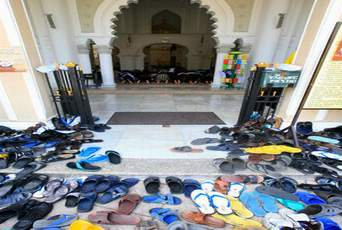

+++
title = "ضع حذائك أمامك !"
date = 2007-01-27
authors = ["مجاهد شرارة"]

[taxonomies]
authors = ["magahd-shrara"]
sections = ["7ayatna"]

[extra]
section_name = "حياتنا"
share_image = "/media/admins.20at.com/do3a2/gazma3.jpg"
summary = "تهفو النفس لنداء الحق سبحانه وتعالى..فتسعى إلى بيوت الله ملبية حي على الصلاة حي على الفلاح..وتخلع عنها رداء الدنيا عند باب المسجد لتنهل من رحمات الرحمن الرحيم.."
section_slug = "7ayatna"
section_colour = "#CA0789"
thumb = "/media/admins.20at.com/do3a2/gazma3.jpg"
n_comments = 4
original_url = "http://20at.com/20at/lifestyle/3127.html"
archived = "20100105225851"
date_source = "byline/meta"
aliases_20at = ["/20at/lifestyle/3127.html"]

[extra.provenance]
original_url = "http://20at.com/20at/lifestyle/3127.html"
capture_url = "https://web.archive.org/web/20100105225851/http://20at.com/20at/lifestyle/3127.html"
capture_label = "٥ يناير ٢٠١٠، ٢٢:٥٨ UTC"
date_note = "من سطر التوقيع في المقال"
other_urls = []
comments = "٤"
missing_images = ""
+++

<figure></figure>

تهفو النفس لنداء الحق سبحانه وتعالى..فتسعى إلى بيوت الله ملبية حي على الصلاة حي على الفلاح..وتخلع عنها رداء الدنيا عند باب المسجد لتنهل من رحمات الرحمن الرحيم..

ويأبى الشيطان إلا أن يعكر على المصلين صفاء روحهم ونقاء سريرتهم، فيتصيد الفرص ما بين وسوسة وانشغال في الصلاة، حتى تصل إلى انتهاك حرمة المسجد، فتمتد يد خبيثة مريضة لتسرق في بيوت الله الآمنة!

ومما زاد الأمر سوءا أن السرقة أصبحت عملا معتادا في المساجد، حتى أصبح من البديهيات أن توضع ورقة مكتوب عليها "احترس من السرقة"، وأخرى "حافظ على أمتعتك" وثالثة "ضع حذائك أمامك"..

ومع ذلك لم تنتهي ظاهرة السرقة، فتم إضافة مهمة جديدة لخادم المسجد وهي الوقوف بجوار أحذية المصلين في مكان مخصص لحراستها وحمايتها من السرقة، فيظل مراقبا لكل حركة غريبة ومريبة، وبعد انتهاء المصلين من صلاتهم وأخذ متاعهم يشرع في الصلاة جماعة ثانية، وهذا الأمر لم يقضِِ على السرقة نهائيا سواء في مصلى الرجال أو مصلى النساء وإنما قلل منها.

<h3>سرقة ..أول صلاة</h3>

يحكي الشيخ "عبد العاطي عبد الشافي" موقفا تعرض له شخصيا قائلا: كان لي جار أحثه على الصلاة في المسجد للثواب، وبعد فترة ليست بالقصيرة استجاب ودخل يصلي معي، ورغم حرصي على وضع الأحذية في مكان قريب من مكان وقوفنا للصلاة، إلا أن السارق أراد أن يعكر على جاري جو المسجد الروحاني، فبعد الانتهاء من الصلاة وختام الصلاة وصلاة ركعتي السنة، توجهنا إلى مكان الأحذية وللأسف لم يجد جاري حذائه الذي اشتراه منذ بضعة أيام فقط!!

هذا الموقف أحزنني كثيرا فهذا أول يوم له للصلاة في المسجد وخشيت أن يؤثر ذلك عليه فيقرر عدم دخول المسجد مرة أخرى.

ويكمل الشيخ حديثه منشرحا قائلا: لكن الحمد لله حافظ جاري على الصلاة بالمسجد دون أن أدعوه إليها مرة أخرى، وبفضل الله لم يسرق منه حذاء آخر حتى الآن.

أما الحاج "صبحي ندا" فقد قابل زميله "هاني" الذي كان يعرفه منذ أيام الدراسة وعلم منه أنه أسلم لله رب العالمين، فارتسمت علامات البهجة والسرور على وجه الحاج صبحي، لكنه وجد هاني يلوم المسلمين قائلا: "هل هذا يصح يا حاج صبحي، أدخل إلى مسجد السيدة زينب فيتم سرقتي في أول يوم لي في الإسلام"!!

<h3>العريس حافي القدمين</h3>

"هدى صادق" تتذكر يوم زفافها على زوجها "أحمد" قائلة: هذا يوم لا أستطيع أن أنساه، فقد ذهبنا للمسجد لكتابة لعقد الزواج والإشهار، وبعد أن تعالت الأصوات تهنئ كلانا، ذهب أحمد ليبحث عن حذائه فاكتشف أنه سرق، فوقف خجلا أمام جميع الناس واضطر أن يرسل أخاه للبيت ليأتي له بأي حذاء، ومكث في المسجد لمدة ساعة مما دفع بعض الناس للانتظار معه لمواساته.

وتكمل هدى القصة والضحكة مرسومة على وجهها: كانت البدلة سوداء داكنة وكان الحذاء بني داكن، ومشينا بهذا الشكل وحاولت ألا أضحك أمامه حتى لا أثير غضبه.

أما "هبه أحمد" فتحكي عن قريبتها التي خرجت مع زوجها الذي عقد عليها منذ بضعة أيام، وجاء وقت صلاة المغرب ودخلا أقرب مسجد لأداء الصلاة، وبعد الفراغ من الصلاة لم يجد زوجها حذائه واضطر أن يرتدي "شبشب بإصبع" وعادا إلى بيت زوجته، لكنه تحرج من الصعود بهذا الشكل فقرر أن يمضي إلى بيته وسط ضحكات مكتومة من كل من يراه.

<h3>امسك حرامي</h3>

ويروي "علي فتحي" يوم أن أمسك سارق أحذية داخل المسجد، قائلا: كنت في عجلة من أمري ودخلت أصلي العشاء في المسجد ووضعت حذائي بجواري، وبعد أن سلم الإمام قمت أكمل الركعة التي سبقتني، وفور أن انتهيت من الصلاة نظرت فلم أجد حذائي، فهرعت إلى خارج المسجد فوجدت شابا يهم بالخروج من المسجد ممسكا حذائي في يديه فأمسكت منه حذائي بعد أن صحت في المصلين "امسك حرامي"، وبعد أن ألتف المصلون حول السارق أخذت من يديه حذائي ولبستها وتركت السارق بين أيدي المصلين يريدون افتراسه!

<h3>استحيت من الله</h3>

أما "ممدوح رجب" فيحكي عن سرقة حذائه قائلا: اشتريت حذاءا باهظ الثمن كعادتي، ودخلت مسجد عمر مكرم للصلاة فيه ووضعت الحذاء أمامي، وما أن سجدت وقمت من السجود إلا ووجدت الحذاء قد سرق، فأكملت صلاتي وبعدها جاء صديقي الذي واعدته كي نتقابل في المسجد، فأرسلته ليشتري لي شبشب بـ10 جنيهات، وسبحان مغير الأحوال فلقد خرجت من بيتي بحذاء يساوي أكثر من مائتي جنيه وعدت إليه بـ شبشب قيمته 10 جنيهات!

وكان صديقي غاضبا من موقفي وسألني لماذا لم تقطع الصلاة وتحاول الإمساك تمسك بالسارق فأجبته: "لقد استحيت من الله أن اقطع صلتي به من أجل حذاء".

وأنت..هل لك قصة مع سرقة الأحذية داخل المسجد ؟

