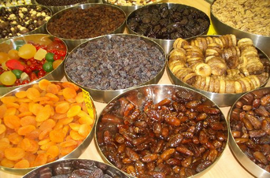

+++
title = "في المغرب..عيد \"بابا عيشور\""
date = 2007-01-28
authors = ["عبد الله التفراوتي"]

[taxonomies]
authors = ["abdallah-eltafraoti"]
sections = ["7ayatna"]

[extra]
section_name = "حياتنا"
share_image = "/media/admins.20at.com/aly/jj.jpg"
summary = "رغم أن عاشوراء تمثل مناسبة دينية لدى البلاد الإسلامية والعربية، إلا أنها في المغرب تتخذ شكلا آخر، فهي مناسبة اجتماعية تتعدد مسمياتها فهي \"شعالة\" و\"شعيلة\" و\"عيشو"
section_slug = "7ayatna"
section_colour = "#CA0789"
thumb = "/media/admins.20at.com/aly/jj.jpg"
n_comments = 4
original_url = "http://20at.com/20at/lifestyle/3138.html"
archived = "20100105225903"
date_source = "byline/meta"
aliases_20at = ["/20at/lifestyle/3138.html"]

[extra.provenance]
original_url = "http://20at.com/20at/lifestyle/3138.html"
capture_url = "https://web.archive.org/web/20100105225903/http://20at.com/20at/lifestyle/3138.html"
capture_label = "٥ يناير ٢٠١٠، ٢٢:٥٩ UTC"
date_note = "من سطر التوقيع في المقال"
other_urls = []
comments = "٤"
missing_images = ""
+++

<figure></figure>

رغم أن عاشوراء تمثل مناسبة دينية لدى البلاد الإسلامية والعربية، إلا أنها في المغرب تتخذ شكلا آخر، فهي مناسبة اجتماعية تتعدد مسمياتها فهي "شعالة" و"شعيلة" و"عيشور" و"عاشوري"..وأيضا لها طقوس خاصة، فهي عند البعض تمثل فرصة للحفاظ على التقاليد والعادات المغربية، كما أنها أيضا فرصة للتسول والشعوذة، ومعها كذلك نرى العديد من الوجبات والأطباق..

<h3>''عيشور'' يصيح بابا</h3>

"بابا عيشور آلالة .. ما علينا الحْكَام آلالة''..عبارات يرددها الكثير من الفتيات قبل عاشوراء بأيام، في إشارة إلى أن رجال العائلة لا سلطة لهم على نساء وفتيات العائلة طيلة عاشوراء، مما يسمح لهن بالغناء والرقص ليال متتابعة، وعلى الرجال أن ينتظروا انتهاء شهر ربيع الأول، موعد للاحتفال بذكرى المولد النبوي الشريف، ليسترجعوا سلطتهم المنتزعة من لدن النساء!..

<h3>صواريخ ومفرقعات</h3>

أما الأطفال الصغار فتصادفهم فرادى وجماعات في كل حي تقريبا، يمدون إليك أياديهم البريئة سائلين ''فلوس بابا عيشور'' أو ''حق بابا عيشور''، ولهم تخصص أصنافا شتى من اللعب والدمى التي يحتفلون بها بعاشوراء.

كما تنتشر في المغرب في الأيام التي تسبق العاشر من شهر محرم وحتى أثناءه وبعده، ظاهرة لعب الأطفال بـ''متفجرات'' يدوية صغيرة تحمل أسماء مختلفة مثل ''المين'' و''الصواريخ'' و''البوطات''، يتداولونها فيما بينهم، يشاركون بها في ''معارك'' صغيرة خيالية تؤذيهم أكثر مما تمتعهم، بل قد ينقلب اللعب إلى مآس وحوادث مؤسفة.

<h3>''بابا عيشور'' فرصة للتسول..</h3>

هؤلاء الأطفال إذا ما انتهوا من لعبهم، تجمعوا حول دف ينشدون على إيقاعه بعض الأهازيج الخاصة بعاشوراء، يعبرون من خلالها وببراءة بادية على تقاسيم ملامحهم الطفولية عن سعادتهم الغامرة وهم يتلقفون بأياديهم الصغيرة بعض الدريهمات من الناس كحصيلة يوم مجهد من التسول بلسان ''بابا عيشور''.

إلا أن الكثير من الكبار يستنكرون مثل هذه السلوكيات، منهم حسن أبو عبد الله، الذي يقول: ''إنني لا أعاتب الأطفال، فهم عموما لا يدركون ما يفعلونه، إن ما يقومون به يعدونه لعبا ولهوا صبيانيا، ولكني أوجه اللوم أساسا إلى الآباء والأمهات وأولياء الأمور الذين يتركون أبناءهم يتسولون، ويلحون في التسول بدعوى حق عاشوراء، فمن يدري.. فقد يتعلم الطفل من هذا السلوك غير السليم أولى بذور احتراف التسول''.

وتحكي سيدة عن ''عيشور'' متذكرة فترة صباها: ''كنا نأخذ عظمة من خروف العيد ونزينها بالحناء ونغطيها ونقصد بها الرجال طلبا لحق ''عيشور''، وعندما ننتهي نطلب من شباب غير متزوج دفنها مقابل أجر رمزي، أما اليوم فقد اضمحلت كثير من هذه المظاهر والعادات إلا ما ندر منها''.

<h3>''شعالة'' وشعوذة</h3>

دأب كثير من الأطفال والشباب أيضا على سلوك عادة إشعال النار في العجلات المطاطية وأغصان الشجر (شعالة)، وعمت هذه العادة المدن والأرياف، وفي ليلة عاشوراء تنبعث ألسنة اللهب، وتتصاعد الأدخنة في عنان السماء، ويبدأ الأطفال ذكورا وإناثا في الطواف حول النار!

وتستغل بعض الجاهلات بأمور دينهن من الفتيات والنساء هذه الفرصة بالذات من كل سنة ليلقين مواد غريبة في النار المشتعلة، وتكون غالبا عبارة عن بخور ووصفات تشتمل على طلاسم وتعويذات شيطانية، حتى يضمن بلوغ مراميهن ويحققن مرادهن على مدار العام، إلى أن تحل عاشوراء السنة الموالية.

وأغلب تلك الأعمال والصنائع السحرية تتركز حول مسألتين: الأولى تتعلق بـ''ترويض'' المرأة لزوجها وإجباره على طاعتها، والثانية ترتبط بمسألة العنوسة، إذ تلقي المرأة أو الفتاة العازبة جزءا من أثر الرجل الذي تريده زوجا لها (شيئا من ثيابه أو شعر رأسه أو جسده، أو حبات تراب وطئت قدمه عليها..) في النار الملتهبة، وهناك أخريات يرغبن في كسب شَعر جميل وقوي، يدخلن طرفا من شعورهن في خاتم فضي، ويقطعن ما فضل منه، ويرمينه في النار.

وهناك عادة غريبة أيضا، ولكنها تخص الرجال، حيث تجدهم يرفضون حلق لحاهم طيلة الأيام العشرة الأولى من محرم، ولا يستحمون، ولا يغسلون ثيابهم، ويتجنبون مظاهر الفرح، منذ اليوم الأول من شهر محرم إلى أن تمر مناسبة عاشوراء، وحينئذ يحللون لأنفسهم ما حرموه عليها من مباهج الحياة ومباحاتها.

<h3>''قديد'' عاشوراء</h3>

أما عن أطباق عاشوراء..فبعض الأسر تحتفظ بلحم ''القديد'' من أضحية العيد، لتقوم بطبخه في الغذاء يوم عاشوراء، كما أن بعض النساء المبتليات بالعقم يجمعن عشرات من قطع القديد (100 قديدة) من مختلف النساء الولودات، لكي تضعها في طبق من الكسكس يوم عاشوراء بنية حصول الفرج والشفاء من العقم.

وإذا ما حولت وجهك يمنة أو يسرة، بصرت عيناك أنواعا عديدة من الفواكه الجافة معروضة بعناية أمام أنظار المشترين.

<h3>السنة هي الغالبة</h3>

رغم كل هذه العادات العجيبة التي تسود بعض مناطق المغرب ببواديه ومدنه أيام عاشوراء، إلا أن إتباع سنة النبي الكريم صلى الله عليه وسلم مازالت غالبة، إذ يعمد كثير من المغاربة إلى إخراج الزكاة خلال هذه الأيام، وأيضا يبادرون إلى صيام يوم التاسع والعاشر من شهر محرم حتى ينالوا الأجر العظيم والثواب الوفير.

