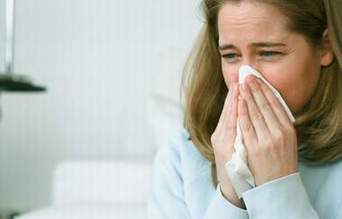

+++
title = "إنت شامم نفسك ؟!"
date = 2007-02-17
authors = ["يسر عبد الدايم"]
aliases = ["/articles/20at-7ayatna-3267/"]

[taxonomies]
authors = ["yasr-abdel-eldaim"]
sections = ["7ayatna"]

[extra]
section_name = "حياتنا"
share_image = "/media/admins.20at.com/do3a2/42-15539084.jpg"
summary = "ياااة يوم طويل من العمل المرهق أو يوم دراسي تتنقل فيه من مكان لآخر.."
section_slug = "7ayatna"
section_colour = "#CA0789"
thumb = "/media/admins.20at.com/do3a2/42-15539084.jpg"
n_comments = 22
original_url = "http://www.20at.com:80/20at/lifestyle/3267.html"
archived = "20100227161929"
date_source = "byline/meta"
aliases_20at = ["/20at/7ayatna/3267.html", "/20at/lifestyle/3267.html"]

[extra.provenance]
original_url = "http://www.20at.com:80/20at/lifestyle/3267.html"
capture_url = "https://web.archive.org/web/20100227161929/http://www.20at.com:80/20at/lifestyle/3267.html"
capture_label = "٢٧ فبراير ٢٠١٠، ١٦:١٩ UTC"
date_note = "من سطر التوقيع في المقال"
other_urls = ["/20at/7ayatna/3267.html"]
comments = "٢٢"
missing_images = ""
+++

<figure></figure>

ياااة يوم طويل من العمل المرهق أو يوم دراسي تتنقل فيه من مكان لآخر..

منهك..مرهق..أخيرا قد جاء وقت الراحة.. ولكن من أين هذه الرائحة؟

إنها رائحة كريهة للغاية..هل أنا مصدر هذه الرائحة الكريهة!

لا يمكنني أن اصدق..طوال اليوم ولم أشعر بهذه الرائحة..لقد قمت بإيذاء زملائي طوال هذه المدة ولكنى لم أشعر بنفسي..

<h3>احترس من الطعام</h3>

الدراسات العلمية تشير إلى أن هناك علاقة مباشرة بين نوعية الأطعمة التى نتناولها والرائحة التى تنبعث من الجسم، والحل هنا ليس هو استخدام مزيلات رائحة العرق أو العطور، ولكن هو الحرص علي تناول أغدية نظيفة حتى لا تسبب رائحة عرق كريهة تؤذي بها الغير.

لقد حث الإسلام علي النظافة والطهارة، فالقرآن والحديث مليئان بالتوجيهات العامة التي تحث على النظافة، قال تعالى: &#123; إن الله يحب التوابين ويحب المتطهرين&#125;، وعلي الرغم من هذا فهناك الكثير من الناس لا يلتزمون بهذه التعاليم حتى البسيط منها.

<h3>النظافة جزء من إيمان</h3>

فعلى الرغم من ارتباط الصلاة بالطهارة والوضوء، إلا أن بعض الناس لايراعون ذلك، فعندما سألنا احد خدامي المسجد عن نظافة المصليين رد قائلا: هناك الكثير من الشكوى بسبب هذا الامر، فهناك عدد كبير من المصليين لا يهتمون بالتاكد من نظافتهم العامة، وعندما ازدادت هذه الشكوى قام الخطيب في صلاة الجمعه بالتبية علي المصليين بالتاكد من نظافتهم الشخصية وخاصة الجوارب "الشرابات" التي تختنق المصلين منها.

والأمر لا يختلف في سلوكيات بعد المصلين، فهذا (احمد حامد) -27عاما- يحدثنا عن موقف حدث له أثناء الصلاة، يقول: في رمضان الماضي ذهبت إلى المسجد لأداء صلاة التراويح، وبعد أول ركعة فقدت تركيزي في الصلاة، وتشتت تفكيرى، وكان كل ما أريدة هو أن ينتهي الإمام من الركعتين بمنتهي السرعة، والسبب هو أن الشخص الذي كان يقف بجانبى لم يكف عن التجشؤ طوال الصلاة!

<h3>موقف محرج ...جدا</h3>

ومن الأمور المحرجة للغاية هو ان تقوم بوعظ أحد كي يهتم بنظافته الشخصية، وهذا ما فعلته (هبه عاطف) -21سنة- مع إحدى صديقتها في الجامعة، تخبرنا قائلة: كان من الصعب أن اقوم بهذه المهمة، ولكنى أحسست أن كل زملائنا في الجامعة يتحدثون عنها ويحاولون الابتعاد عنها بأي طريقة ممكنة.. فاتخذت القرار وتحدثت معها بمنتهي الصراحة كي تهتم بنظافة ملابسها ونظافتها الشخصية، وهي تقبلت الأمر بصدر رحب وبالفعل قامت بالتغيير من نفسها تماما.

"فهمنى غلط"...هكذا قال (سامح المراغي) -28سنة- الذي يستكمل قائلا: عندما قمت بنصيحة أحد اصدقائي في العمل بأن يهتم بنظافتة الشخصية أخذ الموضوع بحساسية شديدة للغاية، ومنذ هذه اللحظة وهو لا يتحدث معي مطلقا!

<h3>نظافتك الشخصية</h3>

يعترف( شادي سليمان) -23عاما- قائلا: كنت لأ اهتم مطلقا بألتاكد من مدي نظافة ملابسي وكان من الممكن أن يمر بي أسبوع كامل لا أغير فيه ملابسي، فأنا اسكن بمفردي في المنزل لظروف عمل والدي ووالدتى في الخارج، حتى قام احد زملائي بالجامعة بالتحدث معي في هذا الأمر، وبالفعل أحسست بالخجل، لأننى لم أكن اشعر مطلقا برائحة ملابسي، فلا يستطيع احد أن يحكم علي نفسه.

ومن أشد الامور إحراجا هو ان تقوم بزيارة شخص ويطلب منك القيام بخلع حذائك، وهذه كانت حكاية (سارة يوسف) -20سنة- التي قالت: عند قيامي بزيارة إحدى صديقاتي لأول مرة، طلبت مني والدتها خلع حذائي علي الباب، وبعدما قمت بخلع الحذاء شممت رائحة كريهة للغاية، وقتها تذكرت أنني لم اقم بتغير جوربي"الشراب" منذ ثلاث أيام، وكنت في شدة الاحراج، وبعد أن مضت خمس دقائق طلبت منها أن أذهب لكي أحضر شيء من منزلي وأعود لها مرة اخري، ومنذ هذه المرة وأنا أتاكد من نظافتي الشخصية بصوة كاملة حتى لا أتعرض لموقف محرج مرة أخري.

<h3>الحل بسيط جدا..جدا</h3>

لكي تتخلص من هذه المشكلة، نقدم لك بعض النصائح اليومية لتجنب الروائح الكريهة:

1- إحرص يوميا علي التأكد من نظافة أسنانك، فالأسنان مرآة الجسم، وهي مصدر للرائحة الكريهة اذا لم يتم الاعتناء بها.

2- يوميا قم بعمل جرد لملابسك كي تتاكد من نظافتها، حتى لا ياتى اليوم التالي وترتدي ملابس متسخة.

3- احرص يوميا علي تغيير ملابسك الدخلية، وجوربك"شرابك".

4- عند قيامك بارتداء ملابسك احرص علي إرتداء ثوب قطني كي يمتص العرق، لان الملابس القطنية لا ينتج عن ارتداءها روائح كريهة.

5- تجنب استعمال مزيل عرق أو العطور أثناء افراز العرق، فهذا يعمل على زيادة الروائح الكريهة ولا يعالجها.

