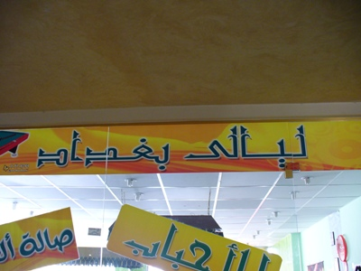
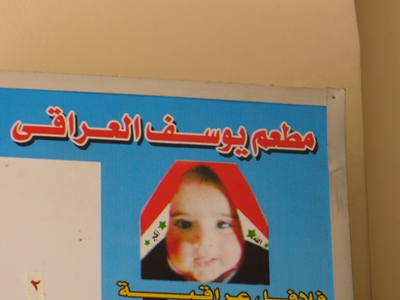
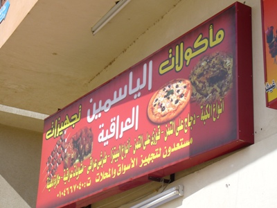
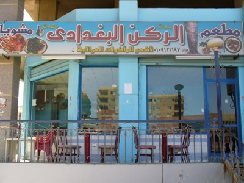
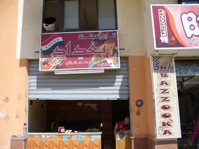

+++
title = "العراقيون في مصر.. شكل تاني"
date = 2007-03-14
authors = ["إيمان كمال"]
aliases = ["/articles/7ayatna-3416/"]

[taxonomies]
authors = ["iman-kamal"]
sections = ["7ayatna"]

[extra]
section_name = "حياتنا"
share_image = "/media/admins.20at.com/aly/p1000275.jpg"
summary = "آلاف العراقيين لجأوا إلى مصر كما لجأوا إلى غيرها مثل الأردن وسوريا، ولكن ما يميزهم في مصر أنهم يتمركزون في أحياء بعينها مثل مدينة نصر أو الرحاب أو مدينة 6 أكتوب"
section_slug = "7ayatna"
section_colour = "#CA0789"
thumb = "/media/admins.20at.com/aly/p1000275.jpg"
n_comments = 22
original_url = "http://www.20at.com:80/20at/lifestyle/3416.html"
archived = "20100215070620"
date_source = "byline/meta"
aliases_20at = ["/7ayatna/3416.html", "/20at/lifestyle/3416.html"]

[extra.provenance]
original_url = "http://www.20at.com:80/20at/lifestyle/3416.html"
capture_url = "https://web.archive.org/web/20100215070620/http://www.20at.com:80/20at/lifestyle/3416.html"
capture_label = "١٥ فبراير ٢٠١٠، ٠٧:٠٦ UTC"
date_note = "من سطر التوقيع في المقال"
other_urls = ["/7ayatna/3416.html"]
comments = "٢٢"
missing_images = "٣"
+++

آلاف العراقيين لجأوا إلى مصر كما لجأوا إلى غيرها مثل الأردن وسوريا، ولكن ما يميزهم في مصر أنهم يتمركزون في أحياء بعينها مثل مدينة نصر أو الرحاب أو مدينة 6 أكتوبر..

وفي هذه الأخيرة تشعر أنك في العراق تماماً، فكل ما يحيط بك يحمل الصفة العراقية، بداية من اللغة واللهجة والطباع ومرورا بالخدمات، فالمقهى يقدم مشروبات عراقية، والمخبز والمطاعم عراقيه تطهى أجمل الأكلات مثل العرايس أو الحوواشى ودجاج على سمن ومرق، وحتى صالات البلياردو، والاستوديوهات، والنت كافية.. وكافة تلك الأماكن يعمل بها عراقيون.

اتجهت إلى مدينة 6 أكتوبر، والتقيت ببعض العراقيين.. لنعرف كيف يعيشون وماذا يمتهنون، وما هي أهم مشكلاتهم ؟

<h3>بعيدا عن الجثث</h3>

نائل أبو يوسف - صاحب إحدى المطاعم العراقية- يقول: "كنت أعيش في العراق معيشة أخرى، ولكن ظروف الحرب اضطرتني للمجيء إلى مصر رغم توافر العمل في العراق، ولكن كيف أذهب للعمل وأنا أرى الجثث متناثرة وغيرها من المناظر غير الآدمية التي من الممكن أن أصبح مثلها في أي ثانية، مما جعلني أفضل ترك العراق وتفضيل الغربة خوفا على نفسي وعلى أهلي".

يضيف: "جئت إلى مصر وتحديدا مدينة 6 أكتوبر التي تضم عددا كبيرا من العراقيين، وقمت بافتتاح مطعما للوجبات العراقية وأقمت بجواره، لكن أصحاب المحلات والشقق استغلوا كوننا من خارج مصر ورفعوا أسعارها بشكل خرافي ليصل للضعف في وقت قصير".

<h3>فين أيامك يا صدام</h3>

أما "لواء" فهو شاب عراقي جاء لمصر منذ 4 أشهر هو وأسرته، ويشتكي من بعض المضايقات الأمنية التي يتعرض لها، ولكنهم يفضلون الصمت لأن أي مشكله بالنسبة لهم معناها الترحيل!

وعن معيشته في مصر، يقول: "منذ مجيئي إلى مصر تعلمت الاقتصاد والتوفير خصوصا أن خطيبتي مصريه تساعدني على ذلك، ولا أذهب إلى أي مكان بخلاف العمل حتى أوفر نقود الإقامة، فالدخل هنا ليس مثل العراق".

وفي نهاية حديثه أشار لواء الى أنه يتحسر على أيام صدام ويشاركه في ذلك كل العراقيين، الذين توقعوا بعد ترك صدام الحكم أن يأتي من هو أفضل منه، لكن ما حدث أكد أنهم كانوا فى نعيم، فجحيم صدام ولا نعيم الأمريكان!

<h3>نحن مسالمون</h3>

وعن سبب وجود هذا الكم الكبير من العراقيين أخبرني صاحب فرن ومخللات وهو عراقي: "من يأتي للمدينة يتصل بمن يعرفه فى العراق فيأتي ليسكن بجواره ليستأنس به، لذا يقول بعض المصريين أننا احتللنا المنطقة وهو كلام ليس صحيحا، فنحن كشيعة وسنة نعيش بمصر مسالمين، لكن أعتقد من يقول ذلك يكون بسبب ما يراه من قتال في العراق".

ومن داخل أحد المطاعم العراقية التقيت مع حسين، وهو شاب كان يدرس في كليته بالعراق، وعندما أراد أن يستكمل دراسته في مصر أعاقته التكاليف الباهظة للدراسة، ويشير إلى أن مشاكل العراقيين تتركز حول الفيزا والإقامة وارتفاع الأسعار، فمن يملك أموالا كثيرة يستطيع دخول مصر بسهولة وخصوصا إذا كانت معه وساطة، أما من لا يملك فيعانى من مشكله الترحيل في أي وقت ولا يعلم إلى أين يذهب.

لكن رغم ذلك يشير حسين أن العراقيون أهينوا في كل مكان ذهبوا إليه إلا مصر، فالناس في مصر تساعدهم وتتعاطف معهم.

بعد جولتي بين العراقيين كان الشئ كان الذي ألمنى حقا هو إحساس العراقيين بالغربة رغم حبهم لمصر أم الدنيا وهو الشعور الذي أجمع عليه الكثير، حيث تبقى العراق بالنسبة لهم هي الوطن والحلم والحبيب مهما حدث.

<figure></figure>

<figure></figure>

<figure></figure>

<figure></figure>

<figure></figure>
