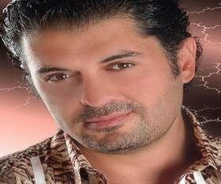

+++
title = "راغب وهيفاء وسميرة.. نجوم الموريكس"
date = 2009-06-21

[taxonomies]
authors = []
sections = ["nashrat-9"]

[extra]
section_name = "نشرة 9"
share_image = "/media/images/stories/20at/neshret_9/ragheb01.jpg"
summary = "حصل الفنان راغب علامة على جائزة (الموريكس2009) لأفضل مطرب عربي ، والذي أقيم مساء أمس الجمعة في صالة السفراء في كازينو لبنان ، حيث احتفل باليوبيل الفضي له ، فيما"
section_slug = "nashrat-9"
section_colour = "#004B80"
thumb = "/media/images/stories/20at/neshret_9/ragheb01.jpg"
n_comments = 1
original_url = "http://www.20at.com:80/20at/nashrat-9/12425-2009-06-21-12-05-05.html"
archived = "20090624025644"
date_source = "byline/meta"
aliases_20at = ["/20at/nashrat-9/12425-2009-06-21-12-05-05.html"]

[extra.provenance]
original_url = "http://www.20at.com:80/20at/nashrat-9/12425-2009-06-21-12-05-05.html"
capture_url = "https://web.archive.org/web/20090624025644/http://www.20at.com:80/20at/nashrat-9/12425-2009-06-21-12-05-05.html"
capture_label = "٢٤ يونيو ٢٠٠٩، ٠٢:٥٦ UTC"
date_note = "من سطر التوقيع في المقال"
other_urls = []
comments = "١"
missing_images = ""
+++

<figure></figure>

حصل الفنان راغب علامة على جائزة (الموريكس2009) لأفضل مطرب عربي ، والذي أقيم مساء أمس الجمعة في صالة السفراء في كازينو لبنان ، حيث احتفل باليوبيل الفضي له ، فيما نالت الفنانة القديرة سميرة سعيد جائزة "نجمة الغناء العربي" عن مجمل مسيرتها الفنية.

<strong>وفيما يلي قائمة الجوائز:</strong>

النجمة اللبنانية الأكثر جماهيرية: هيفاء وهبي

أفضل مطربة عربية : سميرة سعيد

أفضل مطرب عربي : راغب علامة

أفضل مطربة لبنانية : يارا

أفضل مغنٍ شاب : حسام حبيب

أفضل مغنّية شابة : شذا حسون.

أفضل أغنية لبنانية : (بتمون) غناء إليسا، كلمات وألحان مروان خوري

أفضل أغنية وطنية : (لبنان رح يرجع) لجوزف عطية، كلمات سمير نخلة

أفضل شاعر أغنية : منير بو عساف

أفضل ملحن لبناني : هشام بولس

أفضل ممثل لبناني – دور أول : فادي إبراهيم

أفضل ممثل لبناني - دور ثان : كمال الحلو

أفضل ممثلة لبنانية – دور أول : كارمن لبس

أفضل ممثلة لبنانية - دور ثان : رندة كعدي

أفضل ممثلة تلفزيونية عربية : سلاف فواخرجي عن دورها في مسلسل (أسمهان)

أفضل ممثل تلفزيوني عربي : عابد فهد أيضاً عن دوره في مسلسل (أسمهان)

أفضل ممثّل كوميدي: ماريو باسيل

أفضل مخرج تلفزيوني درامي لبناني : إيلي معلوف عن المسلسل اللبناني (ورود ممزّقة)

أفضل مخرج سينمائي لبناني: سمير حبشي

أفضل ممثّلة سينمائية عربية: سمية الخشاب

أفضل ممثّل سينمائي عربي: خالد النبوي

أفضل كاتب سيناريو : طوني شمعون عن مسلسل (ورود ممزقة)

أفضل فيديو كليب: وليد ناصيف عن أغنية (بتمون) لإليسا، وجو بو عيد عن (ما يهمك) ليارا

التصويت على الجوائز توزع بين 50 في المائة من حق لجنة الحكم التي تألفت من لجنتي حكم متخصصتين: حكم على الاعمال الدرامية، وتضم وفاء طربية، مي منسي، باسل خياط، طوني أبوالياس،محمد حجازي، عمار شلق، منى طايع، ماغي بدوي، وفاء شدياق وسمير خوري، ولجنة في مجال الغناء والموسيقى وتضم جوزف أبي ضاهر، مريم شقير أبوجودة، إحسان المنذر، غسان صليبا، فرح بن رجب، باسكال صقر، ميرنا خياط، باسم كريستو، روني نجيم وفيني رومي، إضافة إلى تصويت الجمهور بنسبة 15 في المائة على راديو (روتانا – دلتا)،و15 في المائة على راديو (ميلودي اف ام)، و20 في المائة على الموقع الخاص بالـ(موركس دور).

ــــــــــــــــــــــــــــــــــــــــــــــــ

المصدر: موقع البوابة

