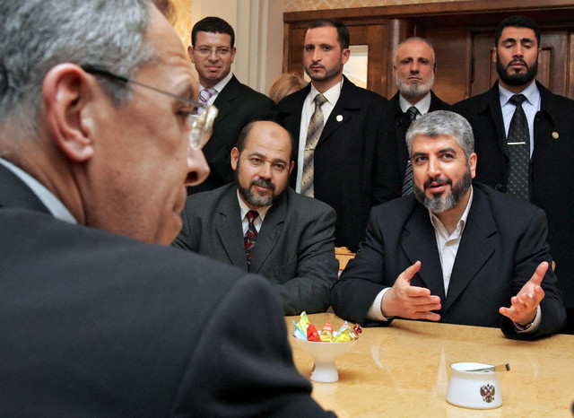

+++
title = "تصورات ما وراء الصورة!"
date = 2006-03-04
authors = ["مروة صلاح"]
aliases = ["/articles/b520/"]

[taxonomies]
authors = ["marwa-salah"]
sections = ["nashrat-9"]

[extra]
section_name = "نشرة 9"
share_image = "/media/admins.20at.com/yasmine/8.jpg"
summary = "بصيت ع الصورة، معلهش ارجع تانى وركز فيها.........."
section_slug = "nashrat-9"
section_colour = "#004B80"
thumb = "/media/admins.20at.com/yasmine/8.jpg"
n_comments = 4
original_url = "http://20at.com:80/20at/nashrat-9/1843.html"
archived = "20090619075425"
date_source = "byline/meta"
aliases_20at = ["/article2.php?sid=520", "/20at/nashrat-9/1843.html"]

[extra.provenance]
original_url = "http://20at.com:80/20at/nashrat-9/1843.html"
capture_url = "https://web.archive.org/web/20090619075425/http://20at.com:80/20at/nashrat-9/1843.html"
capture_label = "١٩ يونيو ٢٠٠٩، ٠٧:٥٤ UTC"
date_note = "من سطر التوقيع في المقال"
other_urls = ["/article2.php?sid=520"]
comments = "٤"
missing_images = ""
+++

<figure></figure>

بصيت ع الصورة، معلهش ارجع تانى وركز فيها..........

مشاهد مأساوية كثيرة رأيناها للشعب الفلسطيني من مذابح واعتقالات ودماء وعربيات إسعاف وبيوت مهدمة.......

وشاهدنا الكثير أيضا من التحركات السياسية للقضية بدايات من التصريحات المتبادلة بين السلطة الفلسطينية وإسرائيل والرئيس الامريكى وجامعة دول عربية واتحاد أوربي ومجلس أمن وأمم متحدة.

ووسط هذا وذاك كان هناك تحرك على المستوى الداخلي من حركات تدافع ضد العدوان وتحظى بقبول شعبي أثبتته نتائج الانتخابات يناير الماضي بفوز إحداها وهى حركة المقاومة الإسلامية "حماس".

<h3>حكاية الصورة</h3>

تباعا للفوز في الانتخابات ورئاسة الوزارة، بدأت حماس في الزيارات الرسمية فكانت البداية بروسيا بالأمس لمدة 3 أيام.

ومع الزيارة الأولى بدأت المناوشات، فروسيا تطالب الاعتراف بحق إسرائيل في الوجود والالتزام باتفاقات السلام المؤقتة معها وأعلنت أنها مستعدة لتمديد وقف إطلاق النار الذي تم التوصل إليه مطلع العام الماضي إذا لم تستخدم إسرائيل القوة.

ولكن قبل أول اجتماع بموسكو أعلنت حماس تمسكها برفض الاعتراف بإسرائيل حيث قال محمد نزال "قضية الاعتراف منتهية، لن نعترف بإسرائيل" .

ورد مشعل على الالتزام باتفاقات السلام المؤقتة "أن موقف حماس الواضح هو أنها ستتعامل مع الاتفاقات القائمة وفقا لمصالح الشعب الفلسطيني"

وأضاف مشعل الذي يواجه تهديدا بتجميد المساعدات الغربية للسلطة الفلسطينية "إن حماس تعرض "ضمانات" للمانحين المحتملين بان أموالهم لن تذهب إلى ميزانية حماس، لكنها ستذهب للشعب الفلسطيني".

كما قال عزة الرشق احد أعضاء حماس "إن الحركة ستبحث مسألة تمديد الهدنة بإيجابية لكن فقط إذا أنهت إسرائيل الاعتداءات والاغتيالات والاعتقالات وأطلقت سراح السجناء الفلسطينيين، وقد تقبل بهدنة طويلة الأمد إذا انسحبت إسرائيل من جميع أراضي الضفة الغربية ولبت مطالب أخرى".

ارجع تانى وانظر للصورة

ننتظر تعليقك عليها...........

