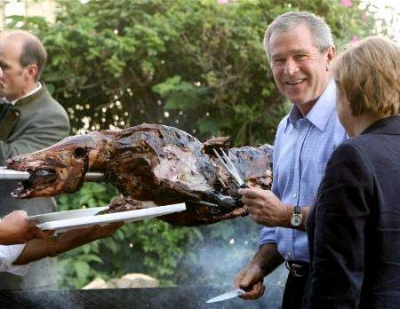

+++
title = "بوش والخنزير وميركل"
date = 2006-07-14
authors = ["رويترز"]
aliases = ["/articles/b1074/"]

[taxonomies]
authors = ["reuters"]
sections = ["nashrat-9"]

[extra]
section_name = "نشرة 9"
share_image = "/media/admins.20at.com/marwa05/khanzer.jpg_.a.jpg"
summary = "الرئيس الأمريكي جورج بوش انشغل بأكثر من البرنامج النووي لإيران والهجوم الصهيوني علي لبنان وغزة وحرية الصحافة في روسيا وذلك أثناء زيارته لألمانيا يوم الخميس."
section_slug = "nashrat-9"
section_colour = "#004B80"
thumb = "/media/admins.20at.com/marwa05/khanzer.jpg_.a.jpg"
n_comments = 35
original_url = "http://www.20at.com:80/20at/nashrat-9/2386.html"
archived = "20091018154423"
date_source = "byline/meta"
aliases_20at = ["/article2.php?sid=1074", "/20at/nashrat-9/2386.html"]

[extra.provenance]
original_url = "http://www.20at.com:80/20at/nashrat-9/2386.html"
capture_url = "https://web.archive.org/web/20091018154423/http://www.20at.com:80/20at/nashrat-9/2386.html"
capture_label = "١٨ أكتوبر ٢٠٠٩، ١٥:٤٤ UTC"
date_note = "من سطر التوقيع في المقال"
other_urls = ["/article2.php?sid=1074"]
comments = "٣٥"
missing_images = ""
+++

<figure></figure>

الرئيس الأمريكي جورج بوش انشغل بأكثر من البرنامج النووي لإيران والهجوم الصهيوني علي لبنان وغزة وحرية الصحافة في روسيا وذلك أثناء زيارته لألمانيا يوم الخميس.

فقد ظل بوش يذكر الخنزير البري وذبحه وشيه طبقا للتقليد المحلي، وذلك قبيل تناوله الخنزير البري في حفل عشاء أقامته له المستشارة الألمانية انجيلا ميركل بمنزلها في منتجع على بحر البلطيق أمس.

وقال بوش لميركل في مستهل مؤتمرهما الصحفي المشترك في سترالسوند شمالي برلين "أتطلع إلى الوليمة التي ستكون لديك الليلة، أستنتج أني قد أنال شرف تولي مهمة تشريح الخنزير.

وبعد دقائق من انتهائهما من مناقشة القضايا السابقة والتقدم في جولة الدوحة الخاصة بمحادثات تحرير التجارة عاد بوش إلى الخنزير البري، وقال بوش لميركل "شكرا على سماحك لي بالتطلع إلى ذلك الخنزير هذه الليلة وأجاب بوش على أسئلة قليلة قبل أن يعود إلى الخنزير البري للمرة الثالثة.

وأضاف "لم أر ذلك الخنزير بعد" وضحكت ميركل وقالت أنها شاهدت تصويرا للخنزير البري ويمكنها التحقق من انه في حالة سكون مضيفة أنها تتعشم أن يكون على النار ليكون جاهزا في الموعد على العشاء.

وقرب نهاية المؤتمر الصحفي طرح بوش سؤالا بشأن الشرق الأوسط في رابع ذكر له للخنزير أثناء المؤتمر، وقال بوش لصحفي "أظن أنك ستسأل عن الخنزير" فأجابه الصحفي قائلا انه فضولي بشأن ذلك أيضا، وقال بوش "الخنزير؛ سأجيبك غدا بعد أن التهمه".

