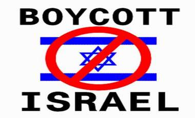

+++
title = "ادعم غزة .. بمقاطعة الكود 729"
date = 2009-01-14
authors = ["كامل الشيرازي"]

[taxonomies]
authors = ["kaml-elshirazi"]
sections = ["siyasa"]

[extra]
section_name = "سياسة"
share_image = "/media/currentarticleassets/boycot.jpg"
summary = "\"من أجل فلسطين لا بد أن نعمل شيئًا\".. بهذا الشعار الذي رفعه عشرات المدونين وأصحاب المنتديات في الجزائر، بدأت حرب الكترونية واسعة ضدّ السلع الإسرائيلية والشركات "
section_slug = "siyasa"
section_colour = "#9E2A2B"
thumb = "/media/currentarticleassets/boycot.jpg"
n_comments = 0
original_url = "http://www.20at.com:80/20at/politics/10951.html"
archived = "20100129023526"
date_source = "byline/meta"
aliases_20at = ["/20at/politics/10951.html"]

[extra.provenance]
original_url = "http://www.20at.com:80/20at/politics/10951.html"
capture_url = "https://web.archive.org/web/20100129023526/http://www.20at.com:80/20at/politics/10951.html"
capture_label = "٢٩ يناير ٢٠١٠، ٠٢:٣٥ UTC"
date_note = "من سطر التوقيع في المقال"
other_urls = []
comments = ""
missing_images = ""
+++

<figure></figure>

"من أجل فلسطين لا بد أن نعمل شيئًا".. بهذا الشعار الذي رفعه عشرات المدونين وأصحاب المنتديات في الجزائر، بدأت حرب الكترونية واسعة ضدّ السلع الإسرائيلية والشركات الغربية الداعمة للكيان الصهيوني، كرد فعل رمزي من الجماهير الجزائرية الغاضبة على ما تقترفه الدولة العبرية من إبادة بغزة، "عشرينات" اقتربت من عرّابي هذه المبادرة، وكانت لها معهم هذه الوقفة.

الخطوة تبنتها 9 منتديات شبابية هي: منتديات الجلفة لكل الجزائريين والعرب، منتديات المهندس الجزائري، منتديات طلبة الجزائر، شبكة النايلي، منتديات نبع الجزائر، شبكة بدر سات العربية الجزائرية، منتدى التقنية الجزائرية، منتديات شباب الجزائر، ومنتديات المفيد، كما انضم إليها عديد المدونين، بينهم فهد (26 سنة) صاحب مدونة "العهد الجديد"، ومحمد صالح (28 سنة) بمدونته "المنارة"، ومدونة "نزف اليراع" للكاتب "عبد الحق حقي"، ومدونة "تلمسان ليست للبيع" لـ"عبد السلام بارودي" (38 عاما)، ومدونة "نبض القلم" لـ "عبد الوهاب بوكروح"، والمدون الشاعر محمد كاديك (31 سنة).

<h3>تجار الكود 729</h3>

الهدف من الحملة ورد في بيان نشره أصحاب المبادرة قائلين: "المقاطعة واجبة ضدّ البضائع الأمريكية مثل البضائع الإسرائيلية، فأمريكا اليوم هي إسرائيل الثانية، ولولا المال الأمريكي، والسلاح الأمريكي، والفيتو الأمريكي، لما استمرت إسرائيل تمارس عدوانها".

كما نشر هؤلاء لائحة بأسماء عشرات السلع الإسرائيلية والغربية، حيث دعوا مواطنيهم للامتناع عن اقتناء كل البضائع التي تحمل الرقم الاستدلالي "729"، وهي على التوالي: كارامال، جافا، كيدام ، كورال، توب، بيجال، هازات، صابرا، أوزم (توت، خضر وفواكه، مشروبات، وجبات جاهزة)، داجير (مصبّرات أسماك)، هوليلاند (عسل، أعشاب عطرية)، أمبا (معلبات)، غرين فالي (خمور)، تيفال (منتجات نباتية)، أغروفراش (خيار)، جوردان فالي (تمور)، دانا (طماطم)، إيبيلادي (أدوات نزع الشعر)، أهافا (مستحضرات تجميل البحر الميت)، علما أنّ هذه السلع لا تسوّق رسميا في الجزائر، لكنه يتم إدخالها على نحو غير مشروع من طرف ما يٌعرف بـ "تجار الشنطة".

كما انطوت المبادرة أيضا على نداء لمقاطعة شركات عالمية مثل ماك دونالدز، كوكاكولا، أكواريوس، شيري كوك، فانتا، نيستا، سبرايت، مينوت مايد، تروبيكال، على خلفية دعم هذه المؤسسات للكيان منذ عام 1966، إضافة إلى دانون، أرفي، بيلان، بليدينا، فوسفاتين، شيبستر، إفيان، جالباني، جرفاس، هيدوبرت، تالفين، وفولفيك.

<h3>تعاون مع فلسطين</h3>

سليم لعجايلية، المتحدث باسم المبادرة أوضح لـ (عشرينات) أنّ الخطوة جرى اعتمادها لجدواها اقتصاديا ودعائيا، فالمقاطعة تعتبر تعاوناً مع فلسطين وتمثل بوجه ما استبعادا لأي تعاون مع إسرائيل، ويضيف: "هنا نستطيع أن نقاتل بدون سلاح بدون صاروخ بدون دبابة بدون طائرة".

ومن جهتها، تحدثت المحامية البارزة فاطمة الزهراء بن براهم، قائلة: "إذا كان كل يهودي يعتبر نفسه مجندًا لنصرة إسرائيل بكل ما يقدر عليه، فإن كل مسلم في أنحاء الأرض مجند لتحرير الأقصى، ومساعدة أهله بكل ما يمكنه من نفس ومال، وأدناه مقاطعة بضائع الأعداء".

ترى المجاهدة الجزائرية التي تحمل الرمز "جميلة بوحيرد" رئيسة اللجنة الشعبية لإغاثة غزة ودعم المقاومة أنه "بالمقاطعة نحافظ على هويتنا، وبها أيضا نقطع الانسياق وراء الثقافات التي لا تراعي تقاليدنا ومعتقداتنا"،فيما يشير الوجه الثوري البارز "الأخضر بورقعة" إلى أنّ المسؤولية التاريخية تملي على الجزائر وسائر الدول الإسلامية تنشيط حملة إفشال الاقتصاد الصهيوني والغربي.

على المنوال ذاته، يذهب الناشط الحقوقي "مقران آيت العربي" والطالب "إسماعيل مجاهد" إلى أنّ حملة مقاطعة المنتجات الإسرائيلية والغربية ستقود حتما إلى تحريك السواكن وتشكل ضغطا على الحكومات.

من جانبه، يرى الكاتب "رياض وطار" أنّه مهما كنا ضعفاء فإننا نستطيع أن نفعل شيئًا، وبمقدورنا أن نقدم لفلسطين شيئا، من خلال تفعيل سلاح المقاطعة الاقتصادية الهائل الذي طالما قلب الموازين وغيّر مجرى التاريخ.

<h3>سلاح فعال</h3>

يجمع من سألناهم على أنّ سلاح المقاطعة سيكون فعاّلا، وكذلك يرى الشباب الجزائري أنّ المقاطعة ستدفع الشركات الغربية إلى مراجعة حساباتها مستقبلا، حيث تنشط حركة حثيثة بين السكان المحليين، لإقناع مختلف الشرائح بمقاطعة بضائع اليهود وأعوان اليهود، وعملاء اليهود، وشعار المبادرين في ذلك "نترفع عن بعض شهواتنا ورغباتنا لئلا تتحول أموالنا إلى رصاصات في صدور إخواننا، وشظايا في أجساد أطفالهم".

يعلّق الشاب أنيس نواري بثقة: "فلنستخدم هذا السلاح لمقاومة أعداء ديننا وأمتنا، حتى يشعروا بأننا أحياء، وأن هذه الأمة لم تمت ولن تموت".

ويؤيده المخرج السينمائي الشاب سفيان بو قرموح، قائلا: "سلاحنا المقاطعة.. صاروخنا إنهاك اقتصادهم.. دباباتنا مقت منتجاتهم".

