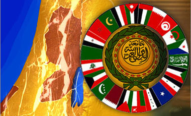

+++
title = "القمم العربية.. مين يلحق الأول؟!"
date = 2009-01-14
authors = ["مروة صلاح"]

[taxonomies]
authors = ["marwa-salah"]
sections = ["siyasa"]

[extra]
section_name = "سياسة"
share_image = "/media/currentarticleassets/1_885122_1_34.jpg"
summary = "قمة عربية في الدوحة بعد غد الجمعة، قمة خليجية في الرياض غداً الخميس، قمة عربية تشاورية في الكويت الأحد.."
section_slug = "siyasa"
section_colour = "#9E2A2B"
thumb = "/media/currentarticleassets/1_885122_1_34.jpg"
n_comments = 0
original_url = "http://20at.com/20at/politics/10955.html"
archived = "20100105193615"
date_source = "byline/meta"
aliases_20at = ["/20at/politics/10955.html"]

[extra.provenance]
original_url = "http://20at.com/20at/politics/10955.html"
capture_url = "https://web.archive.org/web/20100105193615/http://20at.com/20at/politics/10955.html"
capture_label = "٥ يناير ٢٠١٠، ١٩:٣٦ UTC"
date_note = "من سطر التوقيع في المقال"
other_urls = []
comments = ""
missing_images = ""
+++

<figure></figure>

قمة عربية في الدوحة بعد غد الجمعة، قمة خليجية في الرياض غداً الخميس، قمة عربية تشاورية في الكويت الأحد..

لا تظن أن القادة العرب قد اتحدوا فجأة وقرروا أن يجتمعوا لثلاثة مرات خلال أقل من 3 أيام، الواقع أن هناك دول ستحضر قمة واحدة، وأخرى ستحضر قمتين، ودول من نوع ثالث لن تحضر أي قمة!

على دماء الشهداء، وأشلاء الضحايا، يتناوب القادة العرب على القيام بـ"شو" إعلامي يحفظ لهم مكانتهم أمام شعوبهم، كي يثبت كل منهم أنه يريد إنقاذ الوضع في غزة!

<h3>قمة هنا.. قمة هناك</h3>

الحكاية تبدأ بعد أن شنت الحرب بيومين، حين اقترحت الدوحة عقد قمة عربية لبحث الوضع في غزة، ثم وافقت سوريا ولبنان وليبيا، وفجأة قرر بقية القادة العرب عدم الاجتماع، ولم يكتمل النصاب القانوني (وهو موافقة 16 دولة) على الأقل.

مرت الأيام، واستمر العدوان.. فدعت الدوحة من جديد إلى قمة عربية أمس، فرفضت مصر والسعودية بدعوة أن العرب سيجتمعون الأحد المقبل في قمة تشاورية على هامش المؤتمر الاقتصادي العربي في الكويت، لكن ما فاجأ مصر والسعودية هو موافقة 16 دولة على الذهاب إلى الدوحة!

هنا قررت السعودية أن تدخل على الخط، حتى تقطع "الشو" الإعلامي الذي كان ينتظر قطر، ودعت منذ ساعات قليلة إلى قمة خليجية طارئة صباح غد في الرياض، للتشاور في الوضع بقطاع غزة، وهي الدعوة التي لم تلق قبول أي دولة بالطبع حتى كتابة هذه السطور، لأن قادة الدول الخليجية كانوا يرتبون حقائبهم للسفر إلى الدوحة، لكن بات عليهم أن يغيروا وجهتهم إلى الرياض!

<h3>توصيات بلا تنفيذ</h3>

عشرينات، تحدثت مع بعض المحللين السياسيين عن هذه القمم، ومنهم د.حسن أبو طالب - الكاتب والمحلل السياسي بمركز الأهرام للدراسات السياسية والاستراتيجية – الذي انتقد قمتي الدوحة والرياض، وقال عن قمة الدوحة: "هدفها ليس واضحاً وبالتالي فلن يخرج عنها توصيات محددة، بل لن تخرج توصياتها عن الإدانة لإسرائيل وتصعيد القضية للأمم المتحدة مرة أخرى، والمطالبة بمحاكمة إسرائيل كمجرم حرب، والدعوة إلى قطع العلاقات الدبلوماسية مع إسرائيل".

وأضاف أبو طالب أن القمة تدخل ضمن صراع الأدوار بين الدول العربية للحصول على السبق في مساندة القضية الفلسطينية وكسب أدوار إعلامية أكبر، فهي مكايدة سياسية من قطر وليست من أجل تحرك حقيقي لوقف العدوان، وسوف تكرس مزيداً من الانقسام العربي العربي، وستؤدي إلى مزيد من الضغوط على مصر بهدف تصوير الدول التي شاركت في القمة أنها وقفت موقفاً قومياً، أما الدول الأخرى فهي عميلة".

<h3>عزل مصر</h3>

وعلى الرغم من أن معاهدة كامب ديفيد كانت سبباً فى اتخاذ الكثير من الدول العربية موقفا بعزل مصر عربياً، إلا أن مقاطعة مصر لقمة الدوحة لن تكون سبباً فى ذلك كما قال لنا عبد القادر ياسين – المفكر الفلسطينى- موضحا أن هذه المبادرة المصرية تمثل الموقف العربى الوحيد الذي اتخذ حتى الآن، ومهما انتقدناها فهي لصالح فلسطين، بعكس كامب ديفيد 1979".

وأشار ياسين إلى أن قرارات القمم العربية لن تتعد كونها حبرا على ورق، سينادون باتحاد الصف الفلسطينى! .. فقد كان متحدا من قبل لكن ماذا قدمت توصيات القمة برفع الحصار عن غزة؟!

وأكمل ياسين بقوله: "اعتدنا غياب العديد من الأطراف عن القمم العربية، فالقمة الوحيدة التى اجتمع فيها جميع الدول العربية هى القمة التى سبقت حرب تحرير الكويت وذلك لأنها بإيعاز من واشنطن"، وفسر عبد القادر ياسين ذلك بأن الأنظمة العربية حالياً تلتقط أنفاسها بصعوبة، والجامعة العربية غير قادرة على اتخاذ قرار لتحقيق أي تغيير بالقضية الفلسطينية.

<h3>مطالب القمة</h3>

أما اللواء طلعت مسلم – المحلل الاستراتيجي- فقال: "هناك العديد من القرارات التى يمكن أن تخرج بها قمة الدوحة في غياب مصر، فالعرب لم يستخدموا كل قوتهم حتى الآن لمساندة الوضع فى غزة، مثل الحديث عن تخفيض إنتاج البترول، وتجميد أو سحب مبادرة السلام العربية، أو عدم استقبال السفن والطائرات الأوربية للدول التي تساند إسرائيل، فالذي يريد عمل شئ سيقوم به".

هذه الحالة من التفتت العربي، رفعت أعداد الشهداء في غزة إلى ما يقرب الـ1020 شهيداً، في وقت لازال فيه كل زعيم عربي يبحث عن قمة يدعو لها.. قمة مغاربية وأخرى شامية وثالثة إفريقية.. ولا عزاء للشهداء!

