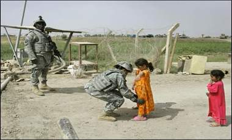

+++
title = "عراقيون:لماذا اهتموا بغزة ونسوا بغداد؟"
date = 2009-01-17
authors = ["فؤاد فليح حسن"]

[taxonomies]
authors = ["fouad-falih-hassan"]
sections = ["siyasa"]

[extra]
section_name = "سياسة"
share_image = "/media/currentarticleassets/iraqgaza.jpg"
summary = "الظروف التي تمر بها غزة حاليا مرت بها بغداد وما زالت حيث قتل الأطفال والنساء وتهديم للبنى التحتية وللمساجد و الكنائس.. لكن هناك سؤال يطرحه البغداديون عن ازدواجي"
section_slug = "siyasa"
section_colour = "#9E2A2B"
thumb = "/media/currentarticleassets/iraqgaza.jpg"
n_comments = 3
original_url = "http://20at.com/20at/politics/10969.html"
archived = "20100105193630"
date_source = "byline/meta"
aliases_20at = ["/20at/politics/10969.html"]

[extra.provenance]
original_url = "http://20at.com/20at/politics/10969.html"
capture_url = "https://web.archive.org/web/20100105193630/http://20at.com/20at/politics/10969.html"
capture_label = "٥ يناير ٢٠١٠، ١٩:٣٦ UTC"
date_note = "من سطر التوقيع في المقال"
other_urls = []
comments = "٣"
missing_images = ""
+++

<figure></figure>

الظروف التي تمر بها غزة حاليا مرت بها بغداد وما زالت حيث قتل الأطفال والنساء وتهديم للبنى التحتية وللمساجد و الكنائس.. لكن هناك سؤال يطرحه البغداديون عن ازدواجية معايير العرب في التعامل مع القضيتين، لماذا اهتموا بغزة و نسوا بغداد؟

محمد عمر (28 عاما) يستنكر المجزرة الإسرائيلية على غزة و يؤكد أنه شارك في حملة تبرعات مادية لتوصيل المساعدات غذائية، لكنه يبدي اندهاشه من موقف الدول العربية قائلا:" أنهم يدعمون إخواننا في غزة ولا يدعمون العراقيون مع العلم نحن نمر في نفس الظروف من قتل وتهجير تركونا فريسة سهلة للأمريكان".

<h3>عنصرية في التعاطف</h3>

سوسن البدري (30 عاما) تعمل صحفية وتطالب بمزيد من المساعدات العربية لأهالي غزة، أما عن عدم أو قلة دعم العرب إلى العراقيين فتقول:" إنه موضوع غريب فعلا فالظروف واحدة لكن التعاطف ليس واحدا.. نحن لا نستجدي من أي إنسان عربي لكننا في نفس الوقت نطالب بالدعم المعنوي لوقف العمليات الإرهابية التي تستهدف الأبرياء من العراقيين في جميع أنحاء بلدنا".

<h3>الإعلام نسى العراق</h3>

"غزة وبغداد هي نفس الحالة ونتمنى من الله أن يفرج عنا وعن الفلسطينيين"..هذا ما قاله أبو مهند (33 عاما)، ويضيف "أخي قُتل قبل أسبوعين تقريبا في انفجار كبير بالكاظمية راح ضحيته أكثر من مائة شهيد وجريح وتزامن مع انطلاق الاعتداءات الإسرائيلية على غزة . لكن مع الأسف فأن الأعلام العربي المستقل وغير المستقل لم يتطرق إلى هذا الخبر وتحدث على الشهداء في غزة فقط".

ويضيف:"أنا لا اقلل من أهمية الشهداء سواء في غزة أو أي مكان أخر لكن أتسأل لماذا هذه التفرقة بالتغطية الإعلامية هل نحن ليسنا بعرب؟"

أما من جانبه سعدون الغريري (26 عاما) يقول:"نحن كشباب عراقي قلوبنا وعقولنا مع أخواننا في غزة . لأننا أكثر الناس شعورا بهم لكوننا نمر في نفس الظروف القاسية التي يمرون بها . غير أني مستغرب جدا عن الصمت العربي تجاه أخوانهم العراقيين الذين عانوا ويعانون من القتل منذ عام 2003.

مدينة الصدر

جاسم الساعدي( 27 عاما) من سكان مدينة الصدر يقول: أن مدينة الصدر (في شرق بغداد ويسكنها أكثر من مليونين نسمة) مرت بنفس الظروف التي تمر بها غزة حيث طوقت من كل جانب وبدأ القصف الجوي والبري الأمريكي عليها. وراح ضحية هذا العدوان على هذه المدينة الفقيرة المئات من الأبرياء ومنهم أخوتي الثلاثة وأبي وهو في السبعين من عمره . لكن مع شديد الأسف لم نجد وقفة حقيقية لإخواننا العرب كهذه الوقفة المعنوية مع أخواننا في غزة .

أم أحمد (35 عاما) تقول: أن انتمائنا إلى الأمة العربية والإسلامية يحتم علينا الوقوف مع كل ما يمر به العرب والمسلمون . فقد قمنا نحن منظمة المرأة العراقية بجمع التبرعات وإعطائها إلى العوائل المتضررة من العمليات العسكرية في بغداد وسنحاول نكرر نفس الحملة لكن هذه المرة إلى أهلنا في غزة . وتضيف أم احمد وهي ناشطة في حقوق الإنسان أن ما نأسف له هو الصمت العربي عن ما يشهده العراق من قتل وتهجير .

