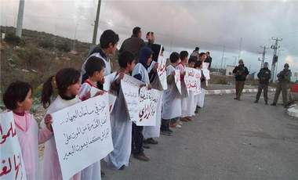

+++
title = "بالأكفان.. البراءة تتحدى الاحتلال"
date = 2009-01-18
authors = ["رنا خموس"]

[taxonomies]
authors = ["rana-khmos"]
sections = ["siyasa"]

[extra]
section_name = "سياسة"
share_image = "/media/currentarticleassets/atfal2.jpg"
summary = "أطفال خرجوا عن صمت أعمارهم الصغيرة رغم فرض منع التجول على قريتهم حوارة الواقعة جنوب مدينة نابلس، ولكنهم أرادوا أن يهتفوا لغزة ويكسروا الحصار المفروض على براءتهم"
section_slug = "siyasa"
section_colour = "#9E2A2B"
thumb = "/media/currentarticleassets/atfal2.jpg"
n_comments = 0
original_url = "http://20at.com/20at/politics/10983.html"
archived = "20100105193529"
date_source = "byline/meta"
aliases_20at = ["/20at/politics/10983.html"]

[extra.provenance]
original_url = "http://20at.com/20at/politics/10983.html"
capture_url = "https://web.archive.org/web/20100105193529/http://20at.com/20at/politics/10983.html"
capture_label = "٥ يناير ٢٠١٠، ١٩:٣٥ UTC"
date_note = "من سطر التوقيع في المقال"
other_urls = []
comments = ""
missing_images = ""
+++

<figure></figure>

أطفال خرجوا عن صمت أعمارهم الصغيرة رغم فرض منع التجول على قريتهم حوارة الواقعة جنوب مدينة نابلس، ولكنهم أرادوا أن يهتفوا لغزة ويكسروا الحصار المفروض على براءتهم وعفويتهم بعد أن بلغ عدد الأطفال الذين سقطوا شهداء في العدوان الإسرائيلي على القطاع 418 طفلا حتى الآن!.

خرجوا متحدين جنود مدججين بأسلحتهم على الحاجز الذي يغلق قريتهم، ليقولوا لأقرانهم في غزة هاشم أننا معكم، فلبسوا أكفناهم ليعلنوا بصوت عالٍ أن "دمهم دمنا ومهما طالت المسافات وقطعت الحواجز أوصالنا.. طفولة واحدة".

<h3>"فلسطين حرة"</h3>

ثائر عبد الله، في الصف الخامس الابتدائي، كان هناك بين أصدقاؤه وأمامه جنود يصوبون أسلحتهم نحوهم، قال لـ (عشرينات): "أنا ما بخاف منهم وبحكي لأطفال غزة أنه ما يخافوا لأن الله أقوى منهم، ونقول لهم نحن معكم".

أما زميله شادي، فكان يعلو صوته بين الفترة والأخرى مرددا "فلسطين حرة" غير آبه للمستوطنين المارين أمامه أو جنود الاحتلال الذين يقومون بتفتيش المارة على الحاجز.

يذكر أن بلدة حوارة قد شهدت منع التجول طوال فترة الحرب على غزة بفترات وساعات متقطعة، وشهد المواطنون ومن بينهم الأطفال ملاحقة مستمرة من قبل قوات الاحتلال الإسرائيلي حيث منعوا من التجول أو التنقل بين شوارعها الرئيسية والفرعية.

<h3>دم بارد</h3>

حسين أنيس، أحد منظمي الاعتصام، يرى أن هذه الفعالية جاءت للتأكيد على وقوف أبناء الضفة مع أهلهم في القطاع وتنديدا بمجازر إسرائيل بحق أهلنا في غزة خاصة الأطفال والنساء، فأطفالنا قد تحركوا لنصرة غزة بعد أن ماتت الهمة والنخوة في نفوس الرجال وبعد أن استبيحت دماء أهلنا في غزة وقتل أطفالنا والنساء بدم بارد، أراد الأطفال التعبير عن رفضهم للعدوان.

كما أكد أنيس أن الرسالة الثانية من هذا الاعتصام هو الخروج لإبداء موقف من هذا الصمت الرهيب الذي عم زعماء وحكام الأمة، "فعلى الرئاسة الفلسطينية اتخاذ موقف مغاير عما نرى لأن وطنهم بحاجة إلى موقف وزعيم كياسر عرفات الذي علم عمالقة المناضلين في العالم معنى الثورة، فنحن لا نقبل تقزيم قضيتنا الفلسطينية فموقف شعبنا الرافض مما يحدث معلن ولا خجل فيه، وعلى ساستنا وقادتنا الخروج إلى الميدان للإعراب عن تنديدهم بالمجازر حتى نكون جسدا واحدا".

يضيف: "رسالتنا الثالثة هي للعالم ومجلس الأمن والأمم المتحدة، هؤلاء المتخاذلون، فالقرارات التي تصدر للعراق تطبع أما لفلسطين لا ضير في عدم تطبيقها، فما يلزم العرب يلزم آخرون، فرغم المجازر والمناظر التي تناقلتها وسائل الإعلام لم يحرك ذلك ساكنا، فبتاريخ البشرية جمعاء لم نشهد مثل تلك الجرائم البشعة وكل ذلك، لم يكون هناك موقف أو إلزام لإسرائيل بوق حربها أو حتى محاسبتها وفرض عقوبات عليها".

