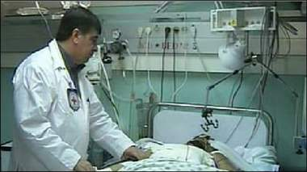

+++
title = "هذا ما جناه (الفسفور الأبيض)!"
date = 2009-01-19
authors = ["نجلاء عبد ربه"]

[taxonomies]
authors = ["naglaa-abdel-rabh"]
sections = ["siyasa"]

[extra]
section_name = "سياسة"
share_image = "/media/currentarticleassets/_45376078_-1.jpg"
summary = "عندما تفكر في زيارة المستشفيات الفلسطينية تجد أن حال أهالي المصابين يتعدى من أن يكون قلقاً أو رعباً من قصة إصابة عدد من أبناءهم، وعندما تبحث في الأمر تجد أن غال"
section_slug = "siyasa"
section_colour = "#9E2A2B"
thumb = "/media/currentarticleassets/_45376078_-1.jpg"
n_comments = 0
original_url = "http://20at.com/20at/politics/10992.html"
archived = "20100105193740"
date_source = "byline/meta"
aliases_20at = ["/20at/politics/10992.html"]

[extra.provenance]
original_url = "http://20at.com/20at/politics/10992.html"
capture_url = "https://web.archive.org/web/20100105193740/http://20at.com/20at/politics/10992.html"
capture_label = "٥ يناير ٢٠١٠، ١٩:٣٧ UTC"
date_note = "من سطر التوقيع في المقال"
other_urls = []
comments = ""
missing_images = ""
+++

<figure></figure>

عندما تفكر في زيارة المستشفيات الفلسطينية تجد أن حال أهالي المصابين يتعدى من أن يكون قلقاً أو رعباً من قصة إصابة عدد من أبناءهم، وعندما تبحث في الأمر تجد أن غالبيتهم من قرى المنطقة الشرقية من خان يونس "خزاعة وعبسان وبني سهيله"، لتدرك وقتها أن هذا القلق على أبنائهم سببه قصف الطائرات الإسرائيلية لتلك المناطق بمادة الفسفور الأبيض المحرم دوليا!.

أبو الرائد، رجل شارف من عمرة الـ 60 عاماً، كان يبحلق في عيون الآخرين، لكن عيونه التي غلب عليها الدمع والحزن كانت وراءها قصة سببها ذلك الفسفور.. رأى أخيه وأولاد أخيه وأبناء عمومته يسقطون بين شهيد وجريح في قرية عبسان الكبيرة جراء صاروخ من مروحية إسرائيلية فأستشهد عدد منهم، أما المصابون منهم فحروقهم خطيرة للغاية.

<h3>محمد وهيثم</h3>

قصة أخرى من داخل المستشفى كانت لا زالت موجودة ولم تغادر باتجاه المستشفيات المصرية لاستكمال العلاج، محمد وهيثم في عمر الـ 17 عاما، أبناء عم يقطنان في بلدة القرارة، بالقرب من جامعة القدس المفتوحة شمالي خان يونس، خرجا من بيتهما صباح الأحد، في يوم مشمس وجلسا على مقربة من جدتهما وأبويهما تحت دفء أشعة الشمس المشرقة وسط ساحة بيت أحدهما.

وما هي إلا لحظات- بحسب هيثم الذي بالكاد استطاع الحديث معنا- حتى بدأ جسد ابن عمه محمد يتحول إلى كتلة لهب حمراء، تصاعد منها دخان أبيض كثيف، "لم أدر ما الذي يحدث حولي، ابن عمي يحترق أمامي ولم أستطع فعل شيء.. لكني لم أكن أعلم أنني احترق أيضا وأن وجهي ويدي قد أصابتهما حروقا شديدة".

تبكي والدة هيثم السيدة نوال، وهي تنظر إلى محمد وهيثم الذين غطا جسدهما الرقيق قطع القماش الطبية نتيجة تلف جلدهما تماماً.. وتقول: "الاحتلال قتل ابنتي الطفلة أسماء قبل 5 أعوام وهي عائدة من المدرسة، واليوم يريد قتل ابني بقنابل لم نعرفها ولم نسمع عنها من قبل!!، ماذا يريدون منا وأين يريدونا أن نذهب؟ فلا مكان آمن في غزة، ولا شارع أو زقاق يخلو من القصف والاستهداف".

وأضافت: "كان يلعب مع ابن عمة أمام البيت، وفجأة سمعت صوت صراخ كبير، خرجت من البيت لاستطلع الأمر فوجدت ابني هيثم محروق وتخرج من دخان، ومحمد ابن عمه يحترق بشكل كامل.. كان الدخان يتصاعد منه وكانت النار تأكل ملابسة، لم أستطع فعل شيء ومن شدة خوفي عجزت عن النطق".

<h3>الفسفور الأبيض</h3>

الأطباء الفلسطينيون وقفوا مذهولين، أمام حجم الإصابات التي تصل إليهم ونوعيتها المختلفة، وخاصة بعد أن استخدمت قوات الاحتلال الصهيونية ما قيل أنه "الفسفور الأبيض"، وهو ما حدث أيضا مع 25 طبيبا عربيا وفدوا إلى غزة وتم تقسيمهم على المستشفيات المختلفة في القطاع.

منهم الدكتور وليد سعيد المحجوب، طبيب مصري كان نصيبه مستشفتي ناصر غرب خان يونس، والأوروبي شرقي المحافظة ذاتها، أكد أن معظم الإصابات التي قابلها تحمل أعراض الغازات المنبعثة عن "القنابل الفسفورية".

وأضاف أن هذه القنابل تنقسم إلى نوعين وتُحدث العديد من الأعراض الجانبية، "فجزء من هذه القنابل تحدث حرقان في الحلق وضيق في التنفس وإغماء وارتفاع في درجات حرارة الجسم، أما الجزء الآخر من المواطنين الذين وصلوا للمستشفى والبالغ عددهم 19 إصابة، أصيبوا بحروق بالغة في الوجه وكافة أنحاء الجسد وخاصة الأماكن المكشوفة والتي تصاب بشكل كبير.

وأكد المحجوب أنه لم ير أبداً طيلة فترة عمله كمتخصص في العظام، مثل تلك الإصابات التي رآها خلال أسبوع، مضيفا: "أي طبيب قد يصاب لمدة يومين بالذهول والصدمة إذا ما شاهد تلك الإصابات غير الطبيعية، حتى يستعيد سيطرته على الأمور، لكن الأطباء الفلسطينيين بخبرتهم وإمكانيات مستشفياتهم المتواضعة يواصلون الليل بالنهار من أجل إنقاذ الجرحى من مختلف المناطق".

وينهي كلامه أن قنابل الفسفور المحرمة دولياً، تُستخدم فقط عندما يريد جيش إفناء جيش آخر، وحرق معدّاته.. فكيف يُستخدم الآن ضدّ المدنيين العُزّل في غزة؟ إنها جريمة حرب بكل المعايير والأعراف!.

ونحن نسأل.. ماذا سيفعل المجتمع الدولي مع أصحاب الفسفور الأبيض؟!

