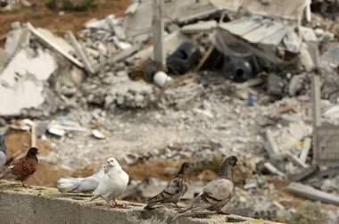

+++
title = "مصارعة إعادة إعمار غزة"
date = 2009-01-20

[taxonomies]
authors = []
sections = ["nashrat-9"]

[extra]
section_name = "نشرة 9"
share_image = "/media/currentarticleassets/e3margaza.jpg"
summary = "تعتزم إسرائيل فرض سيطرتها على عملية إعادة إعمار غزة حيث تسعى للحصول على ضمانات كي لا تستفيد حركة حماس من أي مشروعات للأمم المتحدة."
section_slug = "nashrat-9"
section_colour = "#004B80"
thumb = "/media/currentarticleassets/e3margaza.jpg"
n_comments = 0
original_url = "http://20at.com/20at/politics/10996.html"
archived = "20100105192646"
date_source = "byline/meta"
aliases_20at = ["/20at/politics/10996.html"]

[extra.provenance]
original_url = "http://20at.com/20at/politics/10996.html"
capture_url = "https://web.archive.org/web/20100105192646/http://20at.com/20at/politics/10996.html"
capture_label = "٥ يناير ٢٠١٠، ١٩:٢٦ UTC"
date_note = "من سطر التوقيع في المقال"
other_urls = []
comments = ""
missing_images = ""
+++

<figure></figure>

تعتزم إسرائيل فرض سيطرتها على عملية إعادة إعمار غزة حيث تسعى للحصول على ضمانات كي لا تستفيد حركة حماس من أي مشروعات للأمم المتحدة.

وساعدها على ذلك سيطرتها الكاملة على معابر غزة التجارية التي لابد أن تمر من خلالها السلع والمواد اللازمة لإعادة البناء.

وتشير التقديرات الأولية إلى أن قيمة الخسائر مليارا ونصف المليار دولار،وكانت السعودية قد أعلنت فى القمة الاقتصادية أمس أنها ستتبرع بمليار دولار.

وقال دبلوماسيون غربيون مشترطين عدم نشر أسمائهم أن إسرائيل طلبت من الأمم المتحدة ومنظمات الإغاثة أن تقدم قائمة تفصيلية بما تريد إدخاله إلى قطاع غزة من سلع ومعدات وأفراد سواء لتوفير الحاجات العاجلة أو لإعادة البناء.

وأبلغت إسرائيل منظمات الإغاثة أنها ستبحث التوسع في قائمة المواد المسموح بدخولها إلى قطاع غزة.

<h3>الأمم المتحدة تريد عباس</h3>

وكانت إسرائيل قبل الحرب تمنع دخول معظم شحنات الاسمنت والحديد الصلب والمبالغ النقدية قائلة أن حماس تستخدمها في بناء تحصينات وصنع صواريخ ودفع رواتب أفراد الميلشيات.

وقال الدبلوماسيون إن إسرائيل أوضحت أنها تعتزم إدارة هذه العملية بطريقة محكمة من خلال اشتراط الحصول على موافقتها على كل مشروع على حدة، وطلبت أيضا "ضمانات" من الأمم المتحدة والمنظمات الأخرى كي لا تستفيد حماس من المشروعات التي تقيمها هذه الهيئات.

وقال مسؤول إسرائيلي إن وكالات الأمم المتحدة ستكون مطالبة بمراقبة "كل دولار تنفقه" لضمان أن يذهب بشكل مباشر إلى المقاولين المحليين الذين يقومون بالعمل. وأضاف أن الرسالة هي "لا تسمحوا لحماس أن ترجع الفضل لنفسها في أي شيء."

وامتنع مسؤولو الأمم المتحدة عن التعليق على طلب إسرائيل، وتتبع الأمم المتحدة سياسة تقضي بعدم التحدث مباشرة مع حماس إلا على المستوى العملي من أجل تسهيل أنشطة المعونة في غزة.

وتريد الولايات المتحدة أن تقود السلطة الفلسطينية بزعامة عباس وضع وتنفيذ اي خطط لإعادة الاعمار في غزة الأمر الذي يمنحها وجودا وحضورا في معقل حماس ويحرم الحركة الإسلامية من أن ينسب لها الفضل في إعادة البناء.

لكن الدبلوماسيين يقولون أن حماس تعتبر نفسها السلطة الشرعية في غزة وستقاوم عودة السلطة الفلسطينية.

وأوضحت مفوض العلاقات الخارجية في الاتحاد الاوروبي بنيتا فيرارو فالدنر يوم الاثنين أن مساعدات إعادة الاعمار في غزة لن تكون متاحة لحكومة حماس ما لم تنبذ الحركة العنف الذي حدا بالغرب إلى مقاطعتها.

وعين رئيس الوزراء الإسرائيلي ايهود اولمرت وزير الرفاه اسحق هرتزوج منسقا لجهود الاعمار مع المنظمات الدولية.

وقالت إسرائيل أنها قد تسمح بزيادة حادة في تدفق الأغذية والأدوية إلى غزة إذا صمد وقف إطلاق النار لكنها استبعدت رفع الحصار بالكامل إلى أن تطلق حماس وحلفاؤها سراح الجندي الإسرائيلي جلعاد شليط الذي أسر في عام.

