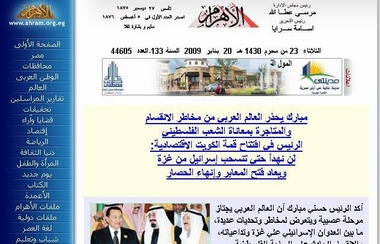

+++
title = "خناقة المصالحة العربية!"
date = 2009-01-20
authors = ["خباب عبد المقصود"]

[taxonomies]
authors = ["khbab-abdel-elmaksod"]
sections = ["siyasa"]

[extra]
section_name = "سياسة"
share_image = "/media/currentarticleassets/ahraaaaam.jpg"
summary = "خرج علينا القادة العرب أمس وأثناء القمة الاقتصادية العربية بدعوات للمصالحة بين الجميع، وتم عقد اجتماع لتصفية الأجواء.."
section_slug = "siyasa"
section_colour = "#9E2A2B"
thumb = "/media/currentarticleassets/ahraaaaam.jpg"
n_comments = 2
original_url = "http://20at.com/20at/politics/11001.html"
archived = "20100105192506"
date_source = "byline/meta"
aliases_20at = ["/20at/politics/11001.html"]

[extra.provenance]
original_url = "http://20at.com/20at/politics/11001.html"
capture_url = "https://web.archive.org/web/20100105192506/http://20at.com/20at/politics/11001.html"
capture_label = "٥ يناير ٢٠١٠، ١٩:٢٥ UTC"
date_note = "من سطر التوقيع في المقال"
other_urls = []
comments = "٢"
missing_images = "٦"
+++

<figure></figure>

خرج علينا القادة العرب أمس وأثناء القمة الاقتصادية العربية بدعوات للمصالحة بين الجميع، وتم عقد اجتماع لتصفية الأجواء..

نعم تصالح الحكام وهلل الجميع، وبدورها باركت الصحافة العربية الوفاق، لكن كان الملاحظ أن كل صحيفة تحيزت لوطنها وهللت لزعيمها باعتباره قائد المصالحة، وأنه هو من لم الشمل ورأب الصدع!!.

<h3>شاهد عناوين الصحف العربية</h3>

• الشرق الاوسط السعودية

• الأخبار المصرية

• الجريدة الكويتية

• الشرق القطرية

• البعث السورية

• الرياض السعودية

