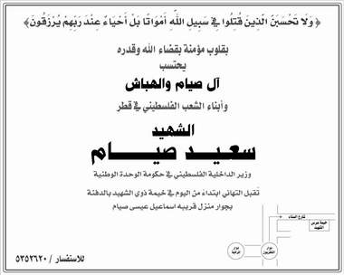

+++
title = "في (عُرس الشهيد).. نقبل التهاني!"
date = 2009-01-20
authors = ["مصري يوسف"]

[taxonomies]
authors = ["masri-youssef"]
sections = ["siyasa"]

[extra]
section_name = "سياسة"
share_image = "/media/masr.20at.com/currentarticleassets/marwah/siam.jpg"
summary = "العزاء يتحول إلى عرس.. والبكاء إلى ابتسامة عطرة، ويتبدل العويل إلى صرخات حماس.. هكذا كان الحال في عزاء أقامه الفلسطينيين المقيمين بقطر على روح الشهيد \"سعيد صيام"
section_slug = "siyasa"
section_colour = "#9E2A2B"
thumb = "/media/masr.20at.com/currentarticleassets/marwah/siam.jpg"
n_comments = 0
original_url = "http://20at.com/20at/politics/11004.html"
archived = "20100105192741"
date_source = "byline/meta"
aliases_20at = ["/20at/politics/11004.html"]

[extra.provenance]
original_url = "http://20at.com/20at/politics/11004.html"
capture_url = "https://web.archive.org/web/20100105192741/http://20at.com/20at/politics/11004.html"
capture_label = "٥ يناير ٢٠١٠، ١٩:٢٧ UTC"
date_note = "من سطر التوقيع في المقال"
other_urls = []
comments = ""
missing_images = ""
+++

<figure></figure>

العزاء يتحول إلى عرس.. والبكاء إلى ابتسامة عطرة، ويتبدل العويل إلى صرخات حماس.. هكذا كان الحال في عزاء أقامه الفلسطينيين المقيمين بقطر على روح الشهيد "سعيد صيام" وزير الداخلية في الحكومة الفلسطينية المقالة، والذي اغتيل على أيدي قوات الاحتلال الإسرائيلية في غزة منذ أيام..

أرفق منظمو "عرس الشهيد" - حسبما أطلقوا عليه - إعلانا شمل جميع صحف قطر عن إقامة سرادق لتقبل التهاني، ولم تكن هذه الفعالية هي الأولى من نوعها، بل سبقها خلال الأسبوع الأول من العدوان على غزة إعلان مواطن قطري الحداد على شهداء غزة بل وأغلق محله التجاري وعلق راية سوداء على بابه، بل وأعلن أن عن تخصيص دخله لأسبوع كامل لضحايا غزة.

<h3>عروبة مصغّرة</h3>

الخيمة الكبيرة التي أقامها الفلسطينيين لعرس الشهيد في قطر لم تكن حكرا على عائلة صيام وإنما امتدت إلى جميع الفلسطينيين وشملت الدائرة جميع العرب المقيمين فأصبحت العرس كمجتمع عربي يضم جميع الأطياف الذين تجمعوا لهدف واحد.

حول العزاء تقول ريما أحمد، فلسطينية: "ذهبت وأسرتي للعزاء ولكننا شهدنا الأمر وقد تحول إلى صيحات فخر فنحن في ثقافتنا أهل الشهيد يفخرون به، فلدى عائلة صيام 7 شهداء ونحن جئنا لنعبر عن رأينا ولو كانت هناك مظاهرات لدعم المقاومة في غزة وأهلها لما تأخرنا عنها لحظة واحدة".

أحمد، أحد منظمي عرس الشهيد، يقول: "استشهاد صيام يعد شرف للأسرة جميعها، لذلك لم يكن تجمعنا لثلاثة أيام في هذه الخيمة الكبيرة إلا عرسا فهو ليس بعزاء على ميت، ويكفينا أنه مات شهيدا وله سبعين يوم القيامة يشفع له، فأنا أتمنى أن أنال ما وصل إليه سعيد صيام".

وأضاف: "لم نكن نتوقع أن يُقبل على التهنئة هذا العدد الكبير، فهناك أشخاص كثيرون لم نكن نعرفهم ولكنهم جاءوا ليعبروا عن غضبهم تجاه ما يحدث في غزة".

أما طلال بركات، فيقول: "قمنا مع عدد من شباب عائلة صيام بنصب عدة لوحات كبيرة تصدرتها صورة الشهيد وكتبنا عليها عرس الشهيد سعيد صيام وعدد من عائلته، في إشارة إلى الشهداء السبعة الآخرين من عائلة صيام، وقد قمنا بالمساعدة في الإعداد لهذا العرس على نحو جيد خاصة ونحن نتوقع أن أهلنا في غزة هم جميعهم مقاومون ومجاهدون في غزة ونتمنى لهم جميعا الشهادة".

يذكر أن سعيد صيام ولد في مخيم الشاطئ في غزة عام 1959، وتنحدر عائلته من قرية الجورة قرب عسقلان في جنوب فلسطين، وهو متزوج له 6 أبناء، واغتالته إسرائيل في منتصف الشهر الحالي، وشغل سعيد صيام عدة مناصب، منها ممثل لحركة حماس في لجنة المتابعة العليا للقوى الوطنية والإسلامية، عضو القيادة السياسية لحركة حماس في قطاع غزة، ومسئول دائرة العلاقات الخارجية في الحركة، ووزير الداخلية في حكومة الوحدة الوطنية التي شكلتها حركة حماس.

