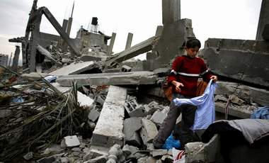

+++
title = "منذ 26 يوما .. كان هناك بيتا!"
date = 2009-01-21
authors = ["نجلاء عبد ربه"]

[taxonomies]
authors = ["naglaa-abdel-rabh"]
sections = ["siyasa"]

[extra]
section_name = "سياسة"
share_image = "/media/currentarticleassets/biet2.jpg"
summary = "\"كان هناك بيت الحاج أبو خليل.. لا أظنه كان على بعد 4 أمتار مما تشير إليه\". نقاش دار بين شابين تواجدا عند مدخل منطقة \"العطاطرة\"، شرق بيت لاهيا، فاختلفا على مكان "
section_slug = "siyasa"
section_colour = "#9E2A2B"
thumb = "/media/currentarticleassets/biet2.jpg"
n_comments = 0
original_url = "http://20at.com/20at/politics/11011.html"
archived = "20100105192605"
date_source = "byline/meta"
aliases_20at = ["/20at/politics/11011.html"]

[extra.provenance]
original_url = "http://20at.com/20at/politics/11011.html"
capture_url = "https://web.archive.org/web/20100105192605/http://20at.com/20at/politics/11011.html"
capture_label = "٥ يناير ٢٠١٠، ١٩:٢٦ UTC"
date_note = "من سطر التوقيع في المقال"
other_urls = []
comments = ""
missing_images = ""
+++

<figure></figure>

"كان هناك بيت الحاج أبو خليل.. لا أظنه كان على بعد 4 أمتار مما تشير إليه". نقاش دار بين شابين تواجدا عند مدخل منطقة "العطاطرة"، شرق بيت لاهيا، فاختلفا على مكان منزل أبو خليل الذي كان قائما قبل 26 يوماً، لكنه الآن قد مُسح تماماً عن الخارطة، بعدما جرفت قوات الاحتلال الصهيونية المنزل والشارع والحي بكامله!.

رائحة العطاطرة والتي تبدو من اسمها أنها كانت تفوح بروائح جميلة تحميها بساتين البرتقال والليمون؛ أصبحت تفوح منها رائحة الموت والجثث التي تحللت بعد حرب ضروس على الأطفال والنساء والشيوخ في قطاع غزة.

<h3>بين الركام</h3>

هناك كانت سيدة تعانق وليدها قبل أسبوعين على الأقل، لكنه كان أخر عناق في الحياة، بعدما هبط سقف المنزل عليهم جراء قصف المنطقة بصواريخ إف 16.

أما الحاجة أم محمود، 63عاماً، فقد خيم الصمت على وجهها وهي تتنقل بين ركام منزلها في المنطقة التي حولته الدبابات الصهيونية إلى أكوام من الحجارة، إلا من بعض الحاجيات التي استطاعت أن تنتشلها من تحت الأنقاض.

بينما الشاب هيثم الشمباري،25 عاماً، الذي يعمل بنظام البطالة في إحدى الوزارات في غزة، فأخوته وأقاربه بجانبه يشدون من أزره ويواسونه بقولهم: "الحمد لله أنك حي.. يمكن إعادة بناء المنزل بإذن الله، المال معوض".

وكان هيثم الذي لم يمض على زواجه سوى عام واحد، قد وجد نفسه مع زوجته دون مأوى لهم، في وقت يصعب عليه الحياة بمعاناتها نظراً لدخله المادي المتواضع جداً.

لكن هيثم محظوظ أكثر من صديقة "مهند" الذي فقد والدته وجدته تحت القصف الصهيوني المدمر، والذي ضرب منطقة بيت لاهيا بكاملها.

<h3>عزبة عبد ربه</h3>

وليس ببعيد عن منزل الشابين هيثم ومهند.. فإن هناك عشرات العائلات الفلسطينية في منطقة عزبة عبد ربه وجبل الكاشف والريس لم يتمكنوا من التعرف على مكان منازلهم بعد أن دفنتها الجرافات الإسرائيلية بكل محتوياتها تحت التراب وغطته ببقايا القذائف والصواريخ المنتشرة.

وأخذ المواطنون في المناطق المنكوبة استخدام آليات بدائية للبحث عما تبقى من ذكريات أعدمتها آلة الحرب الإسرائيلية في حرب الإبادة التي شنتها ضد الفلسطينيين المحاصرين، حيث لا شيء يصلح للحياة من جديد.. فكل ما فيها يحتاج إلى سنوات لإعادة الإعمار، فضلاً عن ترميم ما لحق بالأطفال من خوف وهلع ومشاهد دمار.

يقول المواطن أبو فؤاد ضاحكاً على هول ما رآه: "لقد فقدت كل ما جمعته طوال 30 عاماً من حياتي في لحظات". ويضيف وهو يحمل بعض من حاجيات أطفاله: "لم أجد سوى لعبة طفلي في المكان"، مبدياً إعجابه من صمود هذه اللعبة. ويكمل: "لعلها تخفف عن طفلي ما رآه خلال فترة الحرب وتجعله ينسى آلام التشريد التي نعيشها".

ونظراً لصعوبة انتشال الشهداء من تحت الأنقاض، قررت الطواقم الطبية استخدام آليات لرفع الأنقاض في محاولة للبحث عن عشرات المفقودين، حيث تم العثور على جثث حوصر أصحابها في منازلهم أو تركوا ينزفون في الشوارع وتعرضت للتآكل بعد أن هاجمتها الكلاب الضالة، وخاصة في مناطق جبل الكاشف وجبل الريس وشرق جباليا والقرم وعزبة عبد ربه والعطاطرة والسلاطين والفخاري في شمال وشمال غرب القطاع.

<h3>1.4 مليار دولار</h3>

تشير التقديرات الأولية التي ذكرها الجهاز المركزي للإحصاء إلى أن إجمالي الخسائر الاقتصادية المباشرة في المباني والبنية التحتية وخسائر الاقتصاد الوطني في قطاع غزة بلغ حوالي 1.4 مليار دولار.

وشدد الجهاز على أن قطاع غزة أصبح منطقة منكوبة من كافة النواحي الإنسانية والاقتصادية والصحية والاجتماعية بسبب العدوان الإسرائيلي والذي طال كل مناحي الحياة.

وكان المركز الفلسطيني لحقوق الإنسان قال في بيان له خلال جولة ميدانية سريعة لباحثيه في المناطق التي انسحبت منها قوات الاحتلال الصهيونية في قطاع غزة، أنّ "العديد من المناطق في القطاع وخصوصاً في محافظتي غزة والشمال ومنطقة الشريط الحدودي مع مصر، جنوباً، تبدو وكأنّ زلزالاً عنيفاً قد أصابها".

