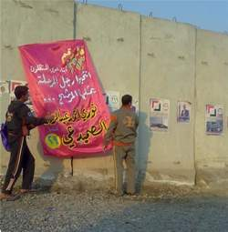

+++
title = "انتخابات العراق.. في الأتوبيس وعلى الجدار"
date = 2009-01-26
authors = ["مازن غازي"]

[taxonomies]
authors = ["mazn-ghazi"]
sections = ["siyasa"]

[extra]
section_name = "سياسة"
share_image = "/media/masr.20at.com/currentarticleassets/marwah/entkhabatiraq2_.jpg"
summary = "\"معكم معكم\"، \"معنا حياتكم لها قيمة\"، \"سنحاسب المفسدون بأصواتكم\"، \"الطفولة والرفاهية والمستقبل الواعد هدفنا\"، \"النزاهة والأمانة غايتنا\".."
section_slug = "siyasa"
section_colour = "#9E2A2B"
thumb = "/media/masr.20at.com/currentarticleassets/marwah/entkhabatiraq2_.jpg"
n_comments = 0
original_url = "http://20at.com/20at/politics/11068.html"
archived = "20100105192445"
date_source = "byline/meta"
aliases_20at = ["/20at/politics/11068.html"]

[extra.provenance]
original_url = "http://20at.com/20at/politics/11068.html"
capture_url = "https://web.archive.org/web/20100105192445/http://20at.com/20at/politics/11068.html"
capture_label = "٥ يناير ٢٠١٠، ١٩:٢٤ UTC"
date_note = "من سطر التوقيع في المقال"
other_urls = []
comments = ""
missing_images = ""
+++

<figure></figure>

"معكم معكم"، "معنا حياتكم لها قيمة"، "سنحاسب المفسدون بأصواتكم"، "الطفولة والرفاهية والمستقبل الواعد هدفنا"، "النزاهة والأمانة غايتنا"..

بهذه الشعارات تشتد حدة المنافسة في انتخابات مجالس المحافظات العراقية التي ستجري يوم 31 يناير الجاري، فقد تلونت شوارع ومباني وجدران المدن العراقية وخصوصا العاصمة بغداد بعشرات الآلاف من الملصقات الجدارية واللافتات التي تسعى لاستمالة الناخب وكسب صوته، في حين يقف الناخب العراقي من هذه الوعود بين متمنٍ ومشكك ومستخف!.

<h3>مسرحية الانتخابات</h3>

ستتيح الانتخابات المقبلة لقرابة 14 مليونا و780 ألف عراقي الإدلاء بأصواتهم لاختيار 440 مرشحا من أصل 14.429في 14 محافظة من أصل 18 محافظة عراقية (باستثناء أربيل والسلمانية ودهوك في كردستان العراق، إضافة إلى كركوك التي تقرر تأجيل الانتخابات فيها).

مؤيد قدوري، موظف حكومي يقول مستخفا بالانتخابات: "نسمع ونقرأ وعود براقة تعدنا بتحسين المستوى الاقتصادي والاجتماعي للمواطن وشعارات تطالب بدعم العاطلين، ومحاربة الفقر رفعتها أغلب الأحزاب التي قمنا بانتخابها عام 2004 ولم نلمس لحد الآن أدنى ما وعدوا به منذ 4 أعوام، لهذا لن أشارك بهذه الانتخابات فهي مسرحية بدأت منذ الاحتلال والآن سيرفع الستار عن المشهد الجديد من هذه المسرحية".

إسماعيل فؤاد، 25 سنة، طالب في كلية الإدارة والاقتصاد، يقول: "الكثير من العراقيين أصبح لديهم قناعة من أن هذه الانتخابات ستفرز عناصر أفضل من الدورة التي سبقتها لأن تجربة رجال المرحلة السابقة كانت أليمة وقاسية تخللتها الكثير من التناقضات في الشعارات مع العمل، ولهذا فإنهم سيفشلون في الفوز هذا العام وهو ما جعلهم درسا لمن سيحصل على ثقة الناخب، فاغلب العراقيين لم يعد ينظر إلى الأحزاب والأشخاص إلا بقدر ما تقدم للشعب، ولم تعد الشعارات الدينية والطائفية والأكاذيب تنطلي على الشعب".

<h3>تمزيق الدعاية</h3>

وفي الوقت الذي يلحظ العراقيين همة عالية لشباب يلصقون الدعايات الانتخابية في كل الأزقة والشوارع، يمكن ملاحظة جهد مقابل متمثل في تمزيق هذه الملصقات!، وهو ما دعا بعض المرشحين لأن يشكو من ظاهرة تمزيق الملصقات الدعائية مستندين إلى المادة 43 من قانون انتخاب مجالس المحافظات والأقضية والنواحي التي تنص على أنه "يعاقب بالحبس مدة لا تقل عن شهر ولا تزيد على سنة كل من تعمد الاعتداء على صور المرشحين أو برامجهم الملصقة في الأماكن المخصصة لها لحساب آخر أو جهة معينة بقصد الإضرار بهذا المرشح أو التأثير على سير العملية الانتخابية".

بينما يرجع الكثير من العراقيين هذه الظاهرة إلى أسباب عدة.. لمياء الدرة، 30 سنة، ترى أن هذه الظاهرة تعكس السخط الشعبي من تردي الأوضاع الاجتماعية الاقتصادية لغالبية أفراد الشعب العراقي وإلى عدم ثقتهم بالعملية السياسية في ظل وجود قوات الاحتلال الأمريكية التي تهيمن على الواقع السياسي بالعراق.

أما محمد المختار، مهندس، فقد رأى أن هذا التصرف يعد غير حضاري ويعد جهلا في إنجاح وترسيخ مفهوم الديمقراطية وتغيير الواقع السياسي والمجتمعي في العراق الذي يخوض تجربة تعد فريدة في المنطقة العربية وفي الدول المحيطة بالعراق.

يضيف: "رغم أن البعض يعيب على الوضع السياسي الحالي في العراق اقترانه بظرف الاحتلال إلا أن تجربة الانتخابات يجب إنجاحها وترسيخ أساليبها من أجل تهيئة الشعب والأجيال القادمة على احترام تطور المجتمع".

<h3>نقاش يومي</h3>

آلاف الملصقات المنتشرة هنا وهناك ومشاهد الشباب الذين يلصقون بوسترات الترويج لمرشح ما أو هؤلاء الذين يقومون بنزعها، تجعل ركاب الأوتوبيسات في شوارع بغداد يدخلون في حوارات ونقاشات وانتقادات حول الانتخابات، فتختلف وجهات النظر بين مؤيد داع للمشاركة وبين يائس متذمر يعلن نيته بالمقاطعة وعدم المشاركة..

يقول رجل في الخمسينات من عمره وقد ظهر تعب السنين على ملامح وجهه المجعد "ما في حل، هؤلاء ما بيدهم شيء لتحسين واقعنا المؤلم"، مُنهيا كلامه وهو يلعن الاحتلال وزمانه.

وهنا يرد عليه رجل في أواخر الثلاثينات من عمره: "يجب على الجميع أن يشاركوا إن أردنا تغيير واقعنا".

هذا جزء من مشهد يومي يتكرر مع ركاب الأوتوبيسات والتاكسيات، بل أن البعض يبادر بفتح هذه النقاشات مع الركاب ومن ثم يعطي الراكب كارتا لمرشح أو مطبوعا يروج لحزب.

