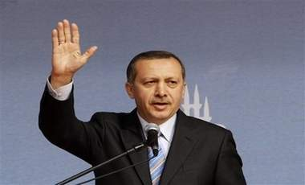

+++
title = "أردوغان.. ينصر دينك"
date = 2009-02-01
authors = ["خباب عبد المقصود"]

[taxonomies]
authors = ["khbab-abdel-elmaksod"]
sections = ["siyasa"]

[extra]
section_name = "سياسة"
share_image = "/media/currentarticleassets/ardogann.jpg"
summary = "في دافوس.. حيث الملوك والسلاطين والزعماء والسادة.. أقوياء وأغنياء.. ولا وجود للضعفاء.. ينطق بكلمة حق ويقول لبيريز: \"\"أتذكر الأطفال الذين قتلوا على الشاطئ ولم يك"
section_slug = "siyasa"
section_colour = "#9E2A2B"
thumb = "/media/currentarticleassets/ardogann.jpg"
n_comments = 0
original_url = "http://20at.com/20at/politics/11131.html"
archived = "20100105192458"
date_source = "byline/meta"
aliases_20at = ["/20at/politics/11131.html"]

[extra.provenance]
original_url = "http://20at.com/20at/politics/11131.html"
capture_url = "https://web.archive.org/web/20100105192458/http://20at.com/20at/politics/11131.html"
capture_label = "٥ يناير ٢٠١٠، ١٩:٢٤ UTC"
date_note = "من سطر التوقيع في المقال"
other_urls = []
comments = ""
missing_images = ""
+++

<figure></figure>

في دافوس.. حيث الملوك والسلاطين والزعماء والسادة.. أقوياء وأغنياء.. ولا وجود للضعفاء.. ينطق بكلمة حق ويقول لبيريز: ""أتذكر الأطفال الذين قتلوا على الشاطئ ولم يكن هناك صواريخ تطلق منها.. عندما يتعلق الأمر بالقتل فأنتم أدرى الناس بالقتل".

رئيس الوزراء التركي رجب طيب أردوغان، لم يكن موقفه الأقوي في حرب غزة، فهو لم يطرد سفير إسرائيل كما فعلت فينزويلا مثلا؛ لكنه كان موقفا أكثر تشريفا من مواقف العرب عندما ساند حماس المنتخبة ديمقراطيا ودعا العالم أجمع إلى الإعتراف بحقها في ممارسة الدفاع عن أراضيها المحتلة محملا إسرائيل كل المسئولية عن تدهور الأوضاع وحصار ملايين الناس الأبرياء في قطاع غزة.

<h3>من هو أردوغان؟</h3>

ولد أردوغان في 26 فبراير 1954 في اسطنبول لأسرة من أصول جورجية، نشأ في أسرة فقيرة, قال بفخرفي مناظرة تلفزيونية: "لم يكن أمامي غير بيع البطيخ والسميط في مرحلتي الإبتدائية والإعدادية؛ كي أستطيع معاونة والدي وتوفير قسم من مصروفات تعليمي؛ فقد كان والدي فقيرًا".

أتم تعليمه في مدارس "إمام خطيب" الدينية ثم في كلية الاقتصاد والأعمال في جامعة مرمرة.

انضم أردوغان إلى حزب الخلاص الوطنى بقيادة نجم الدين أربكان في نهاية السبعينات، لكن مع الإنقلاب العسكرى الذى حصل في 1980، تم إلغاء جميع الأحزاب، وبحلول عام 1983 عادت الحياة الحزبية إلى تركيا وعاد نشاط أردوغان من خلال حزب الرفاه، خاصةً في محافظة إسطنبول.

وبحلول عام 1994 رشح حزب الرفاه أردوغان إلى منصب عمدة اسطنبول، واستطاع أن يفوز في هذه الإنتخابات خاصةً مع حصول حزب الرفاه على عدد كبير من المقاعد.

عام 1998 اتهُم أردوغان بالتحريض على الكراهية الدينية تسببت في سجنه ومنعه من العمل في الوظائف الحكومية ومنها الترشيح للإنتخابات العامة بسبب اقتباسه أبياتاً من شعر تركي أثناء خطاب جماهير يقول فيه: "مساجدنا ثكناتنا.. قبابنا خوذاتنا.. مآذننا حرابنا.. والمصلون جنودنا.. هذا الجيش المقدس يحرس ديننا.. "

لم تثني هذه القضية أردوغان عن الإستمرار في مشواره السياسي بل نبهته هذه القضية إلى كون الإستمرار في هذا الأمر قد يعرضه للحرمان للأبد من السير في الطريق السياسي كما حدث لأستاذه نجم الدين أربكان فاغتنم فرصة حظر حزب الفضيلة لينشق مع عدد من الأعضاء منهم عبدالله غول وتأسيس حزب التنمية عام 2001.

<h3>دافوس 2009</h3>

في 29 من يناير غادر أردوغان منصة مؤتمر دافوس احتجاجاً على عدم اعطائه الوقت الكافي للرد على الرئيس الإسرائيلي شيمون بيريز بشأن الحرب الأخيرة على غزة، وقال "اسرائيل لا تريد إطلاق النار على أحد لكن حماس لم تترك لنا خياراً"، و اشار إلي أردوغان بإصبعه عما كان سيفعله أردوغان لو أن الصواريخ أُطلقت على اسطنبول كل ليلة.

رد رئيس الوزراء التركي على أقوال بيريز بعنف وقال: إنك أكبر مني سناً ولكن لا يحق لك أن تتحدث بهذه اللهجة والصوت العالي الذي يثبت أنك مذنب. وتابع: إن الجيش الاسرائيلي يقتل الأطفال في شواطئ غزة، ورؤساء وزرائكم قالوا لي إنهم يكونون سعداء جداً عندما يدخلون غزة على متن دبابتهم.

ولم يترك مدير الجلسة الفرصة لأردوغان حتى يكمل رده على بيريز، فانسحب رئيس الوزراء التركي بعد أن خاطب المشرفين على الجلسة قائلا "شكراً لن أعود إلى دافوس بعد هذا، أنتم لا تتركونني أتكلم وسمحتم للرئيس بيريز بالحديث مدة 25 دقيقة وتحدثت نصف هذه المدة فحسب",

وأضاف في المؤتمر الذي عقد بعد الجلسة إنه تحدث 12 دقيقة خلال المنتدى كما تحدث الأمين العام لجامعة الدول العربية عمرو موسى بدوره 12 دقيقة، غير أن بيريز تحدث 25 دقيقة، ولما طلب أردوغان التعقيب عليه منعه مدير الجلسة.

واحتشد الآلاف ليلاً لإستقبال أردوغان بعد ساعات من مغادرة مؤتمر دافوس حاملين الأعلام التركية والفلسطينية ولوحوا بلافتات كتب عليها "مرحبا بعودة المنتصر في دافوس" و"أهلا وسهلا بزعيم العالم".

