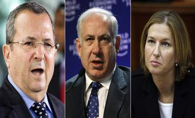

+++
title = "انتخابات الكنيست..اعرف  عدوك"
date = 2009-02-10
authors = ["رنا خموس"]

[taxonomies]
authors = ["rana-khmos"]
sections = ["siyasa"]

[extra]
section_name = "سياسة"
share_image = "/media/currentarticleassets/israel-election.jpg"
summary = "تستعد إسرائيل لإجراء انتخاباتها البرلمانية أو ما يعرف بالكنيست الإسرائيلي غدا العاشر من فبراير/ شباط، والتي تجرى كل 4 سنوات لاختيار النواب الذين يشغلون 120 مقعد"
section_slug = "siyasa"
section_colour = "#9E2A2B"
thumb = "/media/currentarticleassets/israel-election.jpg"
n_comments = 0
original_url = "http://20at.com/20at/politics/11241.html"
archived = "20100105192336"
date_source = "byline/meta"
aliases_20at = ["/20at/politics/11241.html"]

[extra.provenance]
original_url = "http://20at.com/20at/politics/11241.html"
capture_url = "https://web.archive.org/web/20100105192336/http://20at.com/20at/politics/11241.html"
capture_label = "٥ يناير ٢٠١٠، ١٩:٢٣ UTC"
date_note = "من سطر التوقيع في المقال"
other_urls = []
comments = ""
missing_images = ""
+++

<figure></figure>

تستعد إسرائيل لإجراء انتخاباتها البرلمانية أو ما يعرف بالكنيست الإسرائيلي غدا العاشر من فبراير/ شباط، والتي تجرى كل 4 سنوات لاختيار النواب الذين يشغلون 120 مقعدا الخاصة لهذا البرلمان، ويجب أن يحصل الحزب الفائز على 1.5% من أصوات الناخبين للفوز به.

تتنافس في تلك الانتخابات 3 أحزاب، هي حزب كاديما (إلى الأمام) برئاسة وزيرة الخارجية الإسرائيلية الحالية تسيبي ليفني، وحزب الليكود (وسط اليمين) برئاسة بنيامين نتينياهو رئيس الوزراء السابق، وحزب العمل برئاسة أيهود باراك وزير الدفاع الإسرائيلي.

<h3>كديما:</h3>

أسس على يد رئيس الوزراء الإسرائيلي السابق أرييل شارون عام 2005 بعد انسحابه من حزب الليكود، قاد رئيس الوزراء الحالي أيهود أولمرت الحزب بعد أن فاز بـ 29 مقعدا في انتخابات عام 2006 ولكنه فقد التأييد في ذلك العام بسبب حرب لبنان، وأتهم بفضائح فساد أدت إلى استقالته، وحلت محله في قيادة كديما وزيرة الخارجية تسيبي ليفني ولكنه ظل رئيسا للوزراء من أجل تسيير الأعمال بعدما أخفقت في تشكيل ائتلاف حاكم جديد.

وينادى كاديما في برامجه الانتخابية بالحفاظ على دولة إسرائيل يهودية وديمقراطية، ورسم حدودها لضمان وجود دولتين دون المساس بأمن إسرائيل حسب خريطة الطريق، واستكمال بناء الجدار العازل، وإخلاء البؤر الاستيطانية غير القانونية مع الحفاظ على المستوطنات، والحفاظ على القدس موحدة.

<h3>الليكود:</h3>

يتزعم حزب الليكود بنيامين نتانياهو الذي شغل منصب رئيس وزراء من قبل، يؤمن الحزب بحق إسرائيل في كامل أرض إسرائيل التاريخية (فلسطين وشرقي الأردن وفق التصور اليهودي)، ويؤمن بعملية السلام مع العرب عبر مفاوضات مباشرة ومسئولة مع الحفاظ على أمن إسرائيل، ويدعم تنمية الاقتصاد الفلسطيني وليس قيام دولة فلسطينية.

تعهد نتانياهو بمواصلة عمليات توسع المستوطنات مع عدم بناء مستوطنات جديدة، وتعزيز التنمية الاقتصادية وعدم تدخل الدولة بالاقتصاد الإسرائيلي، والعمل على إسقاط حماس وبألا تكون طرفا في المفاوضات، ومنح الفلسطينيين إدارة شؤونهم، وقد حصل الحزب على 12 مقعدا عام 2006، وأظهرت آخر استطلاعات للرأي تقدمه على بقية الأحزاب.

<h3>العمل:</h3>

أما حزب العمل وهو بزعامة أيهود باراك وزير الدفاع الإسرائيلي، وهو حزب يساري وسطي تأسس عام 1930 من اتحاد حركات عمالية وشبابية صهيونية ذات جذور روسية واشتراكية باسم "ماباي"، ومن مؤسسيه ديفيد بن جوريون أول رئيس وزراء إسرائيلي وقادته أيضا جولدا مائير، وله تاريخ طويل في حكم إسرائيل لثلاثين عاما، وهو من أبرم اتفاقية الأرض مقابل السلام مع الفلسطينيين في التسعينيات.

ومن سياساته المعلنة هي خطة إسرائيلية للسلام الإقليمي الشامل، على أن تسمح الخطة بالتصدي لتسويات أمنية ـ سياسية، بالتداخل مع المفاوضات مع جيران إسرائيل العالم العربي بأسره، وتقوية إسرائيل بالاقتصاد على مبادئ السوق الحر، والقدس عاصمة إسرائيل، ويترك الحديث بها بتسوية مع الفلسطينيين وبالمفاوضات، واستخدام القوة ضد تهديدات صواريخ حماس على حد تعبير الحزب.

<h3>رؤساء الأحزاب</h3>

<h3>تسيبي ليفني:</h3>

من مواليد 8 تموز/يوليو 1958 في تل أبيب، وابنة لوالدين من أفراد منظمة الأرجون الإرهابية، وهي ثاني امرأة تتولى وزارة الخارجية في إسرائيل بعد جولدا مائير، وحصلت ليفني على رتبة ملازم أول ودرست الحقوق في جامعة بار ايلان برمات جان في إسرائيل وعملت برتبة ضابط في وكالة الاستخبارات الإسرائيلية "الموساد" وقامت بالعديد من العمليات الخاصة في قتل شخصيات فلسطينية، ووالدها عضو كنيست إسرائيلي عن حزب الليكود.

انضمت ليفني في صباها إلى حركة "بيتار" اليمينية وشاركت في المظاهرات ضد اتفاقية فك الاشتباك بين إسرائيل وكل من مصر وسوريا والتي سعى وزير الخارجية الأمريكي هنري كيسنجر للوصول إليها بعد حرب 1973.

<h3>بنيامين نتنياهو:</h3>

من مواليد21 أكتوبر /تشرين أول عام1949 في تل ابيب، عاش فترة صباه في الولايات المتحدة الأمريكية وأنهى ثانويته العامة هناك، ودرس في جامعة هارفارد ومعهد ماساشوستس للتكنولوجيا، وخدم في الجيش الإسرائيلي بين عامي 1967- 1973، وتولى منصب سفير لدى الأمم المتحدة عام 1984، وتولى منصب رئيس الوزراء عام 1996 وأيضا خدم كوزير لخارجية الحكومة عام 2003 ووزيرا للمالية في 2005 ويشغل حاليا منصب رئيس حزب الليكود ويميل إلى اليمين المتطرف في مواقفه، وهو معارض للمبادرة العربية للسلام.

<h3>أيهود باراك:</h3>

من مواليد 2 فبراير/شباط عام 1942 في مستوطنة مشمار حاشارون بفلسطين، وهو ابن لأسرة مهاجرة من أوروبا الشرقية، خدم في الجيش لأكثر من 35 عاما وشغل منصب وزير الدفاع وحاصل على العديد من الرتب العسكرية والامتيازات، درس علم الفيزياء وحصل على البكالوريوس من الجامعة العبرية في القدس والماجستير من جامعة "ستانفورد"، وشغل مناصب عدة في الحكومات الإسرائيلية كوزير للداخلية عام 1995 والخارجية 1996 وفاز برئاسة الحكومة لغاية 2001.

شارك في عمليات قتل مناضلين فلسطينيين كثر منهم الشهيدة دلال المغربي وخليل الوزير أحد قادة منظمة التحرير الفلسطينية، وكانت أخر عملياته العسكرية الحرب على غزة.

