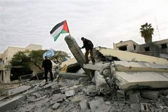

+++
title = "عزبة (عبد ربه) .. مات العبد وبقى ربه"
date = 2009-02-12
authors = ["نجلاء عبد ربه"]

[taxonomies]
authors = ["naglaa-abdel-rabh"]
sections = ["siyasa"]

[extra]
section_name = "سياسة"
share_image = "/media/currentarticleassets/abdrabo.jpg"
summary = "حينما زار عبد العظيم عبد الله، وهو من سكان خان يونس جنوب قطاع غزة، أحد أصدقاءه في الخيمة الرابعة من مجموعة خيم نُصبت على مساحة أكثر من 2 كيلومتر مربع في منطقة \""
section_slug = "siyasa"
section_colour = "#9E2A2B"
thumb = "/media/currentarticleassets/abdrabo.jpg"
n_comments = 0
original_url = "http://20at.com/20at/politics/11270.html"
archived = "20100105193424"
date_source = "byline/meta"
aliases_20at = ["/20at/politics/11270.html"]

[extra.provenance]
original_url = "http://20at.com/20at/politics/11270.html"
capture_url = "https://web.archive.org/web/20100105193424/http://20at.com/20at/politics/11270.html"
capture_label = "٥ يناير ٢٠١٠، ١٩:٣٤ UTC"
date_note = "من سطر التوقيع في المقال"
other_urls = []
comments = ""
missing_images = ""
+++

<figure></figure>

حينما زار عبد العظيم عبد الله، وهو من سكان خان يونس جنوب قطاع غزة، أحد أصدقاءه في الخيمة الرابعة من مجموعة خيم نُصبت على مساحة أكثر من 2 كيلومتر مربع في منطقة "عزبة عبد ربه" شمال غزة، صعق الرجل من هول المشهد..

يقول عبد العظيم: "كنت أزور صديقي محمود بين الحين والآخر، إنها منطقة جميلة لما تحتويه من بيوت وفيلات وسط حدائق من الورود تحيطها مزارع خضراء، لقد كانت تريح النفس والأعصاب للمشاهد، لكنها اليوم أصبحت عين بعد أثر".

ووصف ما شاهده من دمار وخراب للبيوت والمزارع العزبة بـ "مات عبد وبقيّ ربه"، في إشارة منه لحجم الكارثة التي ألمّت بسكان المنطقة نتيجة العدوان الإسرائيلي الأخير على غزة.

<h3>هموم فلسطينية</h3>

محمود عبيد، الشاب الذي تواجد عنده عبد العظيم، يقول: "الخيمة التي أسكن بها تحمل عنوان التشرد والبؤس، ليس بمقدورنا غير السكن في تلك الخيام التي نصبت لأجلنا، في انتظار ما ستؤول إليه الأمور مستقبلاً".

يتخوف محمود وغيره من المشردين من الانتظار طويلاً، حتى يتسنى للفصائل الفلسطينية التحاور والمصالحة وتشكيل حكومة وحدة وطنية أو توافق وطني، تكون مقبولة للدول المانحة، لكن الأمر بحسب محمود "قد يطول لأشهر أو سنوات كي نعيد ما هدمته ودمرته الدبابات الإسرائيلية".

ويشير أحمد ناجي، فقد منزله بالكامل وجُرفت أرضه الزراعية التي يعتاش منها، إلى أن وزارة الحرب الإسرائيلية "استعملت في حربها على الفلسطينيين سلاح التدمير لكل شيء"، في إشارة منه لتدمير كل ما يعارض طريق سير الدبابات والجرافات الإسرائيلية.

يضيف: "لقد كنت أملك 4 دفيئات زراعية على مساحة 3 دونمات، كلفني العمل بهم أكثر من 35 ألف دولار، الآن بت لا أملك شيء فلا بيت ولا أرض، غير بعض الملابس التي استطعت أن أخرجها من تحت الأنقاض".

تعكس هموم عبيد وناجي، حياة آلاف الأسر الفلسطينية التي هُدمت منازلها وسكنت الخيام أو استأجرت منازل وشقق، جراء حرب إسرائيلية مدمرة دامت على قطاع غزة لمدة 22 يوما، لكن المثير في عزبة عبد ربه أن تلك الخيام منصوبة قبالة الدبابات الإسرائيلية لقرب العزبة من الحدود مع إسرائيل، الأمر الذي يعرض هؤلاء الناس لخطر إطلاق النار عليهم في أي وقت.

<h3>إعادة الإعمار</h3>

المهندس محمود فروانه، مدير عام في وزارة الأشغال التابعة للحكومة المقالة، أن إعادة الإعمار ستحتاج إلى وقت أطول في ظل الحصار الصهيوني الغاشم الذي لا زال مفروضاً على قطاع غزة.

وأضاف: "نحن نعمل على قدم وثاق مع كافة الجهات ومع نقابة المهندسين للإسراع في إعمار ما هدمه الاحتلال الصهيوني، لكن هناك معيقات خارجة عن إرادتنا لا زالت تعيق عملنا".

وأشار فروانه إلى أن شركات النقل الفلسطينية العاملة في قطاع غزة "لن يكون بمقدورها وحدها العمل على إزالة ركام المنازل والمؤسسات المدمرة، أو إعادة الإعمار من جديد".

كانت وزارة الأشغال العامة في حكومة غزة قد قالت في بيان لها إن إجمالي الأضرار التي لحقت بكل القطاعات المدنية والصناعية والزراعية بالقطاع جراء العدوان الإسرائيلي بلغت حوالي 2.215 مليار دولار.

وأوضحت أن 5 آلاف أسرة بالقطاع هدمت منازلها وفقدت أثاثها بشكل كامل، وأن مجمل البيوت السكنية التي دمرت وباتت غير صالحة للسكن وصلت إلى 20 ألف وحدة سكنية وتحتاج إلى 40 مليون دولار تكاليف إزالة أنقاضها.

