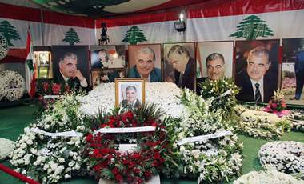

+++
title = "في 14/2..اللقاء بساحة الحرية!"
date = 2009-02-14
authors = ["مهند قاطرجي"]

[taxonomies]
authors = ["mahnd-katrgi"]
sections = ["siyasa"]

[extra]
section_name = "سياسة"
share_image = "/media/currentarticleassets/harir.jpg"
summary = "وانقضت السنة الرابعة على اغتيال رئيس الوزراء اللبناني الأسبق رفيق الحريري، والذي يصادف ذكرى اغتياله يوم السبت 14/2/2009 حيث تجري التحضيرات على قدم وساق منذ اليو"
section_slug = "siyasa"
section_colour = "#9E2A2B"
thumb = "/media/currentarticleassets/harir.jpg"
n_comments = 2
original_url = "http://20at.com/20at/politics/11285.html"
archived = "20100105193510"
date_source = "byline/meta"
aliases_20at = ["/20at/politics/11285.html"]

[extra.provenance]
original_url = "http://20at.com/20at/politics/11285.html"
capture_url = "https://web.archive.org/web/20100105193510/http://20at.com/20at/politics/11285.html"
capture_label = "٥ يناير ٢٠١٠، ١٩:٣٥ UTC"
date_note = "من سطر التوقيع في المقال"
other_urls = []
comments = "٢"
missing_images = ""
+++

<figure></figure>

وانقضت السنة الرابعة على اغتيال رئيس الوزراء اللبناني الأسبق رفيق الحريري، والذي يصادف ذكرى اغتياله يوم السبت 14/2/2009 حيث تجري التحضيرات على قدم وساق منذ اليوم الأول لدخول شهر فبراير/شباط والذي بات يعني الكثير للبنانيين الذي واكبوا ودعموا النهج السياسي لقوى الرابع عشر من آذار، حتى باتت ساحة الشهداء في بيروت ملتقاهم السنوي لتجديد الوعد الذي قطعوه على أنفسهم منذ 4 سنوات تقريباً بإكمال مسيرة الرئيس الحريري من "أجل لبنان".

وعلى الصعيد الإعلامي فقد كثفت الجهود الدعائية والإعلامية من أجل حشد أكبر قدر من المتظاهرين والمتضامنين في ساحة الحرية والتي باتت جزءاً لا يتجزأ من ثورة "الاستقلال" والحرية، إعلانات تدعو الشارع اللبناني إلى تثبيت الموقف والمشاركة في الذكرى السنوية لاغتيال الحريري، كما اعتلت الملصقات الخاصة بالمحكمة الدولية والتي سوف تعقد أولى جلساتها في آذار/مارس المقبل، كما دعت بعض الكتل اللبنانية والنقابات والاتحادات كما المؤسسات إلى المشاركة الكثيفة في هذه الذكرى الثانوية.

كما عمدت المواقع الإلكترونية الداعمة لقوى الرابع عشر من آذار إلى "دعم الاستقلال" والمشاركة "الواجبة"، وما لفت النظر أيضا هو حماسة الشباب اللبناني إلى المشاركة، وتفاعل المهتمين بقضية الرابع عشر من آذار إلى المشاركة حيث كثرت "جروبات الفيس بوك" التي تدعو إلى النزول إلى ساحة الشهداء في بيروت.

(عشرينات) سألت الشباب اللبناني حول موضوع المشاركة في ذكرى الحريري الرابعة وحول ما تعنيه لهم هذه المناسبة.

<h3>أكيد نازلين</h3>

نانسي عبد وهي طالبة جامعية في مجال إدارة الأعمال أكدت بأنها سوف "تشارك" في الذكرى الثانوية لاغتيال الحريري، وأنها منذ "ساعات الصباح الأولى"سوف تعمد للتوجه نحو ساحة الحرية في بيروت قادمة من "قريتها الجنوبية" واعتبرت نانسي أن المشاركة في هذه المناسبة "ضرورة" لتجديد التأكيد على المسار الذي تسلكه قوى الرابع عشر/آذار "بصون" وحدة لبنان ودعم "استقلال قراره".

"نازلين...أكيد نازلين" هكذا أجاب مصطفى منير ووائل محمد، حيث سيشاركون دعماً "للحقيقة" ودعماً لخيار السياسي الذي تقوده قوى 14/آذار والذي يدعم بحسب قولة "استقلال" لبنان من أي جهة دولية وإقليمية ويدعو إلى "توحيد سيادة الدولة على كافة أراضيها" كما أجابا بأنهما سوف يحملون علم "لبنان" تأكيداً منهم على أن الانتماء الحقيقي يكون للوطن الذي برأيهم "تحمّل من شعبه الكثير" -والمقصود هنا الفتن الداخلية والخلافات المستمرة بين أهله- وأنه اقل الواجب أن "نشارك من أجل لبنان".

فرح سعد تساءلت عن السبب الذي يدفعها كل عام للنزول إلى الشارع قائلة " طوال 3 سنوات كنا نشارك، وإلى الآن لم يتحقق أي من مطالبنا" بل وحسب ما تراه "فقد ازداد الوضع تعقيداً" كما اعتبرت أن النزول إلى الشارع في هذا الوقت بالتحديد هو قد يؤدي إلى "رفع مستويات الاحتقان الداخلي من جديد" الاحتقان الذي دفع اللبنانيون ثمنه "غالياً" طوال 4 سنوات على التوالي.

أما توفيق فقد اعتبر أن لغة الشارع قد اثبت فشلها حين احتكم إليه بالسابق، واعتبر أنه من الأولى ألا "نعود" على الشارع، فالشارع ولغته برأيه قد "ولدت" ما فكرة "الشارع والشارع المقابل" في إ شارة إلى القوى 8 و 14/آذار، كما اعتبر أن لبنان يمر بمرحلة مهمة من "التوافق" وعلينا كلبنانيين أن "نستفيد منها بأقصى الحدود الممكنة" من اجل إعادة بناء الدولة بالشكل الصحيح و"المطلوب.

<h3>لا تعنينا المشاركة</h3>

"لا تعنينا المظاهرة" هكذا أجاب كريم، الذي أعتبر لهذه المظاهرة أبعاد "انتخابية" و"جماهيرية" وبعيده عن أي شكل من إشكال تكريم الرئيس الراحل، كما انه أكد لنا أنه لا "يوافق" مع السياسة التي تتبعها قوة 14آذار في رهن البلاد بقوى "خارجية" تملك قرارها، كما اعتبر أن لبنان يقدم على معركة "ضروس" لإثبات الخلفية الجديدة للبنان والتي سوف تدخل برأيه البلاد في مرحلة "فراغ دائم"

ديما علي وهي شابة جامعية، أكدت أن النزول والمشاركة في هذه المناسبة لا تعنيها، فهي ترفض "التبعية" التي يعيش فيها لبنان حيث "نعيش في نظام طائفي، وشمولي، وديني" عدا عن الانتماءات "الحزبية خطيرة" والمغرضة والتي تأثر على أمن لبنان الداخلي وتعرضه للسلة من "التحديات" التي نعتبر أننا في لبنان في "غنى" كامل عنها!

